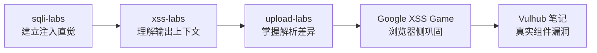

<div align="center">

# 🛡️ LabsTutorialNotes

**Web 安全经典靶场通关笔记 —— 每一关都亲手打过、截图、复盘过的完整实录**

[](./LICENSE)
[](https://hacker369.github.io/LabsTutorialNotes/)
[](https://github.com/hacker369/LabsTutorialNotes/actions/workflows/ci.yml)
[](https://github.com/hacker369/LabsTutorialNotes/issues/new/choose)

🟢 **[在线阅读](https://hacker369.github.io/LabsTutorialNotes/)** · 📥 **[本地部署](#-快速开始)** · 🐛 **[反馈问题](https://github.com/hacker369/LabsTutorialNotes/issues/new/choose)**

<br/>

| 🧪 靶场 | 🚩 关卡 | 📝 笔记 | 📸 实操截图 |
|:---:|:---:|:---:|:---:|
| **4** 大经典 | **120+** 关全通 | **13,000+** 行 | **1,000+** 张 |

</div>

---

## 🎯 这份笔记有什么不同

市面上靶场 writeup 很多，但大多是零散的 payload 堆砌。这份笔记追求的是**可复现的完整过程**：环境怎么搭、请求怎么抓、payload 为什么这样构造、失败了几次、最后怎么绕过——全部记录在案。

- ✅ **关卡全量覆盖**：不是精选合集，是逐关打穿（sqli-labs 75 关、xss-labs 20 关、upload-labs 21 关、Google XSS Game 6 关）
- ✅ **700+ 段可直接复制的 payload / 命令**：全部在真实靶场环境验证过，代码块标注了 HTTP / PHP / SQL / JavaScript 语言类型
- ✅ **方法论沉淀**：每个靶场笔记都含「通用方法论」与「关卡速查表」章节，做完能带走一套思路而不只是答案
- ✅ **环境避坑指南**：PHP 版本坑、Docker 部署差异、Burp 抓包配置等实际踩坑经验

---

## 📊 靶场矩阵

| 靶场 | 漏洞类型 | 关卡 | 篇幅 | 难度 | 笔记 |
|---|---|:---:|:---:|:---:|:---:|
| 💉 **sqli-labs** | SQL 注入：报错 / 联合 / 布尔盲注 / 时间盲注 / 堆叠 / 过滤绕过 | 75 关 | 9,200 行 | ★★★☆☆ | [📖 通关笔记](./sqli-labs靶场通关笔记.md) |
| ⚡ **xss-labs** | XSS：反射型 / 存储型 / 事件触发 / 编码绕过 / 过滤对抗 | 20 关 | 820 行 | ★★☆☆☆ | [📖 通关笔记](./xss-labs靶场通关笔记.md) |
| 📤 **upload-labs** | 文件上传：前后端校验 / MIME / 解析漏洞 / .htaccess / 竞态 | 21 关 | 2,800 行 | ★★★☆☆ | [📖 通关笔记](./upload-labs靶场通关笔记.md) |
| 🎯 **Google XSS Game** | Google 官方闯关：上下文构造 / DOM / 惰性求值 | 6 关 | 420 行 | ★★★☆☆ | [📖 通关笔记](./GoogleXSSGame靶场通关笔记.md) |

> 组件漏洞（Struts2 / Log4j / Fastjson 等真实 CVE 环境）复现笔记在姊妹仓库：
> → **[VulhubTutorialNotes](https://github.com/hacker369/VulhubTutorialNotes.github.io)** · [在线阅读](https://hacker369.github.io/VulhubTutorialNotes.github.io/)

---

## 📍 内容地图

不想一页页翻？按知识点直达对应章节：

| 想学什么 | 靶场 | 直达章节 |
|---|---|:---:|
| SQL 注入入门（报错 / 联合查询） | 💉 sqli-labs | [通关详解 · GET/POST 基础](./sqli-labs靶场通关笔记.md#5-通关详解按关卡类型) |
| SQL 盲注（布尔 / 时间） | 💉 sqli-labs | [Less-8 ~ Less-10](./sqli-labs靶场通关笔记.md#5-通关详解按关卡类型) |
| Header / Cookie 注入 | 💉 sqli-labs | [Less-18 ~ Less-22](./sqli-labs靶场通关笔记.md#5-通关详解按关卡类型) |
| 宽字节 / 过滤绕过 | 💉 sqli-labs | [Less-25 ~ Less-37](./sqli-labs靶场通关笔记.md#5-通关详解按关卡类型) |
| 堆叠注入 / 挑战关 | 💉 sqli-labs | [Less-38 ~ Less-65](./sqli-labs靶场通关笔记.md#5-通关详解按关卡类型) |
| 全关 payload 速查 | 💉 sqli-labs | [关卡速查表（精简）](./sqli-labs靶场通关笔记.md#6-关卡速查表精简) |
| XSS 反射 / 事件触发 | ⚡ xss-labs | [通关详解（Level 1~20）](./xss-labs靶场通关笔记.md#5-通关详解level-120) |
| XSS 编码绕过思路 | ⚡ xss-labs | [关卡速查表](./xss-labs靶场通关笔记.md#6-关卡速查表) |
| 文件上传绕过全流程 | 📤 upload-labs | [通关详解](./upload-labs靶场通关笔记.md#3-通关详解) |
| 上传攻防方法论沉淀 | 📤 upload-labs | [通用方法论](./upload-labs靶场通关笔记.md#4-通用方法论适合知识库沉淀) |
| 真实浏览器 XSS 闯关 | 🎯 Google XSS Game | [Level 1 开始](./GoogleXSSGame靶场通关笔记.md#level-1--hello-world) |

> 🌐 **English version** of this README: [README_EN.md](./README_EN.md)

---

## 🚀 快速开始

**方式一：在线阅读（推荐，零配置）**

直接访问 → **[https://hacker369.github.io/LabsTutorialNotes/](https://hacker369.github.io/LabsTutorialNotes/)**

**方式二：本地部署**

```bash
git clone https://github.com/hacker369/LabsTutorialNotes.git
cd LabsTutorialNotes
npx docsify-cli serve .
# 浏览器打开 http://localhost:3000
```

**靶场环境**：Windows 入门推荐 phpStudy / XAMPP；想少踩 PHP 版本坑就用 Docker（各笔记「安装」章节有现成命令）；抓包改请求用 Burp Suite 社区版。

---

## 🗺️ 推荐学习路线



---

## 📁 仓库结构

```text
LabsTutorialNotes/
├── index.html                        # Docsify 站点入口（暗色终端主题）
├── home.md                           # 站点首页（Landing）
├── _sidebar.md / _navbar.md          # 侧栏与顶栏
├── sqli-labs靶场通关笔记.md            # 75 关 SQL 注入
├── xss-labs靶场通关笔记.md             # 20 关 XSS
├── upload-labs靶场通关笔记.md          # 21 关文件上传
├── GoogleXSSGame靶场通关笔记.md        # 6 关 Google 闯关
├── docs/MAINTENANCE.md               # 仓库维护与图片规范
├── scripts/check_images.py           # 图片引用/体积检查（CI 用）
└── img/                              # 实操截图
```

---

## ⚠️ 免责声明

> 本文档仅供在**本地或已授权**的教学靶场中学习使用。笔记中所有手法均针对故意存在漏洞的练习环境。
> **请勿**对未授权的真实系统进行测试或攻击。作者不对任何滥用行为负责。

---

## 🤝 贡献与反馈

发现 **payload 失效、环境差异、笔误**？欢迎：

- 🐛 [提交 Issue](https://github.com/hacker369/LabsTutorialNotes/issues/new/choose)（有 payload 失效 / 内容纠错两个模板）
- 🔧 直接提 PR（CI 会自动检查图片引用与体积）

维护规范见 [docs/MAINTENANCE.md](./docs/MAINTENANCE.md)。

---

## 📄 License

[MIT License](./LICENSE) · 笔记中引用的靶场项目（sqli-labs / xss-labs / upload-labs / Google XSS Game）版权归其各自作者所有。
