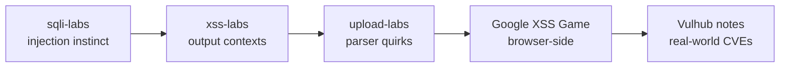

<div align="center">

# 🛡️ LabsTutorialNotes

**Complete walkthrough notes for classic web security labs — every challenge solved hands-on, screenshot-documented and reviewed**

[](./LICENSE)
[](https://hacker369.github.io/LabsTutorialNotes/)
[](https://github.com/hacker369/LabsTutorialNotes/actions/workflows/ci.yml)
[](https://github.com/hacker369/LabsTutorialNotes/issues/new/choose)

🟢 **[Read Online](https://hacker369.github.io/LabsTutorialNotes/)** · 📥 **[Get Started](#-get-started)** · 🐛 **[Report an Issue](https://github.com/hacker369/LabsTutorialNotes/issues/new/choose)**

🌐 [中文文档](./README.md) | **English**

<br/>

| 🧪 Labs | 🚩 Challenges | 📝 Notes | 📸 Screenshots |
|:---:|:---:|:---:|:---:|
| **4** classic labs | **120+** cleared | **13,000+** lines | **1,000+** captured |

</div>

---

## 🎯 What makes these notes different

There are plenty of CTF-style writeups out there, but most are just scattered payload dumps. These notes aim for a **fully reproducible process**: how the environment was set up, how requests were captured, why each payload is crafted that way, what failed along the way, and how the final bypass worked — all documented.

- ✅ **Full challenge coverage** — not a "best of" collection: every single level of sqli-labs (75), xss-labs (20), upload-labs (21) and Google XSS Game (6)
- ✅ **700+ copy-paste-ready payloads / commands** — all verified in a real lab environment, code blocks tagged with HTTP / PHP / SQL / JavaScript
- ✅ **Methodology, not just answers** — every walkthrough includes a "general methodology" chapter and a per-level cheat sheet, so you walk away with a repeatable approach
- ✅ **Environment pitfall guides** — PHP version traps, Docker deployment differences, Burp capture configuration, learned the hard way

---

## 📊 Lab Matrix

| Lab | Vulnerability Focus | Levels | Length | Difficulty | Walkthrough |
|---|---|:---:|:---:|:---:|:---:|
| 💉 **sqli-labs** | SQLi: error-based / UNION / boolean & time-based blind / stacked / filter bypass | 75 | 9,200 lines | ★★★☆☆ | [📖 Notes](./sqli-labs靶场通关笔记.md) |
| ⚡ **xss-labs** | XSS: reflected / stored / event handlers / encoding bypass / filter evasion | 20 | 820 lines | ★★☆☆☆ | [📖 Notes](./xss-labs靶场通关笔记.md) |
| 📤 **upload-labs** | File upload: client checks / MIME / parser vulnerabilities / .htaccess / race conditions | 21 | 2,800 lines | ★★★☆☆ | [📖 Notes](./upload-labs靶场通关笔记.md) |
| 🎯 **Google XSS Game** | Google's official challenge: context construction / DOM / lazy evaluation | 6 | 420 lines | ★★★☆☆ | [📖 Notes](./GoogleXSSGame靶场通关笔记.md) |

> Walkthroughs for real-world component vulnerabilities (Struts2 / Log4j / Fastjson CVE environments) live in the sister repo:
> → **[VulhubTutorialNotes](https://github.com/hacker369/VulhubTutorialNotes.github.io)** · [Read online](https://hacker369.github.io/VulhubTutorialNotes.github.io/)

---

## 🗺️ Content Map

Jump straight to the topic you need (chapter titles are in Chinese):

| Topic | Lab | Direct link |
|---|---|:---:|
| SQLi basics (error-based / UNION) | 💉 sqli-labs | [Walkthrough · GET/POST basics](./sqli-labs靶场通关笔记.md#5-通关详解按关卡类型) |
| SQL blind injection (boolean / time) | 💉 sqli-labs | [Less-8 ~ Less-10](./sqli-labs靶场通关笔记.md#5-通关详解按关卡类型) |
| Header / Cookie injection | 💉 sqli-labs | [Less-18 ~ Less-22](./sqli-labs靶场通关笔记.md#5-通关详解按关卡类型) |
| Charset tricks / filter bypass | 💉 sqli-labs | [Less-25 ~ Less-37](./sqli-labs靶场通关笔记.md#5-通关详解按关卡类型) |
| Stacked queries / challenge levels | 💉 sqli-labs | [Less-38 ~ Less-65](./sqli-labs靶场通关笔记.md#5-通关详解按关卡类型) |
| All-level payload cheat sheet | 💉 sqli-labs | [Cheat sheet](./sqli-labs靶场通关笔记.md#6-关卡速查表精简) |
| XSS reflection / event handlers | ⚡ xss-labs | [Walkthrough (Level 1~20)](./xss-labs靶场通关笔记.md#5-通关详解level-120) |
| XSS encoding bypass ideas | ⚡ xss-labs | [Cheat sheet](./xss-labs靶场通关笔记.md#6-关卡速查表) |
| File upload bypass end-to-end | 📤 upload-labs | [Walkthrough](./upload-labs靶场通关笔记.md#3-通关详解) |
| Upload attack methodology | 📤 upload-labs | [General methodology](./upload-labs靶场通关笔记.md#4-通用方法论适合知识库沉淀) |
| Real-browser XSS challenge | 🎯 Google XSS Game | [Start at Level 1](./GoogleXSSGame靶场通关笔记.md#level-1--hello-world) |

> 🌐 中文版 README：[README.md](./README.md)

---

## 🚀 Get Started

**Option 1: read online (recommended, zero setup)**

→ **[https://hacker369.github.io/LabsTutorialNotes/](https://hacker369.github.io/LabsTutorialNotes/)**

**Option 2: run locally**

```bash
git clone https://github.com/hacker369/LabsTutorialNotes.git
cd LabsTutorialNotes
npx docsify-cli serve .
# open http://localhost:3000
```

**Lab environment**: on Windows start with phpStudy / XAMPP; use Docker to avoid PHP version pitfalls (ready-made commands in each walkthrough's install chapter); capture requests with Burp Suite Community.

---

## 🗺️ Recommended learning path



---

## 📁 Repository structure

```text
LabsTutorialNotes/
├── index.html                        # Docsify entry (terminal-style dual theme)
├── home.md                           # Landing page (CN) · en/home.md (EN)
├── _sidebar.md / _navbar.md          # Sidebar & navbar
├── sqli-labs靶场通关笔记.md            # 75 SQL injection levels
├── xss-labs靶场通关笔记.md             # 20 XSS levels
├── upload-labs靶场通关笔记.md          # 21 file upload levels
├── GoogleXSSGame靶场通关笔记.md        # 6 Google challenge levels
├── docs/MAINTENANCE.md               # Maintenance & image policy
├── scripts/check_images.py           # Image reference/size checker (CI)
└── img/                              # Screenshots
```

---

## ⚠️ Disclaimer

> These notes are for learning in **local or properly authorized** teaching labs only. Every technique targets intentionally vulnerable practice environments.
> Do **not** test or attack real systems without authorization. The author accepts no liability for misuse.

---

## 🤝 Contributing & Feedback

Found a **broken payload, environment difference or typo**?

- 🐛 [Open an issue](https://github.com/hacker369/LabsTutorialNotes/issues/new/choose) (payload-failure / content-feedback templates available)
- 🔧 Submit a PR directly (CI will check image references and sizes automatically)

Maintenance policy: [docs/MAINTENANCE.md](./docs/MAINTENANCE.md).

---

## 📄 License

[MIT License](./LICENSE) · The referenced lab projects (sqli-labs / xss-labs / upload-labs / Google XSS Game) belong to their respective authors.
