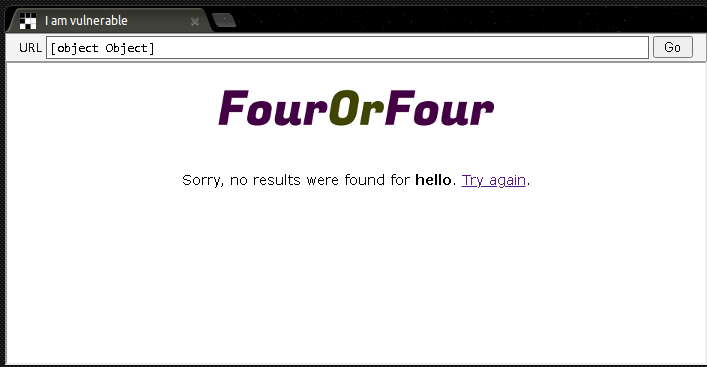
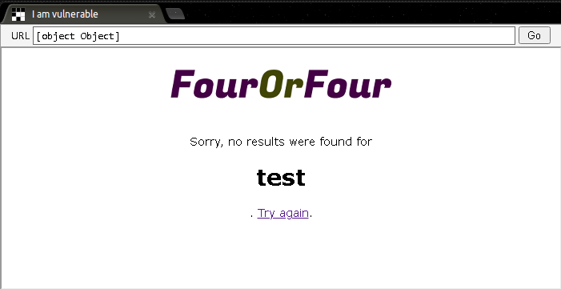
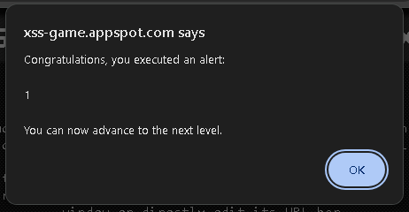
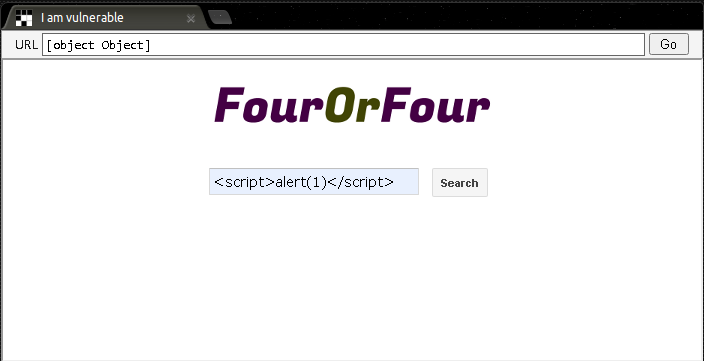
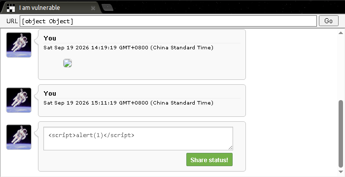
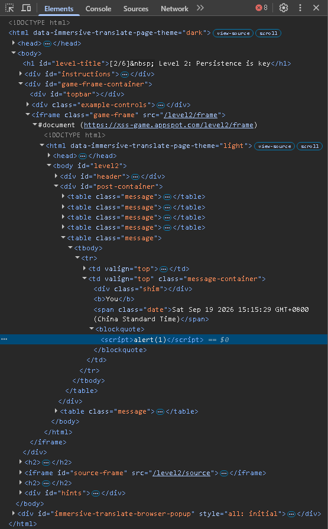
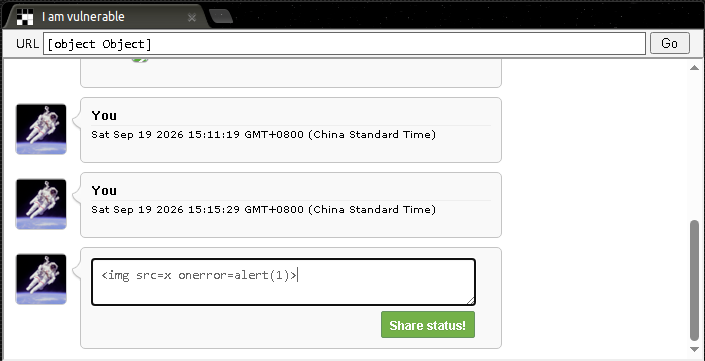

# Google XSS Game Level-01–02

> 本文为 [Google XSS Game 学习索引](README.md) 的章节拆分。仅限官方教学靶场或明确授权的环境。

---

## Level 1 — Hello, World of XSS

### 漏洞类型

反射型 XSS（服务端将用户输入直接输出到 HTML 中）。

### 原理

页面接收 URL 查询参数 `query`，并将其值直接拼接到 HTML 里返回给浏览器。浏览器把用户输入当作 HTML 代码解析，而不是纯文本。

### 侦察过程

1. 访问 `https://xss-game.appspot.com/level1/frame`。
2. 在搜索框输入 `hello`，提交后观察 URL 变为 `?query=hello`，页面显示类似 “Sorry, no results for hello”。



3. 输入 `<h1>test</h1>`，发现页面渲染出大标题，说明 HTML 被解析。



4. 输入 `<script>alert(1)</script>`，弹窗出现。



### Payload

```html
<script>alert(1)</script>
```

### 操作步骤

在搜索框直接输入上述 Payload 并提交。或者直接访问：

```plain
https://xss-game.appspot.com/level1/frame?query=%3Cscript%3Ealert(1)%3C%2Fscript%3E
```



### 原理解析

服务端代码大致为：

```html
<div>Sorry, no results for <b>{{ query }}</b></div>

```

`{{ query }}` 被替换为你的输入，没有做 HTML 实体编码。浏览器看到 `<script>` 标签后，将其作为 JavaScript 执行。

***

## Level 2 — Persistence is Key

### 漏洞类型

存储型 / DOM 型 XSS（用户输入被保存到客户端存储，再通过 `innerHTML` 渲染）。

### 原理

留言板允许你提交消息，消息被保存在浏览器的客户端存储中（推测为 `localStorage` 或类似机制）。页面重新加载时，消息被读取并通过 `innerHTML` 插入 DOM。代码对 `<script>` 标签做了过滤，但未过滤其他 HTML 标签和事件属性。

### 侦察过程

1. 访问 `https://xss-game.appspot.com/level2/frame`。
2. 在留言框提交 `<script>alert(1)</script>`，发现消息显示为纯文本或标签被移除，没有弹窗。



3. 打开开发者工具，查看 Elements 面板，发现消息内容被插入到某个容器中。



4. 推测过滤规则：可能用正则替换了 `<script` 标签（大小写不敏感），但没有处理事件属性。
5. 尝试提交 ``，弹窗出现。


### Payload

```html

```

### 操作步骤

在留言框输入上述 Payload，提交后页面重新渲染消息，弹窗触发。刷新页面后，由于消息被存储，弹窗会再次触发。



### 原理解析

`` 标签的 `src` 设为不存在的 `x`，图片加载失败时触发 `onerror` 事件，执行 `alert(1)`。过滤机制只移除了 `<script>` 标签，但没有移除 `onerror` 等事件属性。这体现了**黑名单过滤的局限性**：攻击者总能找到未过滤的标签或属性。

***
