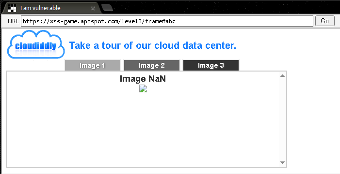
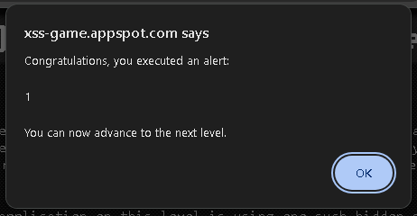
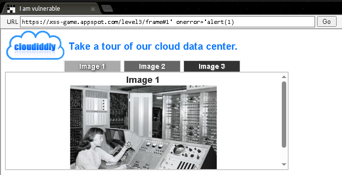
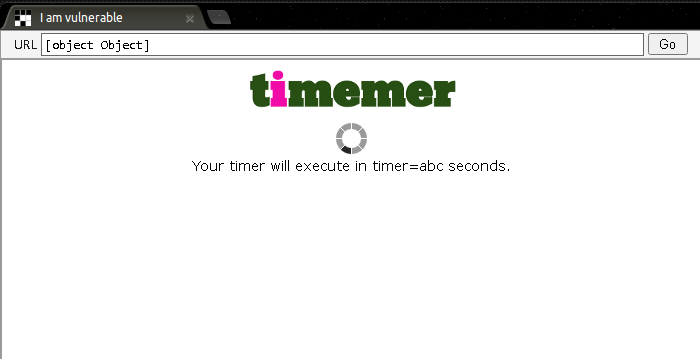
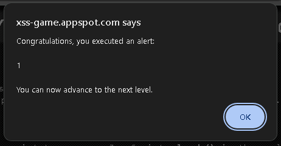

# Google XSS Game Level-03–04

> 本文为 [Google XSS Game 学习索引](README.md) 的章节拆分。仅限官方教学靶场或明确授权的环境。

---

## Level 3 — That Sinking Feeling

### 漏洞类型

DOM 型反射 XSS（`location.hash` 被拼接到 HTML 属性中，再通过 jQuery `.html()` 渲染）。

### 原理

页面从 URL 的 fragment（`#` 后面的内容）中读取一个数字，将其拼接到 `` 标签的 `src` 属性中，然后使用 jQuery 的 `.html()` 方法插入 DOM。fragment 中的内容未经过滤，可以闭合属性并注入事件处理器。

### 侦察过程

1. 访问 `https://xss-game.appspot.com/level3/frame#1`，页面显示一张图片。


2. 将 `#1` 改为 `#abc`，图片消失或出现异常，说明 hash 值被用于构造图片路径。



3. 查看源码（或开发者工具），找到类似逻辑：

```javascript
var hash = location.hash;
if (hash) {
  var img = '';
  $('#image').html(img);
}
```

4. 尝试输入 `#1' onerror='alert(1)`，弹窗出现。



### Payload

```html
#1' onerror='alert(1)
```

### 操作步骤

访问以下完整 URL：

```plain
https://xss-game.appspot.com/level3/frame#1'%20onerror='alert(1)
```

注意：`#` 后的空格需要编码为 `%20`，单引号可以保留。



### 原理解析

原始代码拼接出的 HTML 为：

```html

```

Payload 中的单引号闭合了 `src` 属性的单引号，然后插入 `onerror='alert(1)`。末尾的 `.jpg` 会成为 `onerror` 属性值的一部分，但 `alert(1)` 已经执行，后面的 `.jpg` 只会导致 JavaScript 报错，不影响弹窗。

***

## Level 4 — Context Matters

### 漏洞类型

DOM 型反射 XSS（用户输入被拼接到 JavaScript 字符串上下文中，通过闭合引号逃逸）。

### 原理

页面从 URL 查询参数 `timer` 中读取值，并将其拼接到一段 JavaScript 代码的字符串字面量中。服务端对输入做了一定转义（推测），但输入被放入 JavaScript 字符串，仍然可以用引号闭合逃逸。

### 侦察过程

1. 访问 `https://xss-game.appspot.com/level4/frame?timer=1`，页面显示倒计时。
2. 输入 `timer=abc`，页面出现 JavaScript 错误或倒计时异常。



3. 查看源码，发现类似：

```html
<script>
  function startTimer(seconds) {
    // ...
  }
  startTimer('{{ timer }}');
</script>

```

4. 尝试输入 `1');alert(1);//`，弹窗出现。



### Payload

```javascript
1');alert(1);//
```

### 操作步骤

访问以下完整 URL：

```plain
https://xss-game.appspot.com/level4/frame?timer=1%27%29%3Balert%281%29%3B%2F%2F
```


### 原理解析

服务端将 `timer` 的值插入到 `startTimer('...')` 中。原始代码为：

```javascript
startTimer('1');
```

Payload `1');alert(1);//` 使代码变成：

```javascript
startTimer('1');alert(1);//');
```

* `'` 闭合了字符串。
* `)` 闭合了 `startTimer` 函数调用。
* `;` 结束语句。
* `alert(1);` 执行弹窗。
* `//` 注释掉后面的内容。

此关的核心是**上下文决定 Payload**：在 HTML 上下文中有效的 `<script>` 在这里无效，必须针对 JavaScript 字符串上下文构造。

***
